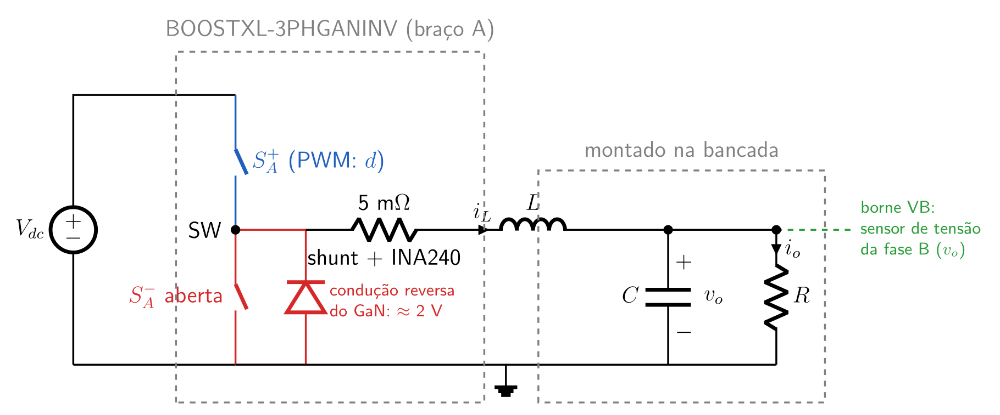
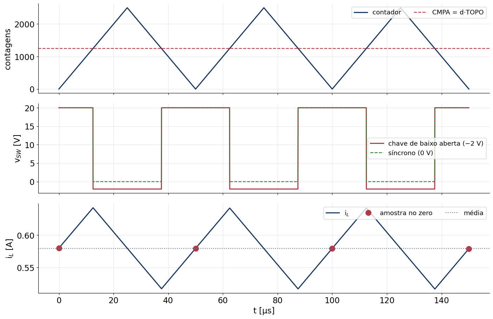
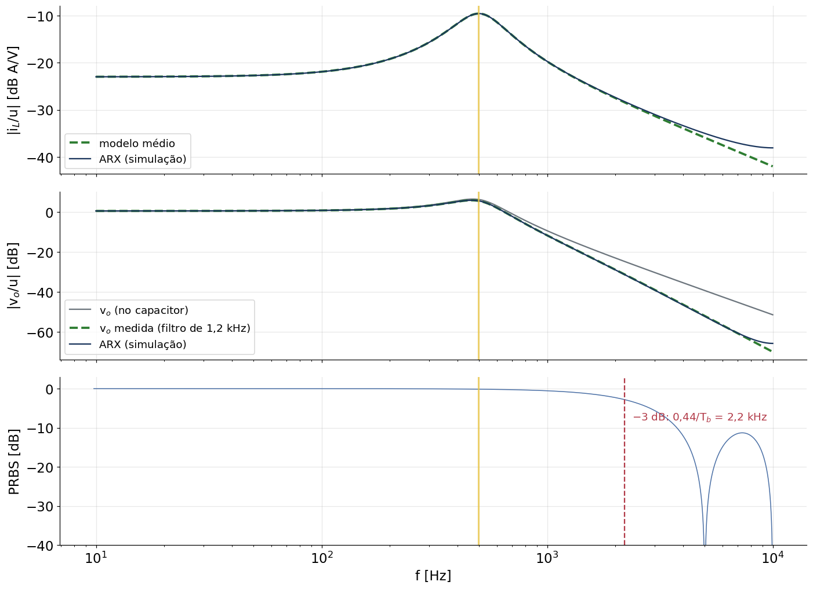
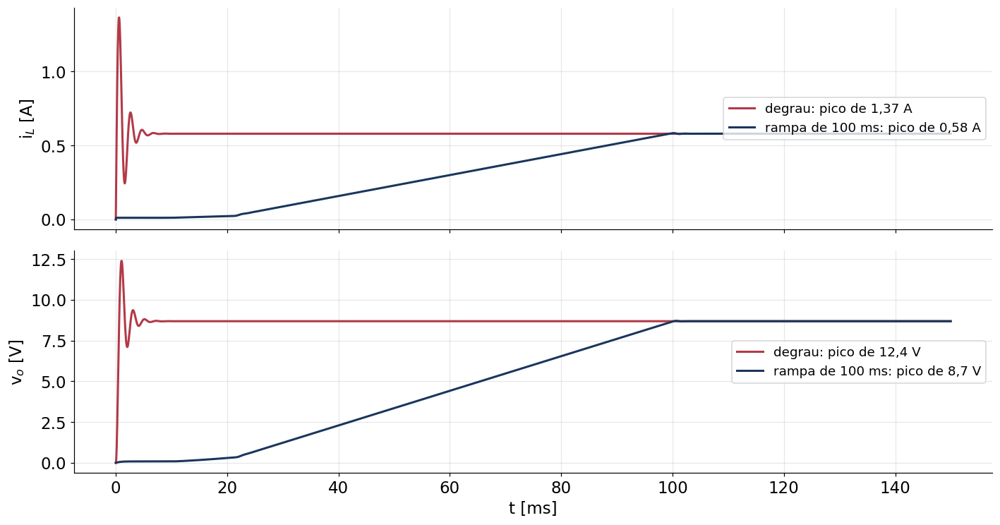
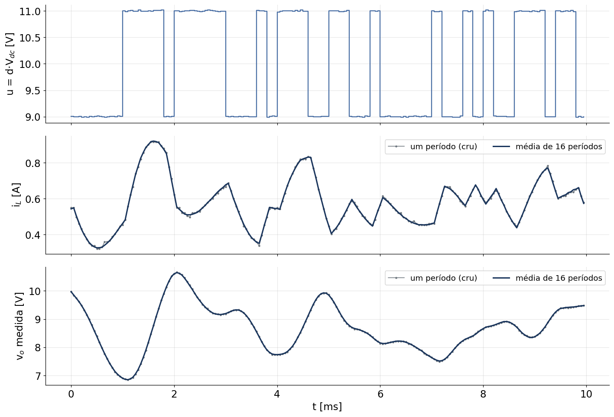
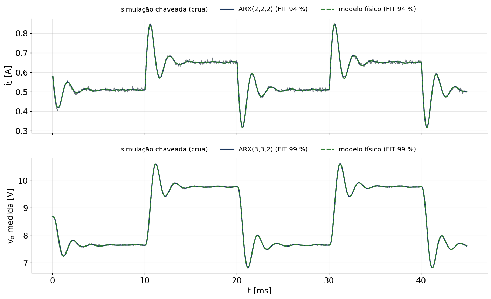

## A ideia

::: {style="font-size:0.85em"}
:::: {.columns}
::: {.column width="55%"}
- A bancada do inversor (LAUNCHXL-F28379D + BOOSTXL-3PHGANINV) já tem **PWM, sensor de corrente
  em linha, sensores de tensão e proteção**. Um braço dela é uma meia-ponte;
- Abrindo a chave de baixo e chaveando só a de cima, o braço A vira a chave de um **buck**;
- Por fora: indutor, capacitor e carga resistiva;
- Objetivo: **identificar um modelo ARX** do buck com os dados da placa, como no inversor
  (etapa 02), mas agora com uma planta de 2ª ordem pouco amortecida.
:::
::: {.column width="45%"}
| O que se reaproveita | De onde |
|---|---|
| PWM simétrico de 20 kHz, T~s~ = 50 µs | VSI01/VSI02 |
| PRBS de 9 bits, 4 amostras/bit | VSI02 |
| Média síncrona (16 períodos) | VSI02 |
| Sensores, ADC, proteção | Bancada |
| Escolha de T~s~ e T~b~ | [Identificação do buck](../IdentificacaoBuckPRBS/index.qmd) |
:::
::::

Tudo o que segue é **simulado em Python** (`analise/simula_buck.py`) antes de ir à bancada: planta
chaveada exata período a período, sensores com ruído e quantização, mesmo atraso do firmware.
:::

## O circuito

{width="88%" fig-align="center"}

- S~A~^+^ recebe o PWM (EPWM1A); S~A~^−^ fica **sempre aberta** (GPIO1 em nível baixo);
- Na roda livre, a corrente passa pela **condução reversa do GaN**: o LMG5200 não tem diodo de
  corpo, mas conduz de fonte para dreno com ≈ 2 V (datasheet: V~SD~ = 2 V a 0,5 A).

## Chave de baixo aberta × buck síncrono

::: {style="font-size:0.82em"}
:::: {.columns}
::: {.column width="50%"}
**Chave de baixo aberta** (o pedido), em condução contínua:

$$
\bar v_{SW} = d\,V_{dc} - (1-d)\,V_{SD} = d\,(V_{dc} + V_{SD}) - V_{SD}
$$

- ganho de d: V~dc~ + V~SD~ = 22 V; deslocamento de −2 V;
- em i~L~ = 0 o "diodo" bloqueia: **condução descontínua**, não linear;
- 2 V × 0,58 A × 0,5 ≈ 0,6 W perdidos na roda livre.
:::
::: {.column width="50%"}
**Síncrono** (`modoChave` = 1): S~A~^−^ complementar com 100 ns de tempo morto, como no
inversor:

$$
\bar v_{SW} \approx d\,V_{dc}
$$

- linear em toda a faixa (a corrente pode inverter);
- sem a queda de 2 V.

| [d]{style="text-transform:none"} | [v~o~ aberta]{style="text-transform:none"} | [v~o~ síncrono]{style="text-transform:none"} |
|---|---|---|
| 0,45 | 7,6 V | 8,7 V |
| 0,50 | 8,7 V | 9,7 V |
| 0,55 | 9,8 V | 10,6 V |
:::
::::

O firmware faz os dois; o ensaio principal é com a chave aberta.
:::

## Formas de onda e amostragem

{width="80%" fig-align="center"}

Saída A alta enquanto contador < CMPA: o pulso fica **centrado no zero do contador**. A amostra
no zero cai no meio da subida de i~L~ e vale a **média** da ondulação (condução contínua).

## Restrições do projeto

| Restrição | Valor | Consequência |
|---|---|---|
| Fonte de bancada | 20 V, limite de 0,5 A | P~o~ ≈ 5 W; I~in~ < 0,4 A |
| Chaveamento e amostragem | 20 kHz, T~s~ = 50 µs | f~0~ com 20 a 40 amostras por oscilação |
| Filtro dos sensores de tensão | 4,05 kΩ × 33 nF → **1,2 kHz** | f~0~ bem abaixo de 1,2 kHz |
| PRBS (T~b~ = 200 µs) | banda de 2,2 kHz | cobre f~0~ e o filtro |
| Chave de baixo aberta | i~L~ > 0 **durante toda a PRBS** | Z~0~ = √(L/C) grande |
| Sensor de corrente | 7,32 mA por contagem | Δi~L~ de dezenas de mA |

A linha da chave aberta é a que decide o projeto: cada degrau da PRBS (2Δd·V~dc~ = 2 V) faz uma
oscilação de i~L~ de amplitude ≈ 2 V / Z~0~, que não pode passar da corrente média.

## A primeira escolha não serve

::: {style="font-size:0.75em"}
Simulação do ensaio (chave aberta, Δd = 0,05, D~0~ = 0,5): mínimo de i~L~ durante a PRBS.

| [L]{style="text-transform:none"} | [C]{style="text-transform:none"} | [R]{style="text-transform:none"} | [f~0~]{style="text-transform:none"} | [Z~0~]{style="text-transform:none"} | [i~L~ mínima]{style="text-transform:none"} | |
|---|---|---|---|---|---|---|
| 1 mH | 100 µF | 20 Ω | 503 Hz | 3,2 Ω | −0,45 A | descontínua |
| 1 mH | 47 µF | 15 Ω | 734 Hz | 4,6 Ω | −0,15 A | descontínua |
| 525 µH | 41,7 µF | 15 Ω | 1076 Hz | 3,5 Ω | −0,62 A | descontínua (buck da IC) |
| 1,5 mH | 47 µF | 15 Ω | 599 Hz | 5,6 Ω | 0,07 A | no limite |
| **2,2 mH** | **47 µF** | **15 Ω** | **495 Hz** | **6,8 Ω** | **0,26 A** | **escolhido** |
| 4,7 mH | 47 µF | 20 Ω | 339 Hz | 10 Ω | 0,17 A | indutor grande |

Com 1 mH e 100 µF a ondulação de regime é pequena, mas a **resposta à PRBS** leva i~L~ abaixo de
zero: o modelo linear deixa de valer exatamente no ensaio que deveria levantá-lo.
:::

## Componentes

::: {style="font-size:0.85em"}
:::: {.columns}
::: {.column width="50%"}
| Componente | Valor | Especificação |
|---|---|---|
| Indutor L | 2,2 mH | ≥ 1,5 A sem saturar, r~L~ ≲ 0,5 Ω |
| Capacitor C | 47 µF | ≥ 35 V (50 V), eletrolítico ou filme |
| Carga R | 15 Ω | ≥ 20 W (fio, dissipador) |
| Fonte | 20 V | limite de 0,5 A |
:::
::: {.column width="50%"}
| Grandeza [(d = 0,5)]{style="text-transform:none"} | Valor |
|---|---|
| v~o~ / i~L~ | 8,7 V / 0,58 A |
| Ondulação de i~L~ | 126 mA pp |
| Ondulação de v~o~ | ≈ 17 mV pp |
| f~0~ / Z~0~ / ζ | 495 Hz / 6,8 Ω / 0,27 |
| L crítico (fronteira) | 188 µH |
| I~in~ (d = 0,55) | 0,36 A |
| i~L~ na PRBS | 0,26 a 0,92 A |
:::
::::

ζ inclui r~L~ = 0,5 Ω (estimado): a resistência real do indutor muda o amortecimento, e é isso
que o ensaio vai medir.
:::

## O que medir

::: {style="font-size:0.75em"}
| Grandeza | Sensor | Canal | Observação |
|---|---|---|---|
| V~dc~ | divisor do barramento | ADCIN14 (ADCD) | como no inversor |
| d | — | firmware | razão aplicada (CMPA/TOPO) |
| i~L~ | shunt + INA240 da **fase A** | ADCINC2, no zero | em linha: é a corrente do indutor |
| v~o~ | divisor da **fase B** | ADCINB3 | saída ligada ao borne VB (braço B desligado) |
| v~A~ | divisor da fase A | ADCINC3 | média de v~SW~: mostra a queda de 2 V |
| i~o~ | — | análise | i~o~ = v~o~/R (sem sensor); i~C~ = i~L~ − i~o~ |

- O **sensor da fase B** vira o voltímetro da saída (braço B aberto: o borne VB só vê o divisor);
- Filtro de **1,2 kHz** (τ = 134 µs) nos sensores de tensão: o modelo de v~o~ ganha um polo.
:::

## Ligações

:::: {.columns}
::: {.column width="55%"}
| Ligação | De | Para |
|---|---|---|
| Fonte de 20 V | + / − | bornes +48V / GND |
| Indutor | borne **VA** | nó de saída |
| Capacitor (+ na saída) | nó de saída | GND |
| Carga | nó de saída | GND |
| Medida de v~o~ | nó de saída | borne **VB** |
| — | borne VC | livre |
:::
::: {.column width="45%"}
- GND da saída = GND do barramento (borne GND do BOOSTXL);
- Braços B e C: GPIO2 a GPIO5 em nível baixo, chaves abertas;
- Montar **com a fonte desligada**; conferir a polaridade do capacitor.
:::
::::

## Modelo médio

::: {style="font-size:0.9em"}
Estados x = [i~L~, v~o~, v~m~] (v~m~ = v~o~ medida, depois do filtro), entrada u = d·V~dc~:

$$
L\,\frac{di_L}{dt} = k\,u - V_{SD} - r\,i_L - v_o,
\qquad
C\,\frac{dv_o}{dt} = i_L - \frac{v_o}{R},
\qquad
\tau\,\frac{dv_m}{dt} = v_o - v_m
$$

Em torno do ponto de operação:

$$
\frac{i_L(s)}{u(s)} = \frac{k\,(sRC + 1)}{\Delta(s)},
\qquad
\frac{v_m(s)}{u(s)} = \frac{k\,R}{\Delta(s)\,(\tau s + 1)}
$$

$$
\Delta(s) = LRC\,s^2 + (L + r R C)\,s + R + r
$$

com k = (V~dc~ + V~SD~)/V~dc~ = 1,1 e r = r~L~ + r~on~. Discretizado com segurador de ordem zero e
**1 amostra de atraso** (a razão escrita em k vale a partir do zero k + 1): i~L~ é de 2ª ordem e
v~m~ de 3ª, ambos com n~k~ = 2.
:::

## Resposta em frequência e a PRBS

{width="72%" fig-align="center"}

Pico em f~0~ = 495 Hz (amarelo). A PRBS com T~b~ = 200 µs tem espectro plano até ≈ 2,2 kHz:
excita a ressonância e o filtro do sensor.

## O ensaio

| Parâmetro | Valor |
|---|---|
| Ponto de operação | D~0~ = 0,5 (v~o~ ≈ 8,7 V) |
| Excitação | d = D~0~ ± 0,05 (u = 9 ↔ 11 V) |
| PRBS | 9 bits, x^9^ + x^5^ + 1, 4 amostras/bit (T~b~ = 200 µs) |
| Registro | 2044 amostras = 1 período da PRBS (102 ms) |
| Média síncrona | 1 período descartado + 16 somados (1,7 s; ruído ÷ 4) |
| Validação | onda quadrada 0,45 ↔ 0,55, período de 20 ms, sem média |
| Partida | rampa de 5 % até D~0~ em 0,1 s |

## Partida em rampa

{width="80%" fig-align="center"}

O degrau de 0 a 50 % dá 1,37 A e 12,4 V de pico (Z~0~ e ζ baixos). A rampa de 100 ms chega sem
sobressinal; no começo dela (d < 2/22 ≈ 0,09) o conversor fica em condução descontínua.

## Ensaio simulado

{width="80%" fig-align="center"}

10 ms do registro. Ruído de 5 mA e 10 mV, mais a quantização do ADC (7,32 mA e 18,1 mV). A
média de 16 períodos tira o ruído sem atrasar o sinal: a PRBS se repete, o ruído não.

## Modelo ARX

$$
A(q)\,y(k) = B(q)\,u(k-2) + e(k), \qquad u = d\,V_{dc} \text{ (desvios em torno da média)}
$$

| Saída | Estrutura | Por quê |
|---|---|---|
| i~L~ | ARX(2, 2, 2) | 2 polos (LC), 1 zero (RC), atraso de 2 |
| v~o~ medida | ARX(3, 3, 2) | os mesmos 2 polos + o polo do filtro do sensor |

Mínimos quadrados com regressores **circulares**: o registro médio é um período exato da PRBS, então
y(k − 1) no início do registro é a última amostra do período anterior.

## Mínimos quadrados: viés com ruído

::: {style="font-size:0.85em"}
| Modelo | Ganho [i~L~ (A/V)]{style="text-transform:none"} | [f~0~ de i~L~]{style="text-transform:none"} | Ganho [v~o~]{style="text-transform:none"} | Polos [v~o~]{style="text-transform:none"} |
|---|---|---|---|---|
| Físico (simulado) | 0,0709 | 503 Hz | 1,063 | 503 Hz e 1187 Hz |
| ARX por mínimos quadrados | 0,0860 | 520 Hz | 0,802 | 464 Hz e 6,7 kHz |
| ARX iterado (Steiglitz–McBride) | **0,0708** | **503 Hz** | **1,064** | **503 Hz e 1185 Hz** |

- Com polos colados em 1 (|z| = 0,96 a 20 kHz), um ruído de 1,3 mA depois da média já **vicia** o
  LS: o erro de equação filtra o ruído por A(q), que amplifica as altas frequências;
- Subir a ordem compensa (ARX(5,5,2) de v~o~: FIT 97 %), mas perde o significado físico;
- **Steiglitz–McBride**: refaz o LS com y e u filtrados por 1/A da estimativa anterior. É o
  mesmo ARX (mesmos regressores), e em poucas iterações chega ao erro de saída;
- Um período cru, sem média: o LS dá FIT negativo. **A média síncrona é indispensável.**
:::

## Validação: onda quadrada

{width="80%" fig-align="center"}

Simulação livre (sem usar a saída medida) na onda quadrada crua: o ARX iterado coincide com o
modelo físico. O FIT de i~L~ (94 %) é o teto dado pelo ruído do registro de validação, que não tem
média.

## O que o ARX enxerga

- **Queda do GaN**: o ganho estático de v~o~ é 1,063, e não R/(R + r) = 0,966: o fator
  k = 22/20 = 1,1 aparece no modelo identificado. Com `modoChave` = 1 (síncrono), o ganho volta a
  ≈ 0,97;
- **Filtro do sensor**: o 3º polo de v~o~ sai em z = 0,689, ou seja, τ = 134 µs;
- **Em cascata** (i~L~ → v~o~, ARX(2,2,1)): ganho estático = **R = 15,1 Ω**, polos em
  z = 0,934 (RC) e 0,654 (filtro). Bom para conferir a carga e o capacitor na bancada;
- **Amortecimento**: ζ e f~0~ dependem de r~L~ e da ESR, que não estão no datasheet de ninguém:
  é aqui que o ensaio real ensina algo que a conta não sabe.

## Firmware `BK02IdentificacaoGaN`

::: {style="font-size:0.75em"}
:::: {.columns}
::: {.column width="50%"}
| Variável (Watch) | Padrão |
|---|---|
| `habilita` | 0 |
| `modoChave` (0 aberta / 1 síncrono) | 0 |
| `modo` (0 PRBS / 1 quadrada / 2 fixa) | 0 |
| `razaoD0` / `amplitudePRBS` | 0,5 / 0,05 |
| `periodosMedia` | 16 |
| `tempoRampa` | 0,2 s (100 %) |
| `correnteMaxima` / `tensaoMaxima` | 1,5 A / 15 V |
| `grava` | 0 |
:::
::: {.column width="50%"}
`DadosBuck[8][2044]` (16 352 floats, cabe no *Graph* do CCS):

| Linha | Canal |
|---|---|
| 0 | d aplicada |
| 1 / 2 | i~L~ / v~o~ (média) |
| 3 / 4 | V~dc~ / v~A~ (média) |
| 5 / 6 | i~L~ / v~o~ crus |
| 7 | i~L~ no topo (média) |
:::
::::

Base: `VSI02IdentificacaoARX`. Compila sem erros; **ainda não testado na placa**. Ver o `TUTORIAL.md`.
:::

## Firmware: a chave de baixo aberta

::: {style="font-size:0.92em"}
```c
static void ConfiguraChaveBaixo(uint16_t modoDaChave)
{
    if (modoDaChave == CHAVE_SINCRONA) {
        GPIO_setPinConfig(GPIO_1_EPWM1B);        // volta a ser PWM (complementar)
    } else {
        GPIO_writePin(PINO_BAIXO_A, 0U);         // nivel baixo: a chave nunca liga
        GPIO_setDirectionMode(PINO_BAIXO_A, GPIO_DIR_MODE_OUT);
        GPIO_setPinConfig(GPIO_1_GPIO1);         // o pino deixa de ser PWM
    }
}
```

- O EPWM1 continua gerando B (complemento com tempo morto), mas o pino não está ligado a ele;
- Só muda com `habilita` = 0 (laço principal); braços B e C: GPIO2–5 sempre em nível baixo.
:::

## Firmware: rampa, excitação e proteção

::: {style="font-size:0.92em"}
```c
passo = PERIODO_AMOSTRA / tempoRampa;        // rampa: 100 % em tempoRampa
erro  = razaoD0 - razaoOperacao;             // (limitado a +-passo)
razaoOperacao += erro;
razao = razaoOperacao;
if ((ligado == 1U) && (emRampa == 0U))
    razao += amplitudePRBS * Excitacao();    // PRBS, quadrada ou nada
razaoAplicada = EscreveRazao(razao);         // CMPA, vale no proximo zero
LeMedidas();                                 // iL (zero e topo), vo, vA, Vdc
if (ligado == 1U) Protege();                 // |iL| > 1,5 A ou vo > 15 V
Grava();                                     // media sincrona em DadosBuck
```

- A corrente é sempre a amostra do **zero** (a troca zero/topo do VSI02 traria um salto de 25 mA
  correlacionado com a PRBS);
- Zero do INA240 medido com o conversor desligado (chaveando, o buck tem corrente).
:::

## Roteiro na bancada

1. Montar com a fonte desligada; *Build* e *Debug* do `BK02IdentificacaoGaN`;
2. Fonte em 20 V; `tensaoBarramento` ≈ 20 V; esperar uns segundos (zero do sensor);
3. `modo` = 2, `habilita` = 1: conferir v~o~ ≈ 8,7 V, i~L~ ≈ 0,58 A, `tensaoBraco` ≈ 9,0 V; no
   osciloscópio, o nó VA vai de 20 V a ≈ −2 V;
4. `modo` = 0, `grava` = 1 → exportar `DadosBuck01.csv` (identificação);
5. `modo` = 1, `grava` = 1 → `DadosBuck02.csv` (validação);
6. Opcional: `habilita` = 0, `modoChave` = 1 e repetir 3–5 (síncrono);
7. `python3 analise/simula_buck.py DadosBuck01.csv`: ARX por LS e por Steiglitz–McBride.

## Próximos passos

- Ensaio real e comparação ARX × modelo físico (r~L~, ESR, V~SD~ de verdade);
- Chave aberta × síncrono: o mesmo ARX com e sem a queda do GaN;
- Controle de v~o~ com o ARX: PI em cascata (corrente interna em i~L~, que o sensor em linha já
  dá), depois MPC, como no inversor (etapas 03–05);
- Ponto de operação variável: repetir o ensaio em D~0~ = 0,3 e 0,7 e ver o quanto o modelo muda.
