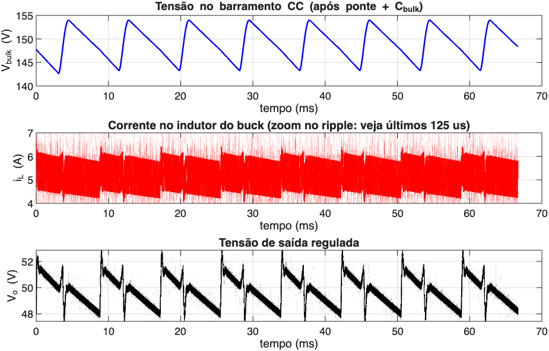
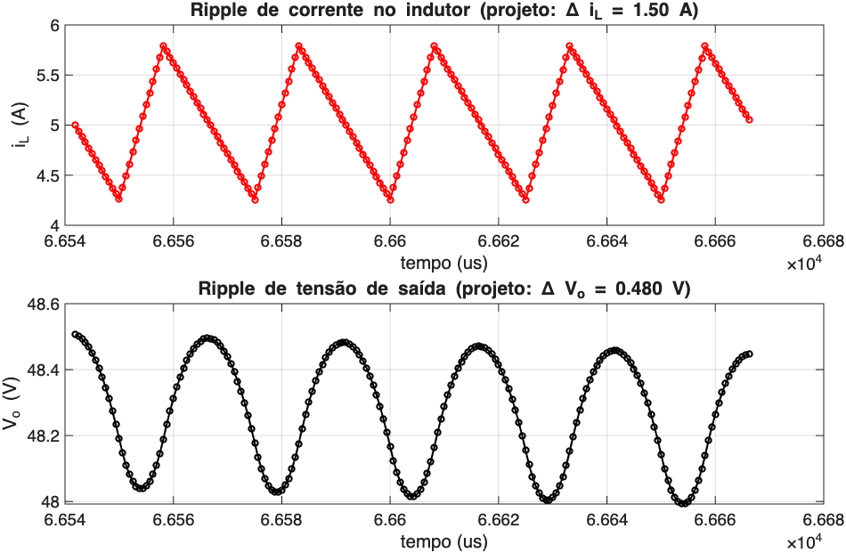

::: {.rtx-hero}
[Iniciação científica · Eletrônica de potência]{.rtx-eyebrow}

# Controle do Conversor Buck {.unnumbered .unlisted}

Fonte CC controlada baseada em conversor Buck: modelagem, identificação e controle.

[Kauã dos Santos Oliveira · orientação: Prof. Dr. Raphael Teixeira]{.rtx-meta}

::: {.rtx-acoes}
[Plano de trabalho](Plano/PlanoIC01.html){.rtx-btn .rtx-btn-primario} [GitHub](https://github.com/raphateixeira/ConversoresPotencia/tree/main/Buck){.rtx-btn} [Site do professor](https://raphateixeira.github.io){.rtx-btn}
:::
:::

Acompanhamento do plano de Iniciação Científica **"Fonte CC
Controlada Baseada em Conversor Buck: Modelagem, Identificação e
Controle"** (Kauã dos Santos Oliveira, orientação do Prof. Dr. Raphael
Barros Teixeira), vinculado ao projeto de pesquisa *Identificação, Estimação
e Controle Baseados em Dados e Inteligência Computacional Aplicados a
Conversores de Potência e Acionamentos Elétricos*.

## Plano de Trabalho

* [Plano de Trabalho de IC](Plano/PlanoIC01.html) — objetivos, metodologia (8 etapas) e cronograma de 12 meses. ([PDF assinado](Plano/PlanoIC01.pdf))

## Conteúdo

**Etapa 1–2 — Fundamentação e projeto analítico**

* [Modelagem simbólica do conversor Buck](Modelagem/ModelagemBuck.html) — dedução das equações de espaço de estados via `sympy` (notebook).
* [Apresentação — Modelagem Simbólica](Modelagem/Apresentacao.html) — mesma dedução em slides, com o código Python executado ao vivo (modos de chaveamento, SSA, pequenos sinais e verificação simbólica).
* [Apresentação — Modelagem e Pequenos Sinais](Apresentacao/Apresentacao.html) — versão narrativa: motivação, modelo médio, pequenos sinais e revisão da literatura.
* [Dimensionamento de uma fonte controlada](FonteControlada/FonteControlada.m) — script MATLAB (ponte retificadora + buck) com simulação comportamental de verificação.
* [Apresentação — Projeto da Fonte CC Controlada](FonteControlada/Apresentacao.html) — passo a passo do dimensionamento e conferência projeto × simulação.

  
  

::: {.callout-note}
Etapas 3–8 do plano (simulação Simulink, bancada física, identificação de
sistemas, controladores PI/PI Tipo 2/MPC, testes embarcados e redação final)
ainda não iniciadas — serão adicionadas aqui conforme o andamento do IC.
:::

## Ensaios na bancada

Conversor CC-CC abaixador (30 V → 10 V) com chave única e diodo: a LaunchPad comanda a razão
cíclica pelo PWM e mede a tensão de saída no ADC.

* [Identificação do Conversor Buck](Ensaios/IdentificacaoBuckPRBS/index.qmd) — escolha de $T_s$ e da duração do bit da PRBS, identificação ARX(2,2,2) e validação, simuladas em MATLAB.
* `Ensaios/ControleBuck/analise/projeto_pi.m` — projeto do controlador PI (em preparação).

## Firmware (Code Composer Studio)

Projetos para a LAUNCHXL-F28379D em `Buck/Firmware/`. Cada `.zip` traz os fontes e as configurações
(descompactar, abrir a pasta no CCS com *File → Open Folder* e fazer *Clean* + *Rebuild*). A placa e o
primeiro projeto no CCS estão na [nota da LaunchPad](https://raphateixeira.github.io/ProjetosCCS/Notas/Nota01LaunchPadF28379D.html).

| Projeto | Ensaio | Código |
|---|---|---|
| `BK01Degrau` | malha aberta: rampa até 10 V e onda quadrada 10 ↔ 12 V, PWM de 20 kHz, $T_s$ = 50 µs | [.zip](../downloads/BK01Degrau.zip) · [GitHub](https://github.com/raphateixeira/ConversoresPotencia/tree/main/Buck/Firmware/BK01Degrau) |
| `PWM_prbs` | malha aberta: PRBS de 9 bits na razão cíclica, $T_b$ = 200 µs, $T_s$ = 50 µs | [.zip](../downloads/PWM_prbs.zip) · [GitHub](https://github.com/raphateixeira/ConversoresPotencia/tree/main/Buck/Firmware/PWM_prbs) |

## Referências

* Dilger (2018) — *Desenvolvimento de uma Fonte Chaveada para Uso em Laboratório de Graduação* (TCC, UTFPR).
