## O caminho

::: {style="font-size:1.0em"}
| Etapa | O que faz | Usa desta apresentação |
|---|---|---|
| 01 Malha aberta | chaveamento, senoides de tensão, mede correntes | braço, PWM, tempo morto, placas, medidas |
| 02 Identificação ARX | PRBS em v~d~ e v~q~, ajusta o modelo | modelo discreto em dq, atraso de 2 amostras |
| 03 Controle PI | PI por eixo + desacoplamento | polo da carga, ωL |
| 04 FCS-MPC | escolhe 1 dos 8 estados a cada 50 µs | estados do inversor, vetores, modelo em αβ |
| 05 FCS + RLS | o modelo se atualiza sozinho | modelo discreto com atraso |
| 06 Koopman | modelo aprendido dos dados | modelo físico para comparar |

: {tbl-colwidths="[20,42,38]"}
:::

- Três partes: **o inversor** (braço, estados, PWM), **a carga e o modelo** (abc → dq → discreto) e
  **as placas** (montagem, sinais, medidas, proteção). As outras apresentações citam esta.

## O inversor trifásico

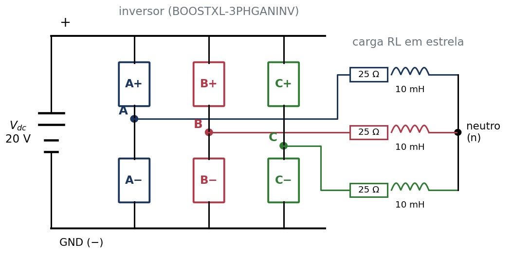{fig-align="center" width="78%"}

- Transforma a tensão contínua $V_{dc}$ em três tensões alternadas, ligando e desligando seis
  chaves 20 mil vezes por segundo.
- Cada coluna de duas chaves (A+ e A−) é um **braço**; o ponto do meio vai para a fase da carga.

## Um braço e o tempo morto

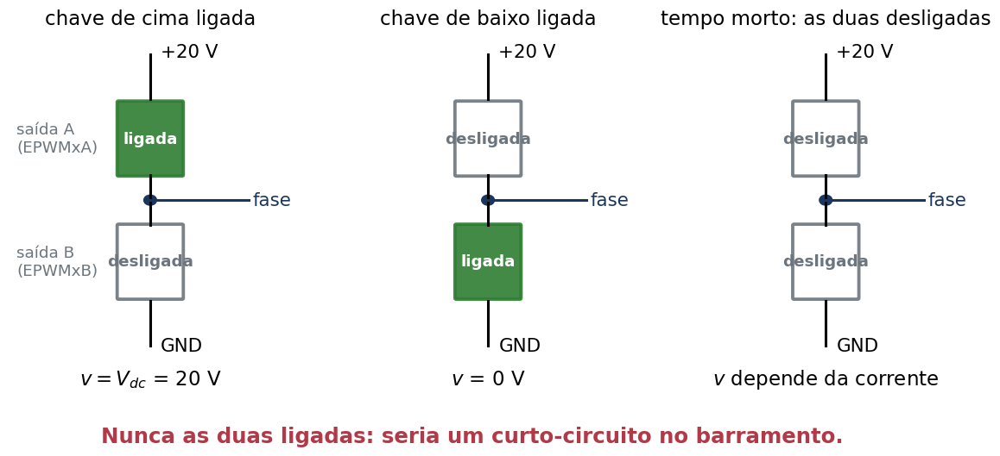{fig-align="center" width="88%"}

- A placa de controle manda dois sinais por braço: **saída A** (chave de cima) e **saída B**
  (chave de baixo), complementares.
- Entre desligar uma e ligar a outra há o **tempo morto**: as duas desligadas, a tensão do
  braço passa a depender do sentido da corrente.

## Oito estados

- Cada braço liga a fase ao + ($S_x$ = 1) ou ao − ($S_x$ = 0) do barramento.
- Com o neutro da carga isolado, a tensão de fase é a de polo menos a média:
  $v_x = V_{dc}\,\big(S_x - \tfrac{S_A+S_B+S_C}{3}\big)$.

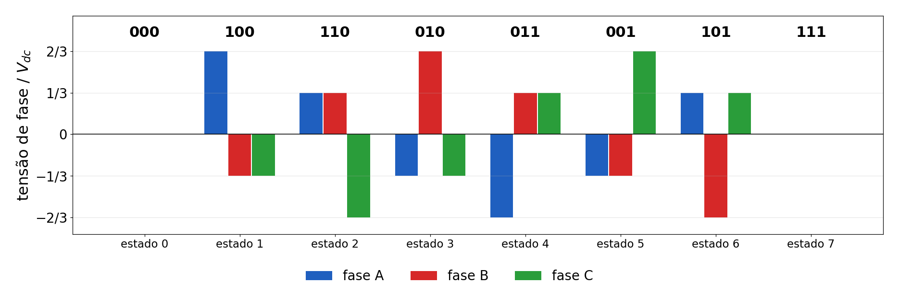{fig-align="center" width="90%"}

## Vetores de tensão

:::: {.columns}
::: {.column width="45%"}
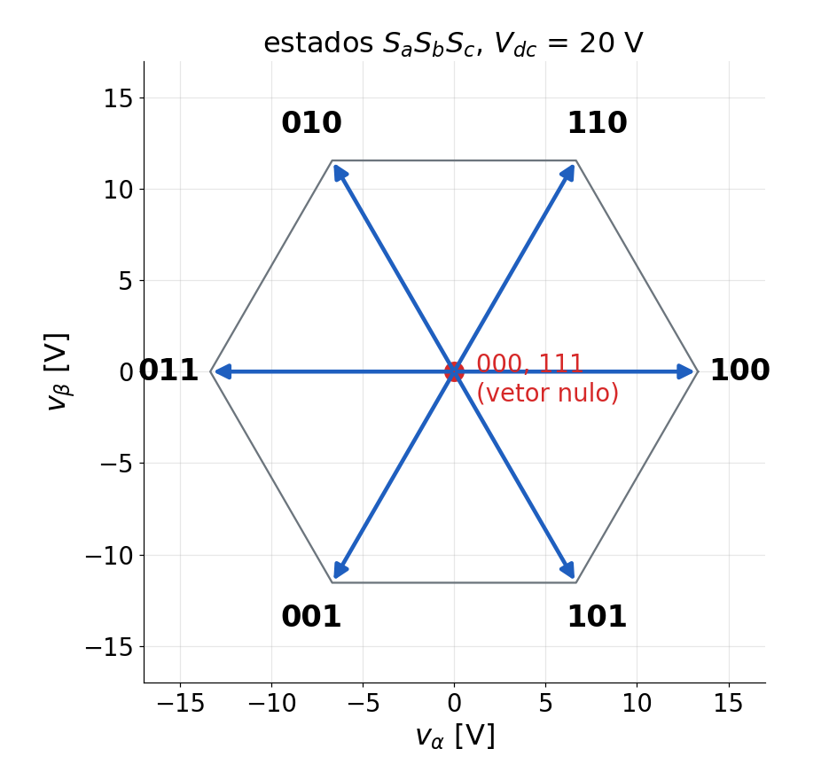{width="100%"}
:::
::: {.column width="55%"}
Em αβ (Clarke, invariante em amplitude):

$$
\begin{aligned}
v_\alpha &= \tfrac{2}{3}V_{dc}\Big(S_A - \tfrac{S_B + S_C}{2}\Big)\\
v_\beta &= \tfrac{V_{dc}}{\sqrt3}\,(S_B - S_C)
\end{aligned}
$$

- 6 vetores ativos de módulo $\tfrac23 V_{dc}$ = 13,3 V (20 V) e 2 nulos (000 e 111).
- O controle só "vê" estes 7 pontos do plano αβ. O PWM obtém a tensão média alternando entre
  eles; o **FCS-MPC** (etapa 04) escolhe um a cada amostra.
:::
::::

## Razão cíclica e tensão média

::: {style="font-size:0.85em"}
Num período de PWM ($T_s$ = 50 µs) a chave de cima fica ligada uma fração $d$ do tempo, a
**razão cíclica**: a média do braço em relação ao GND é $d\,V_{dc}$. Em relação ao centro da estrela:

$$
v_x = \Big(d_x - \tfrac12\Big)V_{dc} \;\Rightarrow\; d_x = 0{,}5 + \frac{v_x}{V_{dc}},
\qquad 0{,}05 \le d_x \le 0{,}95 \;\Rightarrow\; |v| \le 0{,}45\,V_{dc} = 9\ \text{V}
$$

| [$d$]{style="text-transform:none"} | Chave de cima ligada | Média do braço | Tensão de fase |
|---|---|---|---|
| 25 % | 12,5 µs de 50 µs | 5 V | −5 V |
| 50 % | 25 µs | 10 V | 0 |
| 75 % | 37,5 µs | 15 V | +5 V |

: {tbl-colwidths="[16,34,25,25]"}

- Valores com V~dc~ = 20 V. Variando $d$ como senoide, a média vira senoide; modulação linear até
  0,45 V~dc~ (com SVPWM, $V_{dc}/\sqrt3$ = 11,5 V). Etapas 01–03 usam PWM; 04–06 aplicam os estados.
:::

## Como a placa gera o PWM

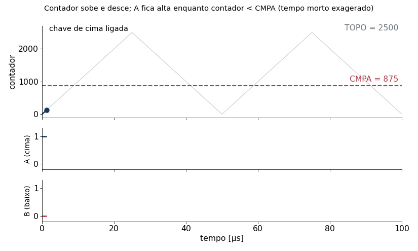{width="78%" fig-align="center"}

Um **contador** sobe de 0 a 2500 e desce de volta, sem parar. A saída A fica alta enquanto o
contador está **abaixo** do valor de comparação (CMPA); a saída B é o contrário, com tempo morto.
O CMPA novo só vale no próximo zero do contador (registrador "sombra").

## Os números do PWM

| Grandeza | Valor | De onde vem |
|---|---|---|
| Relógio do PWM | 100 MHz | 200 MHz do processador ÷ 2: cada contagem dura 10 ns |
| Topo do contador | 2500 | 100 MHz ÷ (2 × 20 kHz) |
| Período do PWM | 50 µs | 2 × 2500 contagens × 10 ns; uma amostra do controle por período |
| Razão cíclica | CMPA ÷ 2500 | CMPA = 1250 → 50 % |
| Tempo morto | 100 ns | 10 contagens |
| Limites da razão | 5 % a 95 % | nenhum pulso mais curto que o tempo morto |

No firmware: `FREQ_PWM`, `TOPO`, `TEMPO_MORTO`, `CONTAGENS_MORTO`, `RAZAO_MINIMA/MAXIMA`.

## Tempo morto

:::: {.columns}
::: {.column width="55%"}
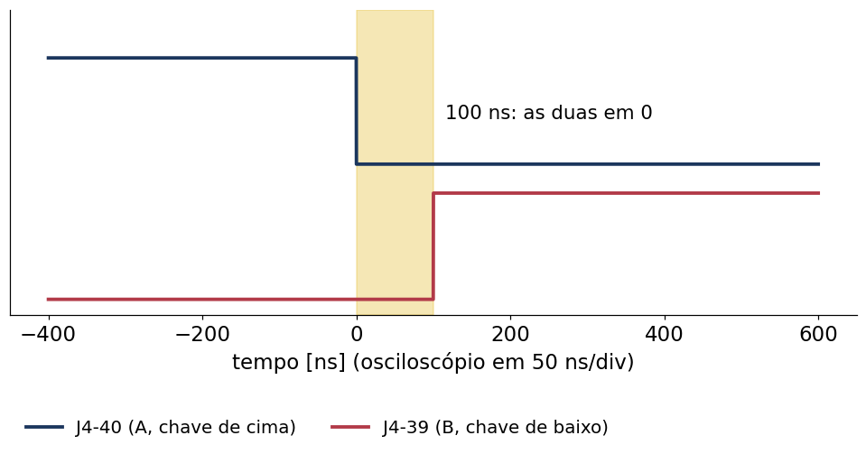{width="100%"}
:::
::: {.column width="45%"}
- Uma chave não desliga na hora: se a outra ligasse junto, haveria curto no barramento.
- Durante o tempo morto a tensão do braço segue o sinal da corrente. Erro médio:

$$
\Delta v \approx V_{dc}\, t_m\, f_{PWM} = 20 \cdot 100\,\text{ns} \cdot 20\,\text{kHz} = 0{,}04\ \text{V}
$$

- 0,4 % dos 9 V de pico: uma não linearidade pequena, visível perto de corrente nula.
:::
::::

- O MotorControl SDK usa 0,5 µs (Δv = 0,2 V); o TIDA-00909 opera o LMG5200 com 12,5 ns (atraso de
  propagação de 29,5 ns). Reduzir $t_m$ é um ensaio a fazer, com o osciloscópio.

## Fonte trifásica

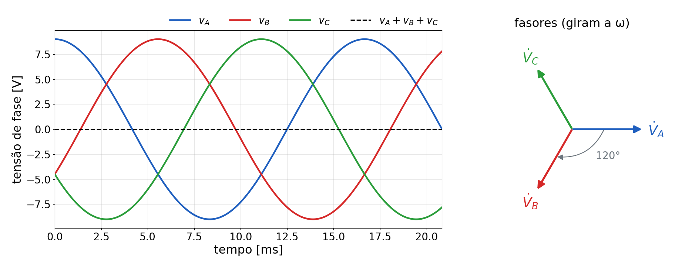{fig-align="center" width="100%"}

$$
v_A = V\cos(\omega t),\quad v_B = V\cos(\omega t - 120°),\quad v_C = V\cos(\omega t + 120°),\qquad v_A+v_B+v_C = 0
$$

## A carga RL em estrela

:::: {.columns}
::: {.column width="52%"}
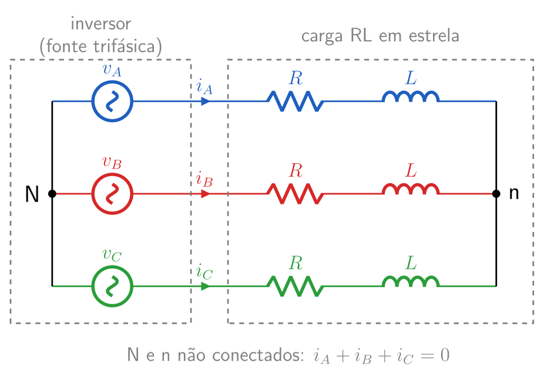{width="100%"}
:::
::: {.column width="48%"}
$$
\begin{bmatrix} v_A \\ v_B \\ v_C \end{bmatrix} = R \begin{bmatrix} i_A \\ i_B \\ i_C \end{bmatrix}
+ L\,\frac{d}{dt}\begin{bmatrix} i_A \\ i_B \\ i_C \end{bmatrix}
$$

- Tensões de fase em relação ao neutro da carga (n), isolado: $i_A + i_B + i_C = 0$.
- Equilibrada: três equações iguais, defasadas de 120°.
- O inversor faz o papel da fonte trifásica.
:::
::::

## Em regime: fasores

:::: {.columns}
::: {.column width="55%"}
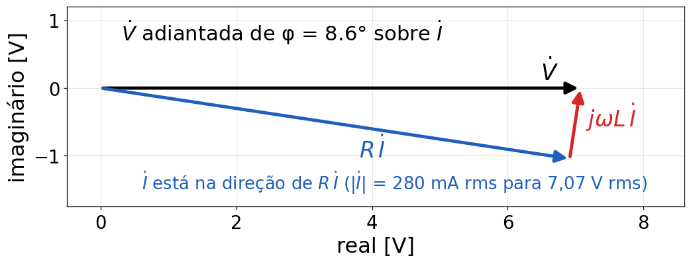{width="100%"}
:::
::: {.column width="45%"}
$$
\dot Z = R + j\omega L = 25 + j\,3{,}77\ \Omega
$$

| | |
|---|---|
| [\|Z\|]{style="text-transform:none"} | 25,3 Ω |
| φ (fator de potência) | 8,6° (0,989) |
| τ = L/R | 0,40 ms = 8 amostras |
| polo | 398 Hz |

: {tbl-colwidths="[50,50]"}
:::
::::

- Quase resistiva em 60 Hz, mas com dinâmica: τ de 8 amostras dá trabalho ao controle.

## Por que 25 Ω e 10 mH?

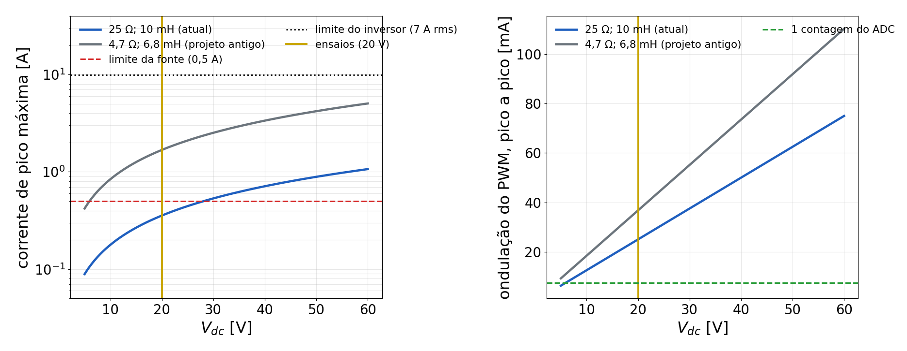{fig-align="center" width="100%"}

- A 20 V: corrente de pico de **0,36 A** (fonte de bancada até 0,5 A), ≈ 49 contagens do ADC;
  ondulação do PWM ≤ 25 mA.
- A carga antiga (4,7 Ω; 6,8 mH) pediria 1,7 A a 20 V: fonte maior, mais perda, mais risco nos
  primeiros ensaios.

## De abc para dq

:::: {.columns}
::: {.column width="31%"}
::: {style="font-size:0.72em"}
**Clarke** (abc → αβ):

$$
\begin{bmatrix} x_\alpha \\ x_\beta \end{bmatrix} = \frac{2}{3}
\begin{bmatrix} 1 & -\tfrac12 & -\tfrac12 \\ 0 & \tfrac{\sqrt3}{2} & -\tfrac{\sqrt3}{2} \end{bmatrix}
\begin{bmatrix} x_A \\ x_B \\ x_C \end{bmatrix}
$$

**Park** (αβ → dq, θ = ωt):

$$
\begin{bmatrix} x_d \\ x_q \end{bmatrix} =
\begin{bmatrix} \cos\theta & \sin\theta \\ -\sin\theta & \cos\theta \end{bmatrix}
\begin{bmatrix} x_\alpha \\ x_\beta \end{bmatrix}
$$

Inversa: $x_A = x_d\cos\theta - x_q\sin\theta$.
:::
:::
::: {.column width="69%"}
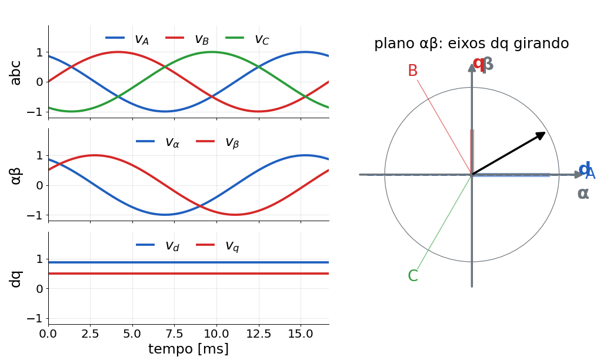{width="100%"}
:::
::::

## Modelo em dq: o acoplamento

::: {style="font-size:0.9em"}
Clarke é linear: em αβ vale a mesma equação, $\;v_{\alpha\beta} = R\,i_{\alpha\beta} + L\,\dfrac{d i_{\alpha\beta}}{dt}$,
com $x_{\alpha\beta} = x_\alpha + j\,x_\beta$ (sem acoplamento: é o modelo do FCS, etapa 04).

Park como rotação: $\;x_{\alpha\beta} = x_{dq}\,e^{j\theta}$, $\;\theta = \omega t$. Substituindo:

$$
v_{dq}\,e^{j\theta} = R\,i_{dq}\,e^{j\theta} + L\,\frac{d i_{dq}}{dt}\,e^{j\theta} + \underbrace{j\omega L\,i_{dq}\,e^{j\theta}}_{\text{derivada de }e^{j\theta}}
\;\;\Rightarrow\;\;
\frac{d}{dt}\begin{bmatrix} i_d \\ i_q \end{bmatrix} =
\underbrace{\begin{bmatrix} -R/L & \omega \\ -\omega & -R/L \end{bmatrix}}_{A}
\begin{bmatrix} i_d \\ i_q \end{bmatrix} + \frac{1}{L}\begin{bmatrix} v_d \\ v_q \end{bmatrix}
$$

- Em regime as grandezas dq são **constantes**: $v_d = R\,i_d - \omega L\,i_q$, $\;v_q = R\,i_q + \omega L\,i_d$.
- Termos cruzados ωL = 3,77 Ω (ωL/R ≈ 0,15): um degrau em $v_d$ mexe em $i_q$. **Desacoplamento**
  (etapa 03): somar $-\omega L\,i_q$ a $v_d$ e $+\omega L\,i_d$ a $v_q$; cada eixo vira $1/(Ls + R)$.
:::

## Modelo discreto

::: {style="font-size:0.82em"}
**Segurador de ordem zero:** a tensão (média do PWM) fica constante em cada $T_s$ = 50 µs:

$$
i(k+1) = \Phi\, i(k) + \Gamma\, v(k), \qquad \Phi = e^{A T_s}, \quad \Gamma = A^{-1}(\Phi - I)\,\tfrac{1}{L}
$$

$A = -\tfrac{R}{L} I + \omega J$ ($J$ = rotação de 90°), então a exponencial separa:

$$
\Phi = e^{-RT_s/L}\begin{bmatrix} \cos\omega T_s & \sin\omega T_s \\ -\sin\omega T_s & \cos\omega T_s \end{bmatrix}
= \begin{bmatrix} a & c \\ -c & a \end{bmatrix} = \begin{bmatrix} 0{,}8823 & 0{,}0166 \\ -0{,}0166 & 0{,}8823 \end{bmatrix},
\qquad
\Gamma \approx \begin{bmatrix} 0{,}0047 & 0{,}00004 \\ -0{,}00004 & 0{,}0047 \end{bmatrix}
$$

Em αβ basta $a = e^{-RT_s/L}$ e $b = (1-a)/R$, separados por eixo.
:::

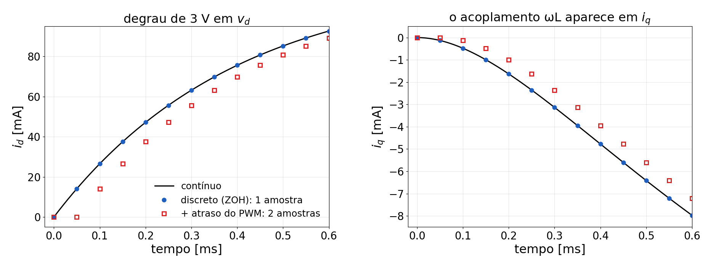{fig-align="center" width="62%"}

## Por que 2 amostras de atraso?

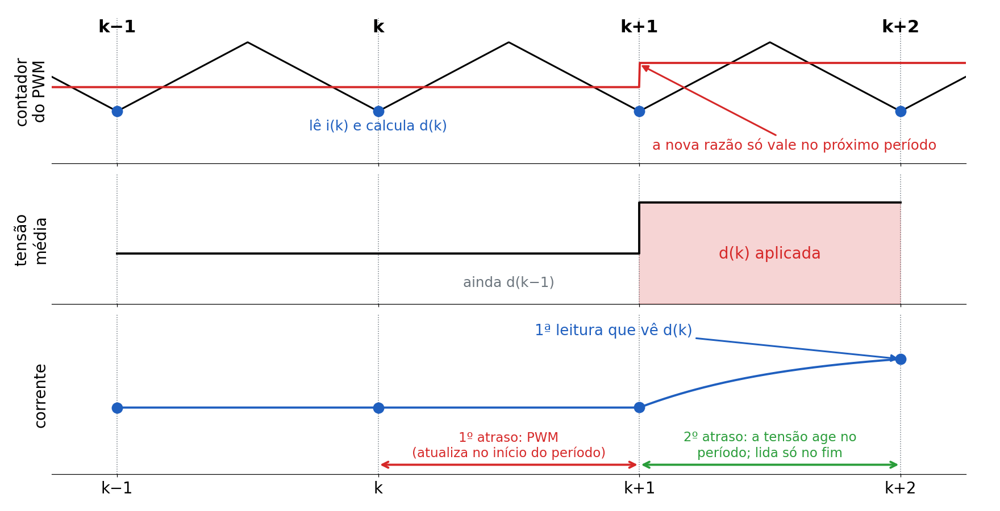{fig-align="center" width="80%"}

- A razão calculada em *k* só vale no período seguinte (sombra do CMPA); a corrente lida em *k*+2 é a
  primeira a senti-la por inteiro. Um atraso é do PWM, o outro existe em qualquer sistema amostrado.
- Estrutura usada nas etapas 02–05: $\;i_d(k) = a\,i_d(k-1) + b\,v_d(k-2) + c\,i_q(k-1)$, e em q com $-c\,i_d$.

## As placas

:::: {.columns}
::: {.column width="55%"}
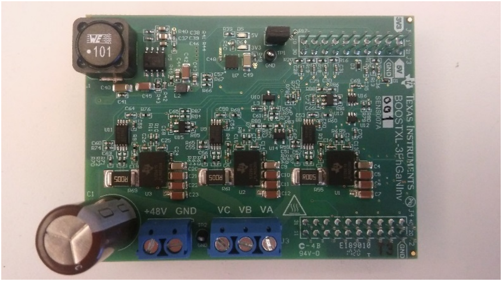{width="100%"}

[BOOSTXL-3PHGANINV (SLUUBP1A, fig. 4). Bornes: +48V/GND (barramento) e VA, VB, VC (carga).]{style="font-size:0.6em"}
:::
::: {.column width="45%"}
- **LAUNCHXL-F28379D**: C2000 de 200 MHz, ePWM, 4 ADCs de 12 bits, sonda XDS100v2 na USB.
- **BOOSTXL-3PHGANINV**: três meias-pontes GaN **LMG5200**, um **INA240** com shunt de 5 mΩ
  por fase, barramento de 12 a 60 V.
- Fonte de bancada de 20 V (limite 0,5 A); carga em estrela, 25 Ω e 10 mH por fase.

| Grandeza | Valor |
|---|---|
| Pico com 20 V (\|v\| ≤ 0,45 V~dc~) | ≈ 0,36 A |
| Medido nos ensaios | ≈ 0,3 A |
:::
::::

## Diagrama de blocos

:::: {.columns}
::: {.column width="55%"}
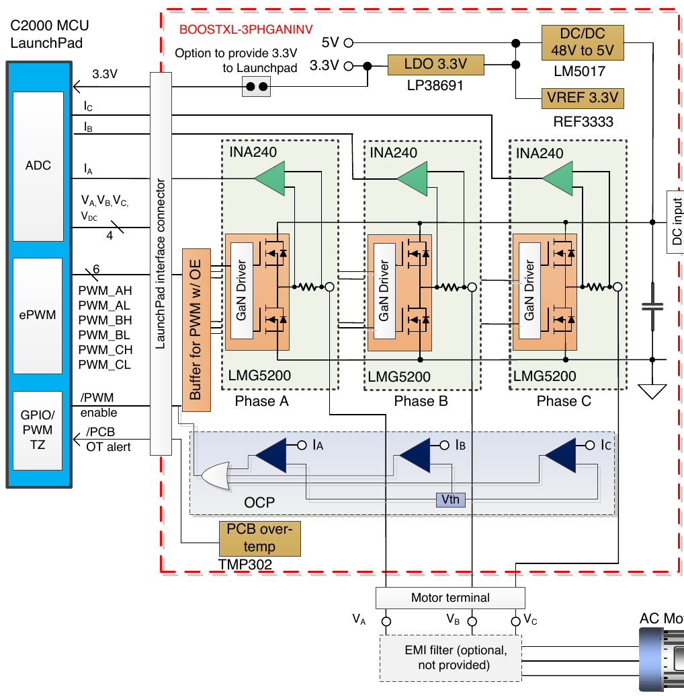{width="92%"}

[SLUUBP1A, fig. 3.]{style="font-size:0.6em"}
:::
::: {.column width="45%"}
- Buffer de PWM com **/PWM enable, ativo em nível baixo** (GPIO124);
- Proteção própria (TLV3201): 12 A;
- O barramento alimenta o LM5017, que gera os 5 V e os 3,3 V da placa: **sem barramento, o
  INA240 e o buffer ficam desligados** e os comparadores disparam.
:::
::::

## Montagem: onde ficam J1–J4 na LaunchPad

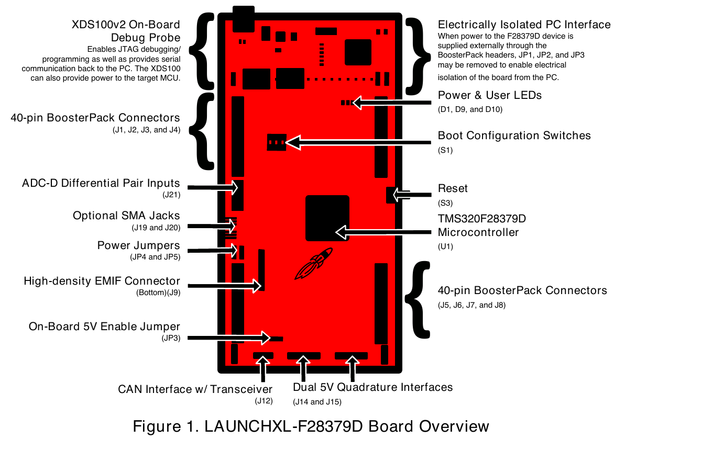{width="62%" fig-align="center"}

[LAUNCHXL-F28379D (SPRUI77C, fig. 1). O inversor usa os conectores J1, J2, J3 e J4, na
metade de cima, perto da USB, e não J5–J8.]{style="font-size:0.6em"}

## Montagem: o inversor na posição de encaixe

:::: {.columns}
::: {.column width="52%"}
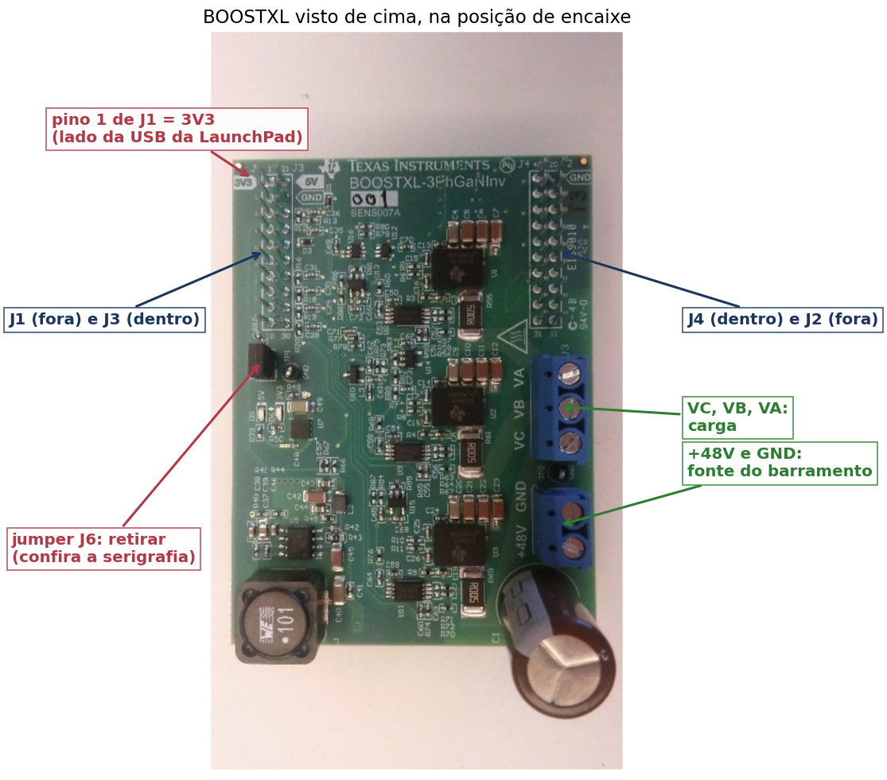{width="100%"}
:::
::: {.column width="48%"}
- A foto da TI (SLUUBP1A, fig. 4) foi girada para a posição em que a placa fica sobre a
  LaunchPad;
- Os conectores do inversor estão na **face de baixo**; na face de cima aparecem só os
  pinos soldados;
- O canto marcado **3V3** fica do lado da USB da LaunchPad;
- Fonte nos bornes **+48V/GND** (usamos 20 V); carga nos bornes **VA, VB, VC**.
:::
::::

## Montagem: alinhamento

:::: {.columns}
::: {.column width="45%"}
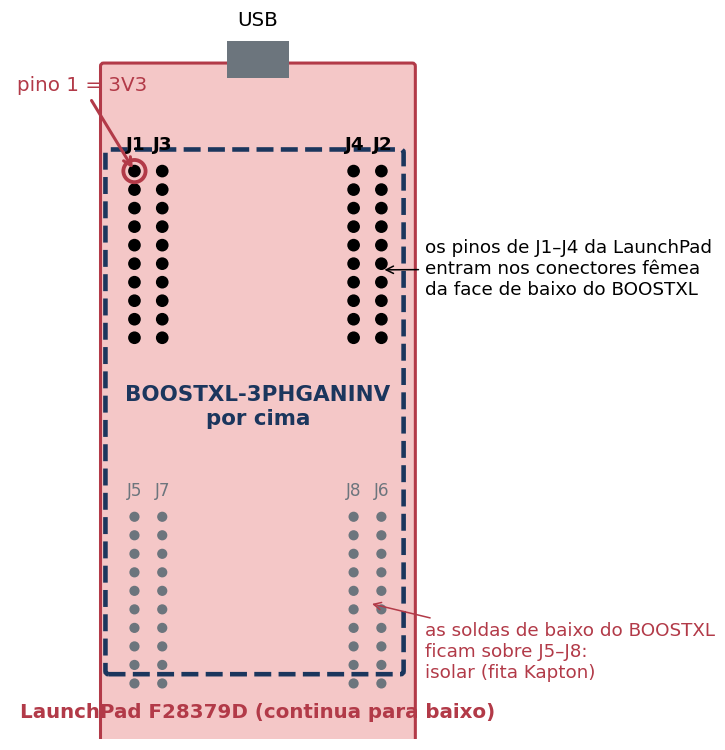{width="82%"}

[Esquema fora de escala.]{style="font-size:0.6em"}
:::
::: {.column width="55%"}
- **3V3 sobre 3V3**: o pino 1 de J1 do inversor encaixa no pino 1 de J1 da LaunchPad;
- Conferir também **5V sobre 5V** e **GND sobre GND** pela serigrafia;
- Encaixado ao contrário, as alimentações ficam trocadas e as placas podem queimar;
- O inversor passa por cima de J5–J8: as soldas de baixo não podem encostar neles.
:::
::::

## Antes de encaixar

1. **Tudo desligado**: sem USB e sem fonte;
2. Retirar o **jumper J6** do inversor: ele levaria 3,3 V do inversor para a LaunchPad, que já é
   alimentada pela USB;
3. Fita Kapton (ou espaçadores) entre as placas, sobre J5–J8 e os jumpers da LaunchPad;
4. Ver a revisão impressa na LaunchPad: na **revisão 1.1**, o pino J3-29 (corrente da fase C) está
   em curto com a referência do ADC (SPRUI77). Nesse caso, falar com o professor antes;
5. Encaixar com 3V3 sobre 3V3, sem forçar e sem entortar os pinos.

## Pinos analógicos da LaunchPad

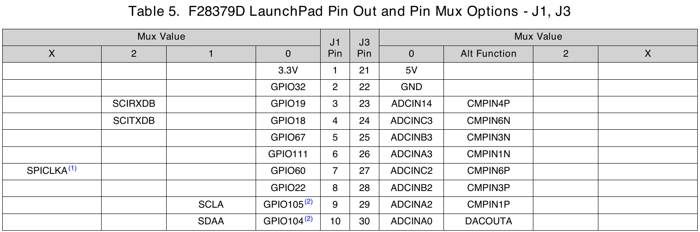{width="80%" fig-align="center"}

[SPRUI77C, tabela 5. A coluna J3 recebe os sinais analógicos do BoosterPack.]{style="font-size:0.6em"}

- J3-27, 28, 29: correntes iA, iB, iC (ADCINC2, B2, A2), também as entradas positivas dos
  comparadores 6, 3 e 1;
- J3-24, 25, 26: tensões vA, vB, vC (ADCINC3, B3, A3); J3-23: barramento (ADCIN14, lido pela ADCD);
- J3-30: VREF do BoosterPack no ADCINA0, que também é a saída do DACA: **não usar o DACA**.

## Saídas de PWM e sinais digitais

| Sinal | Periférico | GPIO | Pino |
|---|---|---|---|
| Fase A (alto / baixo) | EPWM1A / 1B | 0 / 1 | J4-40 / 39 |
| Fase B | EPWM2A / 2B | 2 / 3 | J4-38 / 37 |
| Fase C | EPWM3A / 3B | 4 / 5 | J4-36 / 35 |
| /PWM enable (ativo baixo) | GPIO | 124 | J2-13 |
| /PCB OT alert (ativo baixo) | GPIO, INPUTXBAR1 | 24 | J4-34 |
| GND (terra das pontas) | — | — | J2-20, J3-22 |

- Entradas de PWM do BoosterPack com *pull-down* de 10 kΩ e habilitação com *pull-up* de
  10 kΩ: a placa liga desligada (TIDA-00909, tabela 4). Os firmwares começam com o pino em 1 e só
  escrevem 0 quando `habilita` = 1.

## Os pinos na placa

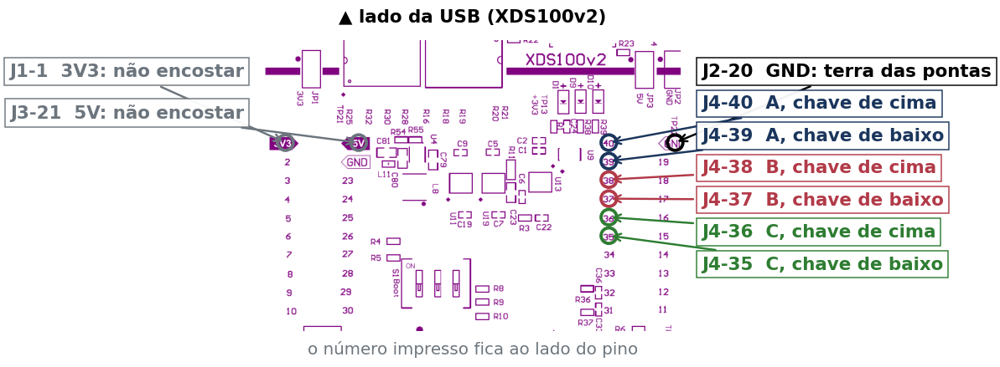{width="92%" fig-align="center"}

LaunchPad vista de cima, com a USB para cima: J4 é a coluna de dentro, à direita, com o pino 40
no alto; J2 é a de fora, com o GND (pino 20) ao lado do 40.

## Sensor de corrente

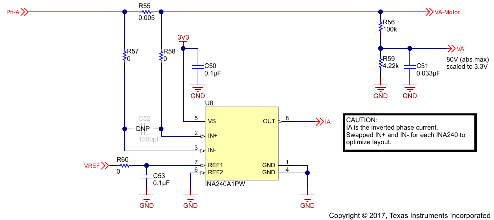{width="88%" fig-align="center"}

[TIDA-00909 (TIDUCE7B), fig. 10: fase A. O BOOSTXL repete o circuito nas três fases.]{style="font-size:0.6em"}

- INA240A1: ganho de 20 V/V sobre 5 mΩ → **0,1 V/A**, ponto médio de 1,65 V (VREF);
- IN+ e IN− trocados para facilitar o *layout*: **a corrente sai invertida**;
- Banda de 400 kHz e acomodação de 9,6 µs (datasheet do INA240). O shunt fica em linha com a
  fase: mede a corrente qualquer que seja a chave conduzindo.

## Conversão para ampères

:::: {.columns}
::: {.column width="58%"}
Na placa, o sensor dá $\;v_{ADC} = 1{,}65 - 0{,}1\,i\;$ [V].

A LaunchPad usa uma referência de 3,0 V (REF5030, SPRUI77) e um ADC de 12 bits:

$$
\begin{aligned}
i &= -k\,(N - N_0) \\
k &= \frac{3{,}0}{4096 \cdot 0{,}1} = 7{,}32\ \text{mA}
\end{aligned}
$$

$N_0 \approx 2253$ (o zero) é medido pelo firmware: no VSI01, média com o inversor desligado; a
partir do VSI02, **chaveando a 50 %** por 110 ms (o zero muda quando o inversor chaveia).
:::
::: {.column width="42%"}
- Faixa **assimétrica**: de −13,5 A a +16,5 A;
- O SDK usa 27 A / 4096 contagens: erro de ≈ 10 %;
- 0,36 A de pico ocupa só ≈ **49 contagens**: o ruído de 1–2 contagens pesa, daí a média
  síncrona de 16 períodos nas etapas 02–05.
:::
::::

## Tensões de fase e barramento

:::: {.columns}
::: {.column width="58%"}
Divisor de 100 kΩ / 4,22 kΩ com 33 nF (TIDA-00909, fig. 10 e 11):

$$
V = 24{,}7\, v_{ADC}, \qquad V_{\max} = 24{,}7 \cdot 3{,}0 = 74{,}1\ \text{V}
$$

com 18,1 mV por contagem. O SDK usa os mesmos 74,1 V.
:::
::: {.column width="42%"}
- Filtro de **1 kHz**: as tensões medidas chegam atrasadas e sem os pulsos do PWM (o ADC vê a
  média do braço em relação ao GND);
- Servem para conferir a montagem, **não** para identificar: nas etapas 02–06 grava-se a tensão
  **comandada** (razão × V~dc~).
:::
::::

## Amostragem sincronizada com o PWM

- O EPWM1 dispara as conversões (SOCA) no **zero do contador**; cada ADC converte a tensão e a
  corrente de uma fase (A no ADCC, B no ADCB, C no ADCA), e a ADCD converte o barramento;
- Com a saída A alta enquanto o contador < CMPA, o zero cai no **meio do pulso**: a amostra pega o
  valor médio da ondulação da corrente;
- O fim da conversão (ADCA INT1) libera o laço de controle, que roda na interrupção do zero;
- Janela de aquisição de 100 ns (o mínimo é 75 ns em 12 bits; o SDK usa 70 ns);
- Com chaveamento direto (FCS, etapas 04–06), as chaves mudam no **topo** e a corrente é lida no
  zero, longe das comutações.

## Proteção contra sobrecorrente

```
iA → CMPSS6 ┐
iB → CMPSS3 ├─ H ou L ─→ XBAR TRIP4 → DCAEVT1 → OST nos EPWM1, 2, 3
iC → CMPSS1 ┘               ↑
                   GPIO24 (sobretemperatura)
```

- Comparadores contra o DAC interno (referência VDDA = 3,3 V), com filtro digital de ≈ 3 µs;
- **OST** (*one-shot*): as saídas ficam em nível baixo (as duas chaves de cada braço desligadas)
  até o software liberar;
- A parada do emulador (CBC6) também desliga as saídas: pausar no CCS desliga as chaves;
- Acima disso, a proteção da própria placa atua em 12 A. A partir do VSI03 os firmwares usam proteção
  por software (`correnteMaxima` = 0,8 A); a do comparador ainda não foi usada.

## Limiar do comparador

O SDK calcula o DAC do CMPSS como $2048 \pm 2048\,I_{lim}/13{,}5$:

- Com a referência de 3,3 V, 2048 = 1,65 V: o ponto médio está **certo**;
- A inclinação 2048/13,5 equivale a 0,122 V/A, mas o sensor dá 0,1 V/A: o limite de 9 A do SDK
  dispara, na verdade, perto de **11 A**;
- Para um limiar próprio, use o offset **medido** de cada fase:

$$
N_{DAC} = \frac{4096}{3{,}3}\left(\frac{3{,}0\,N_0}{4096} \pm 0{,}1\,I_{lim}\right)
$$

## Ligar e desligar a bancada

1. Placas encaixadas, carga nos bornes VA, VB, VC (ou sem carga no primeiro teste);
2. LaunchPad na USB, programa rodando com `habilita` = 0;
3. Fonte ajustada em **20 V** com limite de **0,5 A**, ainda desligada; ligar nos bornes +48V
   (positivo) e GND (negativo);
4. Ligar a fonte: corrente perto de zero; acendem os LEDs 5V e 3V3 do inversor; `tensaoBarramento`
   ≈ 20 V na Watch;
5. `habilita` = 1.

Para desligar, a ordem inversa: `habilita` = 0, fonte, USB. Pausar o programa (‖) desliga as
chaves; o ■ encerra a sessão e desconecta a placa.

## Terra do osciloscópio

- A garra de terra das pontas comuns é ligada ao terra da tomada;
- Ela só pode ir no **GND do inversor** (borne GND, negativo da fonte) ou no GND da LaunchPad
  (J2-20, J3-22), que é o mesmo;
- **Nunca** prender a garra de terra em VA, VB ou VC: isso põe uma fase em curto com o terra;
- A tensão **entre duas fases** se mede com duas pontas (VA e VB contra o GND) e a função
  matemática A − B do osciloscópio.

## Pontos a conferir na bancada

| Item | Como conferir |
|---|---|
| Revisão da LaunchPad | na revisão 1.1, ADCINA2 (iC) está em curto com VREFHIB (SPRUI77) |
| Sinal da corrente | em malha aberta: [$v_A > 0 \Rightarrow i_A > 0$]{style="text-transform:none"} em regime |
| Par de PWM da fase A | osciloscópio em J4-40/39 com 50 % |
| Jumper J6 do BoosterPack | retirar quando a LaunchPad é alimentada pela USB |
| Onde atua o TLV3201 | esquemático do BoosterPack (pacote SLUC631) |
| Escala de [$V_{dc}$]{style="text-transform:none"} | comparar `tensaoBarramento` com um multímetro |

## Resumo dos números

::: {style="font-size:0.85em"}
| Grandeza | Valor |
|---|---|
| Carga por fase | R = 25 Ω, L = 10 mH, estrela, neutro isolado |
| Impedância em 60 Hz | 25,3 Ω, φ = 8,6°, FP = 0,989 |
| Constante de tempo, polo | 0,40 ms (8 amostras), 398 Hz |
| Barramento, PWM | 20 V; 20 kHz ($T_s$ = 50 µs); tempo morto 100 ns; razão de 5 a 95 % |
| Tensão de fase máxima | 9 V de pico; vetores ativos de 13,3 V |
| Corrente máxima | 0,36 A de pico; ADC: 7,32 mA por contagem (≈ 49 contagens) |
| Tensões medidas | 18,1 mV por contagem, filtro de 1 kHz |
| Modelo discreto em dq | a = 0,882, b = 0,0047 A/V, c = 0,0166, atraso de 2 amostras |
| Identificado (etapa 02) e em regime (etapa 03) | R ≈ 25,3–26,2 Ω, L ≈ 9,8 mH |

: {tbl-colwidths="[36,64]"}
:::

## Documentos e scripts

- **SLUUBP1A**: guia do BOOSTXL-3PhGaNInv (diagrama, foto, jumper J6, OCP);
- **TIDUCE7B**: TIDA-00909, inversor GaN de 48 V (pinagem, INA240, divisores, filtros);
- **TIDUCE8A**: TIDA-00913, medição de corrente em linha com o INA240;
- **SPRUI77C**: LAUNCHXL-F28379D (pinos, REF5030, erratas); **SPRS880P**: TMS320F2837xD (ADC, CMPSS);
- Datasheets do **INA240** e do **LMG5200**; **SPRACO3**: projeto de dois eixos do MotorControl SDK.

Os PDFs ficam em `InversorTrifasico/00Bancada/docs/` (fora do repositório). Figuras:
`analise/figuras_modelo.py` (carga e modelo) e `analise/figuras_placa.py` (inversor, PWM e placas).
