## Ensaio 1 {.smaller}

| Item | Valor |
|---|---|
| Placas | LAUNCHXL-F28379D + BOOSTXL-3PHGANINV (J1–J4) |
| Carga | RL trifásica em estrela, neutro isolado: R = 25 Ω, L = 10 mH por fase |
| Barramento | V~dc~ = 19,83 V (lido pelo ADC) |
| PWM | 20 kHz, tempo morto de 100 ns |
| Comando | razão cíclica $d_k = 0{,}5 + 0{,}4\,\mathrm{sen}(\omega t - \theta_k)$, 60 Hz, sequência ABC |
| Programa | `VSI01MalhaAberta`, modo 2 (gravado com a versão anterior de um modo só, mesmo código de PWM e medidas) |
| Medida | uma amostra de cada sinal a cada 50 µs, 2000 amostras (100 ms, 6 ciclos) |

: {tbl-colwidths="[18,82]"}

As três tensões dos braços (×24,7, filtro RC de 1 kHz na placa) e as três correntes (shunt de
5 mΩ + INA240, 0,1 V/A) são convertidas juntas, no zero do contador do PWM da fase A.

## De onde vêm os dados

1. Na placa: `habilita = 1` liga o inversor; `grava = 1` enche os vetores `tensaoA/B/C` e
   `correnteA/B/C` na RAM do microcontrolador.
2. No CCS: com o programa pausado, os vetores vão para um *Graph - Time* e são exportados em
   CSV (`InversorTrifasico/01MalhaAberta/dados/Dados01.csv`).
3. No computador: `analise/figuras.py` lê o CSV, faz as figuras e calcula amplitude e fase de
   cada sinal por mínimos quadrados, com uma senoide de 60 Hz:

$$
x(t) \approx c + X\,\mathrm{sen}(\omega t + \varphi), \qquad \omega = 2\pi\cdot 60~\text{rad/s}.
$$

## Tensões dos braços em relação ao GND

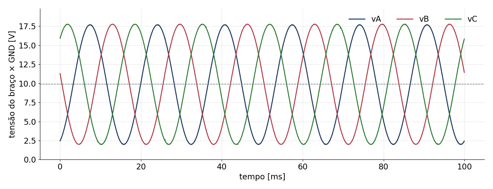{fig-align="center" width="100%"}

- Média de 9,9 V ≈ V~dc~/2 e pico de 7,86 V: cada braço vai de 2 a 17,8 V.
- O ADC vê a tensão **depois do filtro de 1 kHz**: a média de cada período de PWM, não os pulsos
  de 0 a 20 V (esses só no osciloscópio, no borne).

## Tensões de linha

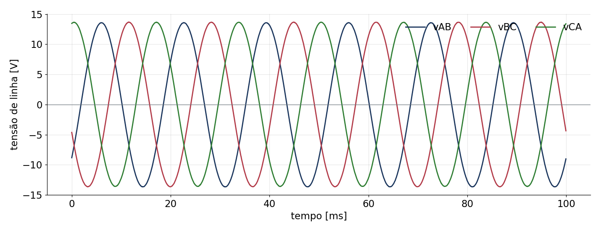{fig-align="center" width="100%"}

- $v_{AB} = v_A - v_B$: o nível de 9,9 V se cancela. Pico de 13,6 V ($\sqrt{3}$ vezes o pico da
  tensão de fase).

## Correntes das três fases

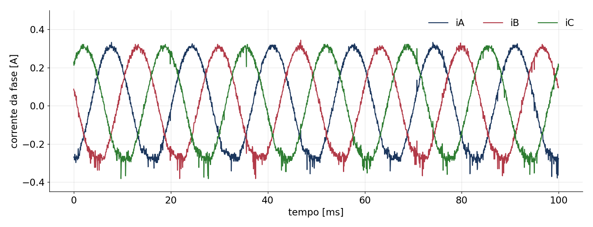{fig-align="center" width="100%"}

- Três senoides de 60 Hz, defasadas de 120,1° e 239,7°; média de 5 mA em cada fase.
- Semiciclo negativo achatado e com ruído: ver adiante.

## Fase A: tensão na carga e corrente

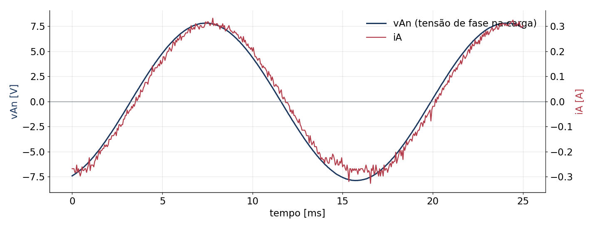{fig-align="center" width="100%"}

- Sem acesso ao neutro, a tensão de fase vem das três medidas:
  $v_{An} = v_A - \tfrac{1}{3}(v_A + v_B + v_C)$.
- Eixos na escala $v/R$: a corrente quase acompanha a tensão; o indutor a atrasa poucos graus.

## Medido × esperado {.smaller}

Modelo por fase: $\hat I = \hat V/|Z|$, com $|Z| = \sqrt{R^2 + (\omega L)^2} = 25{,}28$ Ω e
atraso $\arctan(\omega L/R)$.

| Grandeza | Esperado | Medido |
|---|---|---|
| Pico da tensão de fase (0,4 V~dc~) | 7,93 V | 7,85 a 7,87 V |
| Pico da tensão de linha | 13,74 V | 13,61 V |
| Pico da corrente | 0,314 A | 0,30 A (ajuste); picos positivos de 0,31 a 0,32 A |
| Atraso da corrente | 8,6° | 5,6° a 6,1° (tensão filtrada; ver ensaio 2) |
| Defasagem entre fases | 120° e 240° | 120,0° e 240,0° (v); 120,1° e 239,7° (i) |
| Neutro da carga, $\tfrac{1}{3}(v_A+v_B+v_C)$ | V~dc~/2 = 9,92 V | 9,89 V (0,24 V pico a pico) |
| $i_A + i_B + i_C$ | 0 | média de 14 mA, 30 mA rms |

: {tbl-colwidths="[38,22,40]"}

O filtro de 1 kHz atrasa a tensão medida: 3,4° nominais, 2,8° medidos no ensaio 2.

## Plano αβ (transformada de Clarke)

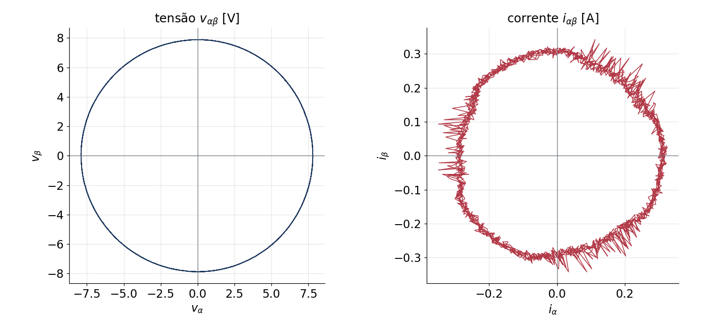{fig-align="center" width="92%"}

$v_\alpha = \tfrac{1}{3}(2v_A - v_B - v_C)$, $v_\beta = \tfrac{1}{\sqrt{3}}(v_B - v_C)$ (o mesmo para $i$):
um sistema trifásico equilibrado vira **um círculo** de raio igual ao pico da fase. A tensão
fecha um círculo limpo de 7,9 V; a corrente, de 0,30 A, com o ruído concentrado em alguns setores.

## Ajuste de 60 Hz e o semiciclo negativo

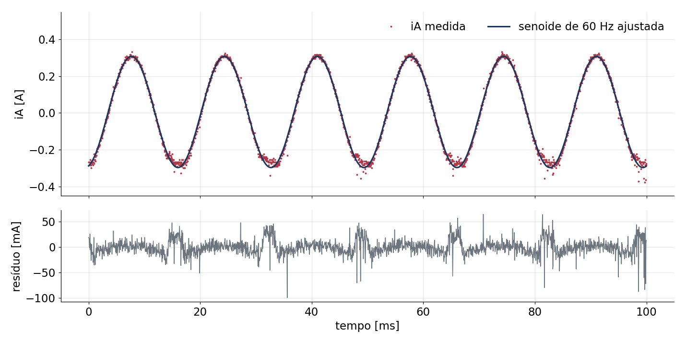{fig-align="center" width="92%"}

- Resíduo de 15 mA rms (duas contagens do ADC de 7,3 mA), maior nos semiciclos negativos.

## Por que o semiciclo negativo?

- No pico negativo de $i_A$, a razão cíclica da fase A é a mínima (0,1): o pulso da chave de
  cima dura só 5 µs, centrado no zero do contador, e as bordas ficam a ±2,5 µs dele.
- A corrente é convertida depois da tensão, de 1 a 2 µs após o zero: **perto de uma borda**,
  quando a saída do INA240 ainda se recupera do degrau de 20 V de modo comum.
- A mesma coisa acontece em cada fase no seu semiciclo negativo (setores ruidosos no plano αβ).

**Hipótese a confirmar** no ensaio 2: amostrar também no topo do contador (meio do pulso da
chave de baixo).

## Ensaio 2: o que passou a ser gravado

| Vetor | O que é |
|---|---|
| `correnteTopoA/B/C` | corrente também no topo do contador (meio do pulso de baixo) |
| `razaoA/B/C` | razão cíclica aplicada: tensão média do braço = d·V~dc~, **sem filtro** |
| `barramento` | V~dc~ a cada amostra (19,85 V, 0,15 V pico a pico) |

: {tbl-colwidths="[28,72]"}

Arquivos `Dados02.csv` e `Dados02RB.csv`; mesma carga, mesmo comando.

## Corrente no zero × no topo

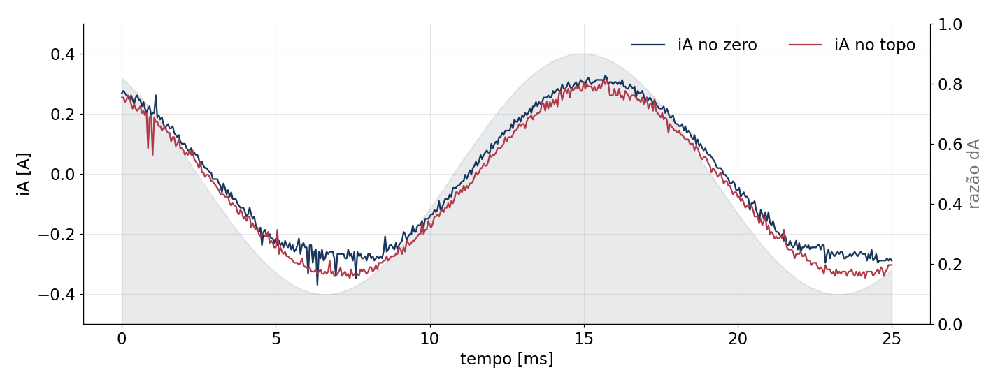{fig-align="center" width="100%"}

- No zero: ruim quando d é pequeno (pulso de cima curto). No topo: o contrário.
- O topo lê ≈ 30 mA abaixo em todas as fases: desvio de zero próprio.

## Hipótese confirmada

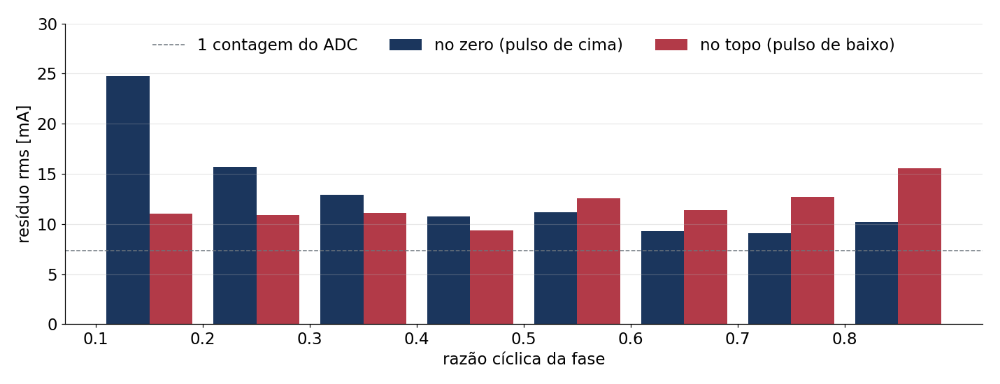{fig-align="center" width="100%"}

- Cada amostra piora perto da borda do seu pulso: zero com d = 0,1 (25 mA), topo com d = 0,8 (16 mA).
- Regra: **zero se d ≥ 0,5, topo se d < 0,5** (amostra sempre a ≥ 12,5 µs de uma borda).

## Corrente combinada

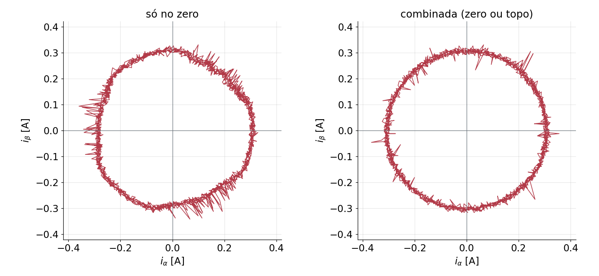{fig-align="center" width="85%"}

Resíduo de 15,5 → 10 mA; $i_A+i_B+i_C$ de 31 → 20 mA rms.

## Tensão: medida × razão

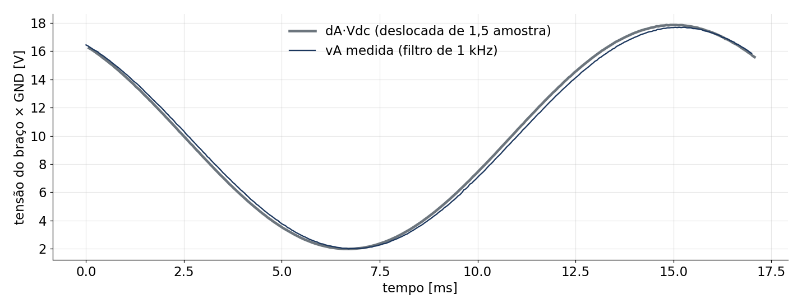{fig-align="center" width="100%"}

- A medida atrasa 2,8° e é 1 % menor que d·V~dc~ (filtro da placa, corte ≈ 1,2 kHz).
- Para modelar, a entrada é **d·V~dc~**, com atraso de 1,5 amostra.

## Ensaio 1 × ensaio 2

| | Ensaio 1 | Ensaio 2 | Esperado |
|---|---|---|---|
| Tensão usada | medida (filtrada) | d·V~dc~ | — |
| Corrente usada | zero | combinada | — |
| Pico da corrente | 0,30 A | 0,30 a 0,31 A | 0,314 A |
| Atraso da corrente | 5,9° | 8,5° a 9,0° | 8,6° |
| Resíduo do ajuste | 15 mA | 10 mA | ≈ 1 contagem (7,3 mA) |
| $i_A+i_B+i_C$ (rms) | 30 mA | 20 mA | 0 |

: {tbl-colwidths="[30,22,24,24]"}

O atraso "pequeno" do ensaio 1 era o filtro das tensões, não a carga.

## Em dq

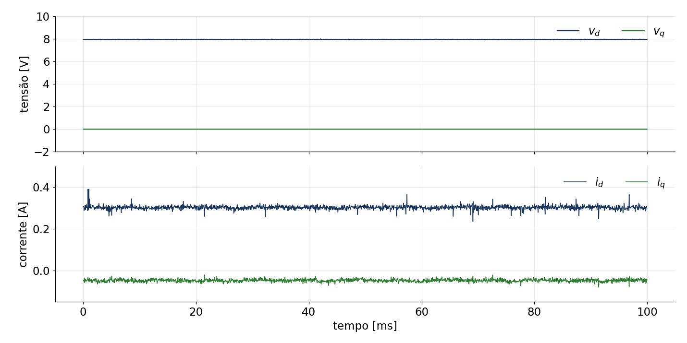{fig-align="center" width="92%"}

- i~d~ = 0,303 A e i~q~ = −0,047 A (modelo: 0,311 e −0,047 A).
- Tudo constante: senoide pura **não excita** um ARX em dq; para identificar, falta PRBS em v~d~ e v~q~.

## Conclusões

- Malha aberta confere com o modelo RL (|Z|, atraso de 8,6°, 120° entre fases).
- Para identificação e controle:
  - entrada = d·V~dc~ (gravada), não a tensão filtrada;
  - corrente = zero se d ≥ 0,5, topo se d < 0,5, com o desvio do topo descontado;
  - atraso de 1,5 amostra entre a razão escrita e a tensão aplicada.
- Próximo passo: excitação PRBS em dq.

Figuras: `analise/figuras.py` (ensaio 1) e `analise/figuras_ensaio2.py` (ensaio 2).
