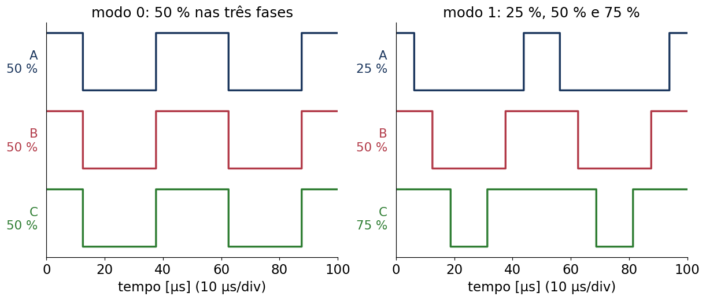
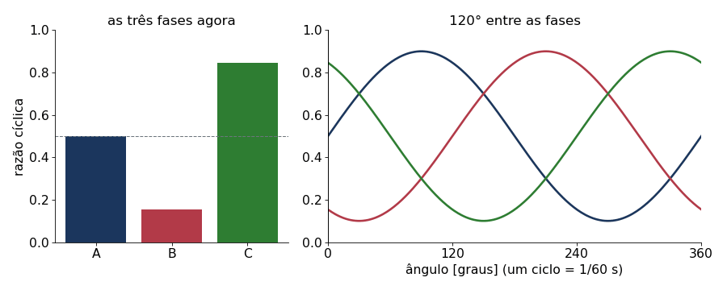
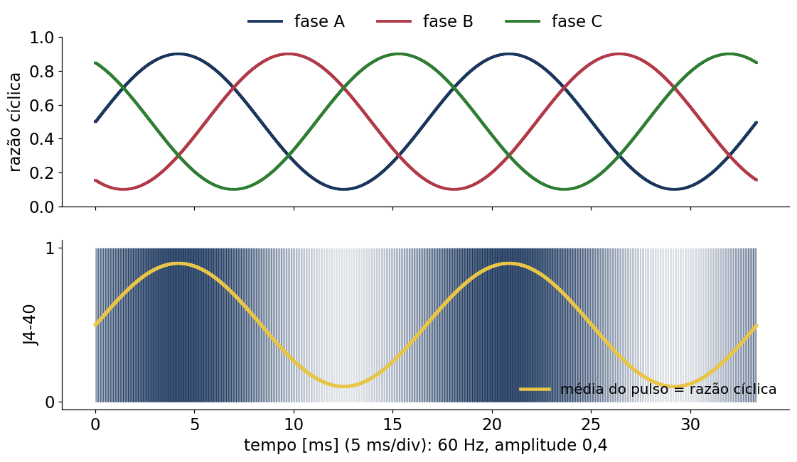
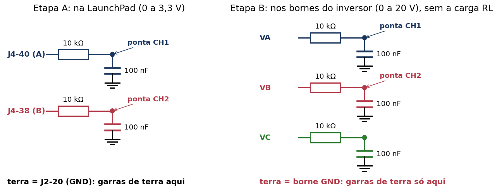
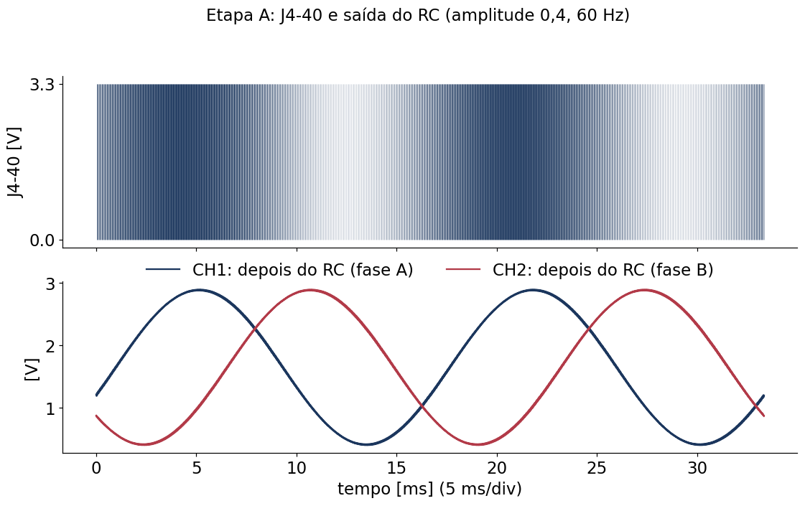
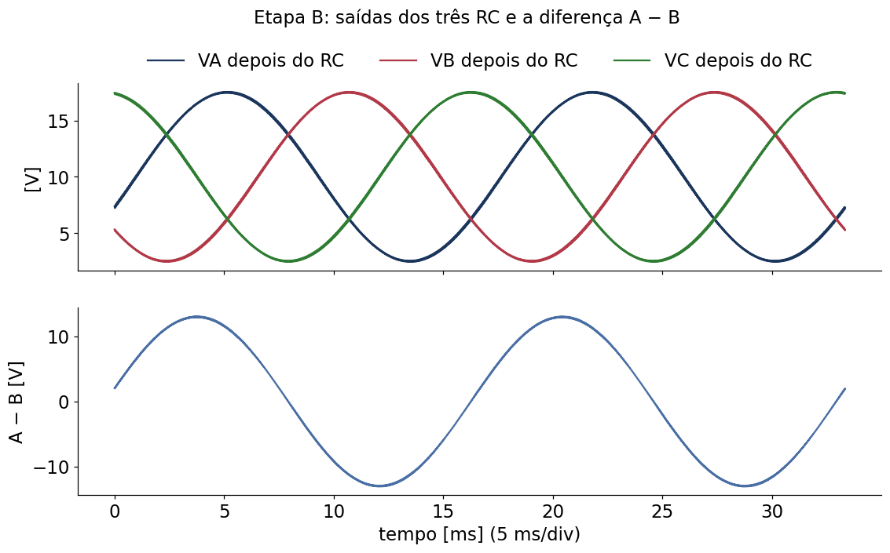
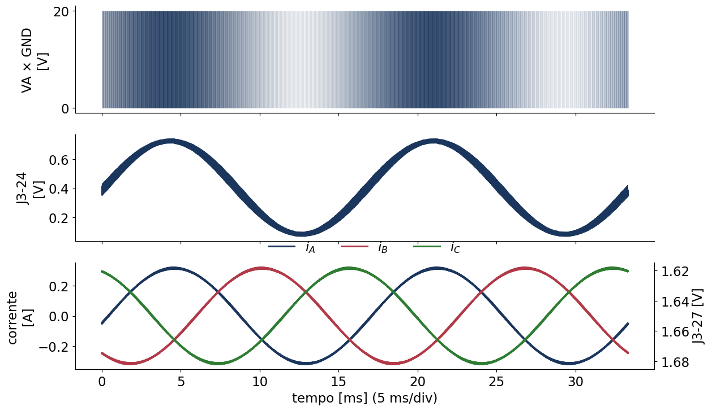

## O que vamos fazer

::: {style="font-size:0.88em"}
- Gravar um programa que liga e desliga as chaves do inversor (PWM), **sem controle**: as medidas
  não voltam para o cálculo, por isso o nome *malha aberta*;
- Ver os sinais no osciloscópio e medir tensões e correntes pela própria placa, em duas etapas:

| Etapa | Montagem | O que se mede |
|---|---|---|
| A | só a LaunchPad, ligada na USB | os sinais de comando (0 a 3,3 V) |
| B | LaunchPad + inversor + fonte de 20 V + carga RL | tensões das fases e correntes |

**Material**: as duas placas, cabo USB, osciloscópio de dois canais, fonte CC com limite de
corrente, carga RL trifásica (25 Ω e 10 mH por fase), fita Kapton.

**Antes**: a apresentação [Bancada do Inversor Trifásico](../../../00Bancada/apresentacoes/BancadaInversor/index.html)
explica o braço, a razão cíclica, o PWM e o tempo morto, a montagem das placas, os pinos, a
ordem de ligação e o cuidado com o terra do osciloscópio.
:::

## Os quatro modos de teste

| `modo` | Razão cíclica | Para que serve |
|---|---|---|
| 0 | 50 % nas três fases | primeiro teste: as três fases iguais, nenhuma tensão na carga |
| 1 | 25 % em A, 50 % em B, 75 % em C | reconhecer qual fio é qual fase |
| 2 | senoide de 60 Hz, 120° entre as fases | ver o inversor gerando corrente alternada |
| 3 | manual: `razaoManual` (A, B, C) | escolher a razão cíclica de cada fase |

No modo 2, para cada fase,

$$
d = 0{,}5 + \text{amplitude} \cdot \sin(\theta - \text{defasagem}), \quad
\text{defasagem} = 0^\circ,\ 120^\circ,\ 240^\circ
$$

com `amplitude` = 0,4 no início (razão de 0,1 a 0,9; fase com $0{,}4\,V_{dc}$ = 8 V de pico).

## Modos 0 e 1 no osciloscópio

{width="90%" fig-align="center"}

- Modo 0: as três fases idênticas;
- Modo 1: a largura do pulso identifica a fase (estreito = A, médio = B, largo = C);
- Os pulsos ficam centrados nos instantes em que o contador vale zero.

## Modo 2: as razões cíclicas giram

{width="88%" fig-align="center"}

As três razões cíclicas oscilam em torno de 50 %, deslocadas de um terço de ciclo (120°). Um
ciclo completo dura 1/60 s ≈ 16,7 ms.

## Modo 2 no osciloscópio

{width="82%" fig-align="center"}

Em 5 ms/div os pulsos de 50 µs ficam muito juntos; o que se vê é uma faixa mais escura (pulsos
largos) e mais clara (pulsos estreitos), repetindo a cada 16,7 ms.

## No Code Composer Studio

1. *File → Open Folder*: a pasta `InversorTrifasico` (o *workspace*, com `.theia/`) ou a pasta
   descompactada do `.zip`;
2. Selecionar o projeto `VSI01MalhaAberta` e compilar (martelo, *Build*);
3. Ligar a LaunchPad na USB e iniciar a depuração (inseto, *Debug*): o programa é gravado e fica
   parado no início do `main`;
4. Na janela **Watch**, acrescentar as variáveis do próximo slide;
5. *Resume* (▶): o PWM começa. Para mudar um valor: pausar (‖), digitar e continuar.

O código, parte por parte: [O Código do Inversor em Malha Aberta](../CodigoMalhaAberta/index.html).

## Variáveis da Watch

::: {style="font-size:0.85em"}
| Variável | Valores | Efeito ou o que mostra |
|---|---|---|
| `modo` | 0 a 3 | escolhe o teste |
| `habilita` | 0 ou 1 | 1 liga o inversor (só na etapa B) |
| `amplitude`, `frequencia` | 0 a 0,45; Hz | senoide do modo 2 |
| `razaoManual` | 0,05 a 0,95 (três valores) | razões das fases A, B, C no modo 3 |
| `grava` | 1 | grava 2000 amostras; vale 2 gravando e 0 no fim |
| `razaoAplicada` | — | razões de fato aplicadas (limitadas a 5–95 %) |
| `tensaoAgora`, `correnteAgora` | — | última amostra de vA, vB, vC [V] e iA, iB, iC [A] |
| `tensaoBarramento`, `offsetCorrente` | — | V~dc~ [V]; zero dos sensores de corrente [contagens] |

: {tbl-colwidths="[28,22,50]"}
:::

## Etapa A: só a LaunchPad

Pontas nos pinos de J4 (mapa no slide *Os pinos na placa* da Bancada), terra em J2-20, 1 V/div:

1. `modo` = 0, J4-40 (A, cima) e J4-39 (A, baixo) em 10 µs/div: 20 kHz, 50 %, um o inverso do outro;
2. Zoom numa borda (50 ns/div): os dois em 0 durante ≈ 100 ns, nunca os dois em 1;
3. `modo` = 1: J4-40, J4-38 e J4-36 com 25 %, 50 % e 75 % (troque a ponta de pino);
4. `modo` = 2, 5 ms/div: a largura do pulso varia como senoide; mudar `amplitude` (0,1 e 0,45) e
   `frequencia` (30 Hz e 60 Hz) e ver a diferença;
5. Pausar o programa: todas as saídas vão para 0.

Sem o inversor (etapa A), os pinos do ADC ficam soltos: `tensaoAgora` e `correnteAgora` não têm sentido.

## Ver a senoide: um filtro RC

O osciloscópio mostra pulsos; a senoide está na **média** deles. Um filtro passa-baixas de
primeira ordem faz essa média:

| Componente | Valor | Por quê |
|---|---|---|
| Resistor | 10 kΩ, 1/4 W | limita a corrente: 0,33 mA na LaunchPad, 2 mA no inversor (20 V) |
| Capacitor | 100 nF, 50 V (cerâmico ou poliéster) | com 10 kΩ, frequência de corte de 159 Hz |

| Frequência | O que acontece no filtro |
|---|---|
| 60 Hz (a senoide) | passa 94 %, com atraso de 21° (≈ 1 ms) |
| 20 kHz (o PWM) | cai 126 vezes: sobra uma ondulação pequena |

## Ligação do filtro

{width="92%" fig-align="center"}

- Um RC por canal; a ponta vai no **ponto entre o resistor e o capacitor**;
- O resistor fica **sempre** entre o pino e o capacitor: ele protege o pino (sem ele, o capacitor
  descarregado seria um curto a cada pulso);
- Monte numa protoboard e ligue à placa com jumpers fêmea-macho.

## Etapa A com o filtro RC

{width="72%" fig-align="center"}

`modo` = 2, `amplitude` = 0,4, 60 Hz, 0,5 V/div e 5 ms/div: senoide de **1,65 ± 1,25 V** (de 0,40
a 2,89 V), com 120° (5,6 ms) entre A e B. No modo 1, o filtro mostra só tensões constantes: 0,83,
1,65 e 2,48 V.

## Etapa B sem carga

Ligar a bancada como no slide *Ligar e desligar a bancada* (Bancada), **sem carga**, `modo` = 0.
Ponta em VA, terra **só no GND**, 10 µs/div e 5 V/div:

| Modo | VA | VB | VC |
|---|---|---|---|
| 0 | 0 ↔ 20 V, 50 % | igual a VA | igual a VA |
| 1 | 0 ↔ 20 V, 25 % | 50 % | 75 % |
| 2 | largura variando a 60 Hz | 120° depois | 240° depois |

Com `habilita` = 0, as chaves ficam desligadas e o borne fica solto: o osciloscópio não mostra os
pulsos.

## Etapa B com o filtro RC

{width="66%" fig-align="center"}

Um RC em cada borne (VA, VB, VC), no lugar da carga RL; capacitores de **50 V**. Com 20 V, `modo` = 2
e `amplitude` = 0,4: cada fase com **10 ± 7,5 V**; a diferença A − B com **13 V de pico**, √3 vezes a
amplitude de uma fase. A fonte quase não fornece corrente: um bom teste antes da carga RL.

## Etapa B com carga: modos 0 e 1

Desligar a fonte, ligar a carga RL nos bornes VA, VB, VC e religar (limite em 0,5 A).

- **Modo 0**: as três fases iguais o tempo todo, sem tensão entre elas: corrente nula;
- **Modo 1**: médias de 5, 10 e 15 V; o centro da estrela fica em 10 V, então as fases ficam com
  −5, 0 e +5 V:

$$
i_A = \frac{-5}{25} = -0{,}2\ \text{A}, \qquad i_B = 0, \qquad i_C = +0{,}2\ \text{A}
$$

São correntes **contínuas** (a indutância não atua): 1 W em cada resistor de A e C, a fonte fornece
≈ 0,1 A. Confere o sinal: $v_A < 0 \Rightarrow i_A < 0$.

## Etapa B com carga: modo 2

{width="70%" fig-align="center"}

[Simulação (`analise/figuras.py`): 20 V, amplitude 0,4, 60 Hz.]{style="font-size:0.6em"}

Tensão de fase com 8 V de pico, corrente com **0,32 A de pico** e 60 Hz, atrasada de 8,6° da tensão
(|Z| = 25,3 Ω); a fonte fornece ≈ 0,19 A.

## Medir a corrente sem ponta de corrente

O inversor entrega os sinais medidos nos pinos de J3 (acessíveis pela face de cima do inversor):

| Pino | Sinal | Conversão |
|---|---|---|
| J3-27 | corrente da fase A | [$v = 1{,}65 - 0{,}1\, i_A$]{style="text-transform:none"} (V, A) |
| J3-24 | tensão de VA, filtrada | [$v = V_A / 24{,}7$]{style="text-transform:none"} (filtro de 1 kHz) |

- O sinal de J3-27 é **invertido**: corrente positiva faz a tensão cair;
- Modo 2 com amplitude 0,4: J3-27 oscila entre 1,62 e 1,68 V; J3-24 entre 0,07 e 0,74 V (a média
  dos pulsos aparece como senoide). Na Watch, `correnteAgora` e `tensaoAgora` já estão em A e V.

## Gravar as medidas

1. Inversor ligado, modo escolhido: **`grava` = 1** na Watch e *Resume*;
2. Esperar `grava` voltar a 0 (2000 amostras de 50 µs = 100 ms, seis ciclos de 60 Hz) e pausar;
3. Para ver: *Graph → Time*, expressão `correnteA` (ou `tensaoA`, `razaoA`...), float de 32 bits,
   2000 amostras, 20000 Hz;
4. Para levar ao computador: *Graph* → exportar em CSV, ou janela **Memory** → *Save Memory* a partir
   de `0xC000`, `0x6000` palavras (tensões e correntes), formato *TI Data* ou binário;
5. `python3 plota_medidas.py arquivo.dat` (em `EnsaioMalhaAberta/analise/`): figura e CSV com
   `t_ms, vA, vB, vC, iA, iB, iC`. Os ensaios feitos estão na apresentação
   [Ensaio em Malha Aberta](../EnsaioMalhaAberta/index.html).

## Valores esperados (20 V, 25 Ω e 10 mH)

| Ensaio | Corrente de pico | J3-27 | Corrente da fonte |
|---|---|---|---|
| Modo 0 | 0 | 1,65 V | ≈ 0 |
| Modo 1 | −0,20 A em A, +0,20 A em C (contínuas) | 1,67 V | 0,10 A |
| Modo 2, amplitude 0,25 | 0,20 A | 1,63 a 1,67 V | 0,07 A |
| Modo 2, amplitude 0,4 | 0,32 A | 1,62 a 1,68 V | 0,19 A |

Se a fonte entrar em limitação de corrente com valores bem menores que 0,5 A, desligue e confira
a montagem.

## Se algo não funcionar

::: {style="font-size:0.85em"}
| Sintoma | Verificar |
|---|---|
| Nenhum pulso em J4 | o programa está rodando (*Resume*)? a ponta está no pino certo? |
| Pulsos em J4, nada em VA | `habilita` = 1? fonte ligada? (o inversor só funciona com ela) |
| LEDs 5V/3V3 apagados | fonte desligada ou invertida |
| Fonte limita a corrente | carga em curto, modo errado, amplitude alta demais |
| Saídas vão a 0 sozinhas | o programa foi pausado (proteção) |
| JTAG Communication Error (−1044) | encerrar, tirar USB e fonte, religar USB, depois fonte; J6 retirado? |
| Corrente da fase C estranha | LaunchPad rev. 1.1: J3-29 em curto com a referência do ADC |
:::

## Próximo passo

- Com o chaveamento e as medidas conferidos, a etapa 02 aplica tensões em dq com PRBS para
  identificar o modelo da carga (`VSI02IdentificacaoARX`); depois vêm o controle de corrente PI
  (etapa 03) e o preditivo FCS-MPC (etapa 04).
