## O ensaio

| Item | Valor |
|---|---|
| Carga | RL em estrela, neutro isolado: R = 25 Ω, L = 10 mH (nominais); V~dc~ ≈ 20 V |
| Excitação | v~d~ = 5 ± 3 V, v~q~ = 0 ± 3 V; PRBS de 9 bits nos dois eixos, bit de 200 µs |
| Média síncrona | 1 período descartado + **16 períodos** da PRBS (1,7 s); i~d~, i~q~ = média |
| Registro | `Dados3F` (8 × 2044): v~d~, v~q~, i~d~, i~q~, iA, iB, iC, ângulo; `Dados01A.csv` |

: {tbl-colwidths="[22,78]"}

## O modelo a identificar

::: {style="font-size:0.95em"}
Carga RL em estrela levada a dq (Park com θ = ωt) e discretizada com segurador de ordem zero
($T_s$ = 50 µs); a dedução está na apresentação
[Bancada do Inversor Trifásico](../../../00Bancada/apresentacoes/BancadaInversor/index.html)
(slides *Modelo em dq*, *Modelo discreto* e *Por que 2 amostras de atraso?*):

$$
i(k+1) = \begin{bmatrix} a & c \\ -c & a \end{bmatrix} i(k) + \begin{bmatrix} b & e \\ -e & b \end{bmatrix} v(k),
\qquad a = 0{,}8823,\; c = 0{,}0166,\; b = 0{,}0047,\; e \approx 0{,}00004
$$

Com o atraso do PWM (a razão calculada em *k* vale no período seguinte), a estrutura MIMO a
identificar é

$$
\begin{aligned}
i_d(k) &= a\,i_d(k-1) + b\,v_d(k-2) + c\,i_q(k-1)\\
i_q(k) &= a\,i_q(k-1) + b\,v_q(k-2) - c\,i_d(k-1)
\end{aligned}
$$

- Os termos ±c vêm do acoplamento ωL = 3,8 Ω; sem eles, d e q seriam dois RL independentes.
:::

## No firmware: tensões em dq com PRBS

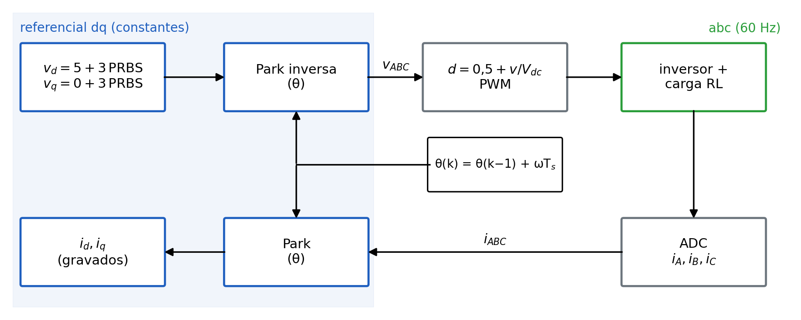{fig-align="center" width="86%"}

- O firmware cria o referencial dq com θ de 60 Hz, perturba v~d~ e v~q~ e mede i~d~, i~q~ com o mesmo θ (Park).

## Tensões dq constantes: senoides em abc

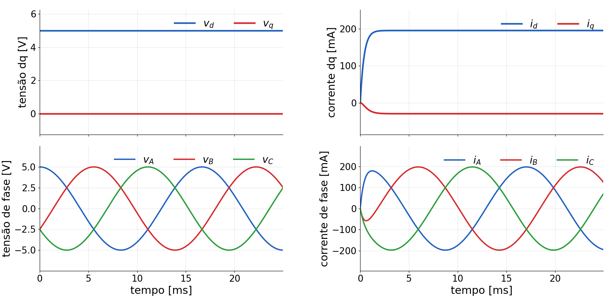{fig-align="center" width="98%"}

## O registro completo

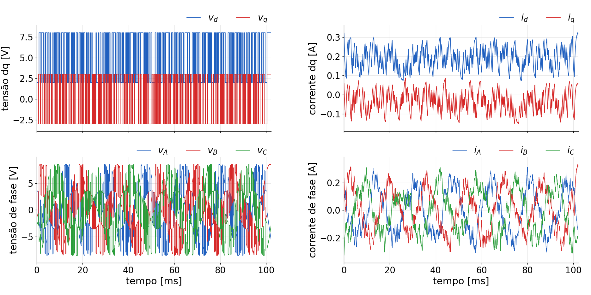{fig-align="center" width="100%"}

## Os dados

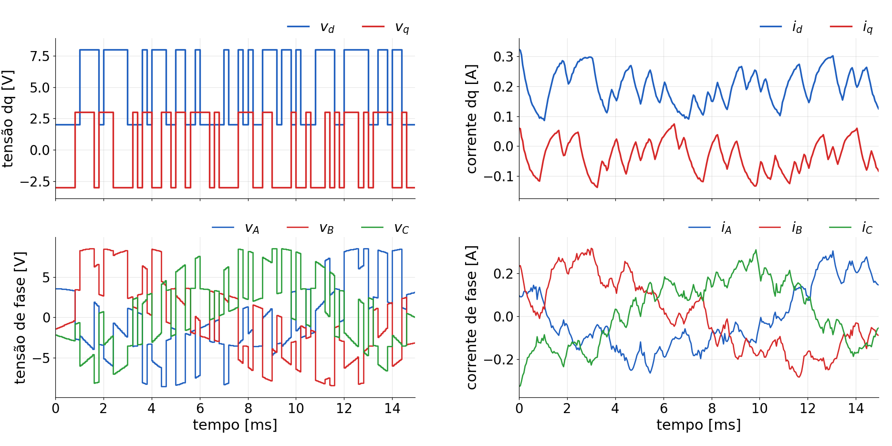{fig-align="center" width="96%"}

## O efeito da média

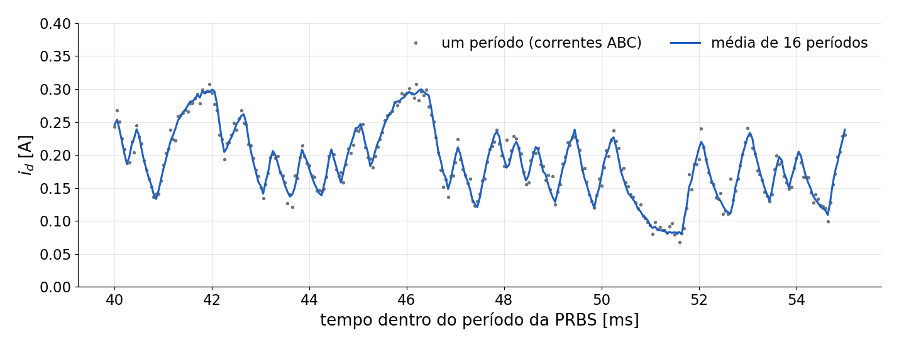{fig-align="center" width="100%"}

- Um período: ≈ 9 mA de ruído em torno da média. A média de 16 períodos o reduz a ≈ 2 mA.

## Autocorrelação e correlação cruzada

::: {style="font-size:0.92em"}
- Autocorrelação: quanto o sinal se parece com ele mesmo deslocado de τ amostras.
- Correlação cruzada: quanto a saída em *k*+τ "lembra" a entrada em *k*.

$$
R_{vv}(\tau) = \frac{1}{N}\sum_k v(k)\,v(k+\tau)
\qquad\qquad
R_{vi}(\tau) = \frac{1}{N}\sum_k v(k)\,i(k+\tau)
$$

Como a corrente é a convolução da tensão com a resposta ao impulso $h$:

$$
i(k) = \sum_{j\ge 0} h(j)\,v(k-j) + \text{ruído}
\quad\Rightarrow\quad
R_{vi}(\tau) = \sum_{j} h(j)\,R_{vv}(\tau-j)
$$

Se a entrada é **ruído branco** (só se parece consigo em τ = 0): $R_{vv}(\tau) = \sigma^2\delta(\tau)$ e $\;h(\tau) = R_{vi}(\tau)/\sigma^2$.

- A resposta ao impulso sai da correlação, sem aplicar um impulso.
:::

## Ruído branco × PRBS

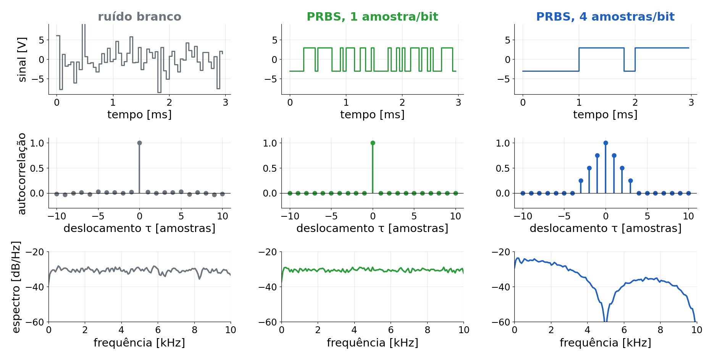{fig-align="center" width="100%"}

## Por que 4 amostras por bit?

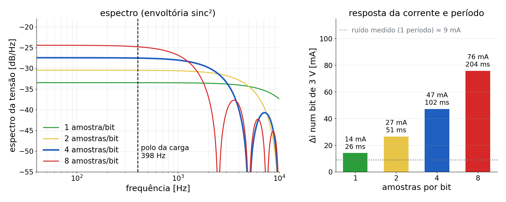{fig-align="center" width="96%"}

- Mesma potência, mais concentrada abaixo de 5 kHz, onde a carga responde (polo em 398 Hz).
- Um bit de 4 amostras move a corrente 47 mA (≈ 6 contagens do ADC), bem acima do ruído; período de 102 ms.

## Correlação × mínimos quadrados

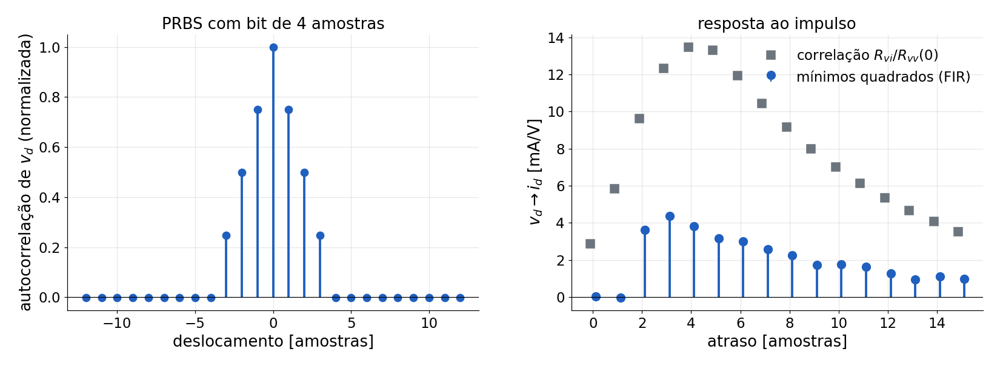{fig-align="center" width="100%"}

- Entrada branca: a correlação já é $h$. Com 4 amostras/bit: $R_{vi} = h \ast R_{vv}$ (triângulo de área 4) → borrado e ≈ 4× maior.
- Mínimos quadrados desfazem essa convolução e recuperam $h$ dos mesmos dados.

## Quantas amostras de atraso?

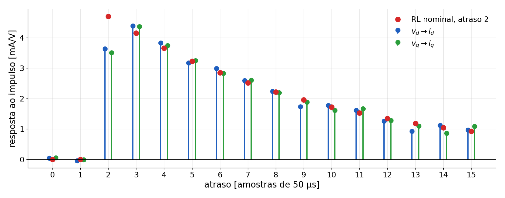{fig-align="center" width="100%"}

- Estimada dos dados (PRBS ≈ ruído branco): atraso de 2 amostras + fração; parte da resposta passa de 2 para 3.

## Modelo ARX e estimação

ARX: a saída atual é combinação linear de saídas e entradas passadas, mais um erro.

$$
i_d(k) = a\,i_d(k-1) + b_1 v_d(k-2) + b_2 v_d(k-3) + \varepsilon(k)
\;\;\Rightarrow\;\;
y(k) = \varphi^\top(k)\,\theta + \varepsilon(k)
$$

Empilhando as *N* amostras: $\;Y = \Phi\,\theta + \varepsilon$.

- **Mínimos quadrados** (LS, *least squares*): $\hat\theta = (\Phi^\top\Phi)^{-1}\Phi^\top Y$.
- O ruído da corrente medida entra em $\Phi$ e puxa o polo (viés); com a média de 16 períodos ele é pequeno.
- Para ruído maior: **variável instrumental** (IV), $\hat\theta = (Z^\top\Phi)^{-1}Z^\top Y$, com a corrente simulada em $Z$ (ver a simulação).

## Estruturas testadas

::: {style="font-size:1.2em"}
| Nome | Regressores de [i~d~(k)]{style="text-transform:none"} | Parâm. |
|---|---|---|
| SISO 1,1,*nk* | i~d~(k−1), v~d~(k−*nk*), *nk* = 1, 2, 3 | 2 |
| SISO 1,2,2 | i~d~(k−1), v~d~(k−2), v~d~(k−3) | 3 |
| SISO 2,2,2 | i~d~(k−1), i~d~(k−2), v~d~(k−2), v~d~(k−3) | 4 |
| MIMO 1,1,*nk* | SISO 1,1,*nk* + i~q~(k−1) + v~q~(k−*nk*), *nk* = 2, 3 | 4 |
| MIMO 1,2,2 | SISO 1,2,2 + i~q~(k−1) + v~q~(k−2), v~q~(k−3) | 6 |
| MIMO 1,2,2 sem e | SISO 1,2,2 + i~q~(k−1) | 4 |

: {tbl-colwidths="[27,60,13]"}
:::

- Eixo q: troca-se d por q. Estima numa metade, valida (simulação livre) na outra.

## FIT na validação

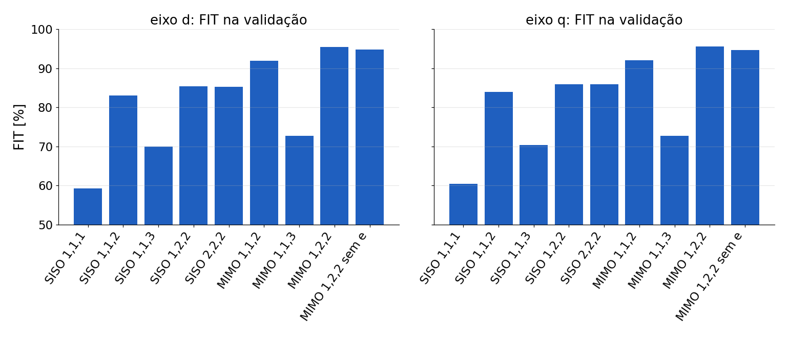{fig-align="center" width="92%"}

- $\text{FIT} = 100\,(1 - \text{NRMSE}) = 100\,\big(1 - \lVert y - \hat y\rVert / \lVert y - \bar y\rVert\big)\ \%$\
  `% função compare do MATLAB`
- Atraso 2 com dois coeficientes de entrada; o eixo vizinho leva de 86 % para 96 %.

## Resumo: o que cada termo acrescenta

::: {style="font-size:1.3em"}
| Estrutura | Entrada | Eixo vizinho | FIT | R [\[Ω\]]{style="text-transform:none"} | L [\[mH\]]{style="text-transform:none"} |
|---|---|---|---|---|---|
| SISO 1,1,2 | atraso 2 | — | 84 % | 24,0 | 10,9 |
| SISO 1,2,2 | atraso 2 + fração | — | 86 % | 26,2 | 9,9 |
| MIMO 1,1,2 | atraso 2 | sim | 92 % | 24,0 | 10,9 |
| [MIMO 1,2,2]{style="color:#B23A48"} | [atraso 2 + fração]{style="color:#B23A48"} | [sim]{style="color:#B23A48"} | [96 %]{style="color:#B23A48"} | [26,2]{style="color:#B23A48"} | [9,8]{style="color:#B23A48"} |
| RL nominal | | | | 25 | 10 |

: {tbl-colwidths="[22,26,18,10,12,12]"}
:::

- Média dos eixos d e q. R = 1/ganho estático, L = −R·T~s~/ln(polo).
- Atraso 1 ou 3: FIT de 60–73 % e R de 18–36 Ω, sem sentido físico.

## O modelo escolhido: MIMO 1,2,2

:::: {.columns}
::: {.column width="57%"}
:::: {style="font-size:0.88em"}
 

$$
\begin{aligned}
i_d(k) = {}& 0{,}8740\,i_d(k-1) + 0{,}0170\,i_q(k-1)\\
&+ 0{,}00359\,v_d(k-2) + 0{,}00121\,v_d(k-3)\\
&+ 0{,}00013\,v_q(k-2) + 0{,}00007\,v_q(k-3)
\end{aligned}
$$

   

$$
\begin{aligned}
i_q(k) = {}& 0{,}8760\,i_q(k-1) - 0{,}0158\,i_d(k-1)\\
&+ 0{,}00354\,v_q(k-2) + 0{,}00118\,v_q(k-3)\\
&- 0{,}00012\,v_d(k-2) - 0{,}00010\,v_d(k-3)
\end{aligned}
$$
::::
:::
::: {.column width="43%"}
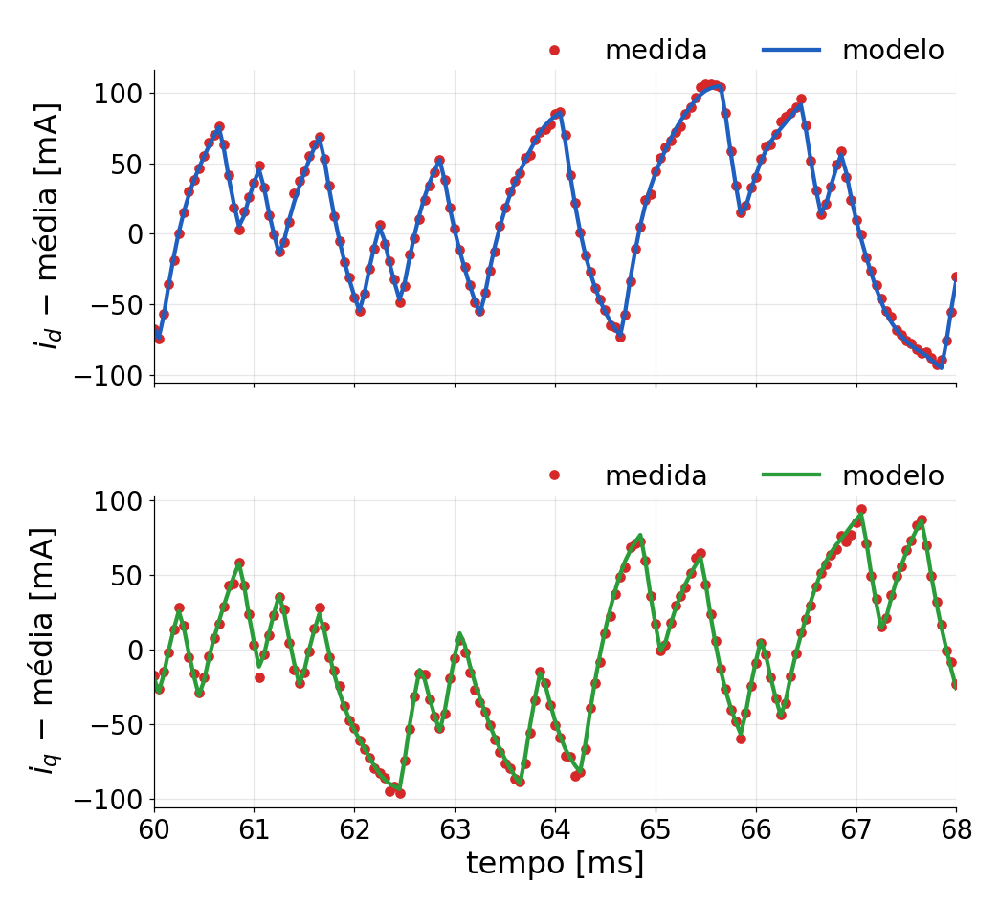{width="100%"}
:::
::::

## Como função de transferência: SISO 1,2,2

$$
G_d(z) = \frac{0{,}00361\,z^{-2} + 0{,}00119\,z^{-3}}{1 - 0{,}8761\,z^{-1}}, \qquad
G_q(z) = \frac{0{,}00353\,z^{-2} + 0{,}00117\,z^{-3}}{1 - 0{,}8755\,z^{-1}}
$$

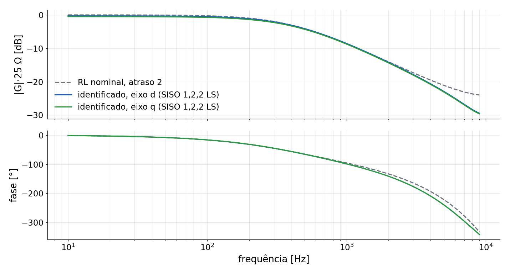{fig-align="center" width="72%"}

- Ignora o acoplamento (FIT de 86 %). Igual ao RL nominal até ≈ 2 kHz.

## Resíduos do modelo escolhido

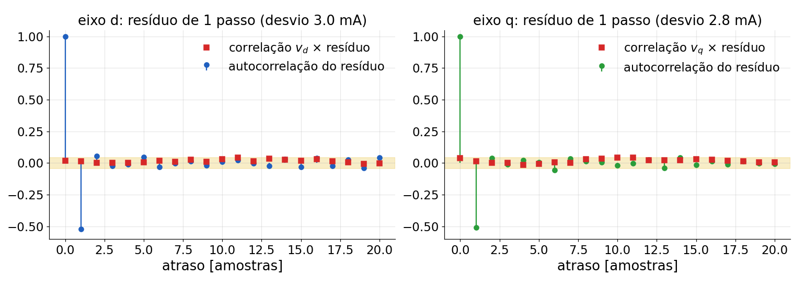{fig-align="center" width="100%"}

- Correlação entrada × resíduo dentro da faixa: a dinâmica e o atraso estão certos.
- Autocorrelação de −0,52 no atraso 1 ≈ −a/(1+a²): o que sobra é ruído **de medida**.

## Modelo físico × identificado

::: {style="font-size:1.2em"}
| | Físico (nominal) | Identificado (MIMO) |
|---|---|---|
| a (d / q) | 0,882 | 0,874 / 0,876 |
| b (soma) | 0,0047 | 0,0048 |
| c (d / q) | +0,0166 / −0,0166 | +0,0170 / −0,0158 |
| Polos | 0,882 ± j0,017 | 0,875 ± j0,016 |
| R / L | 25 Ω / 10 mH | 26,2 Ω / 9,8 mH |
| Atraso | 2 amostras | 2 + fração |

: {tbl-colwidths="[34,33,33]"}
:::

- O acoplamento ωL aparece com o valor e os sinais previstos.

## Malha de corrente (eixo d)

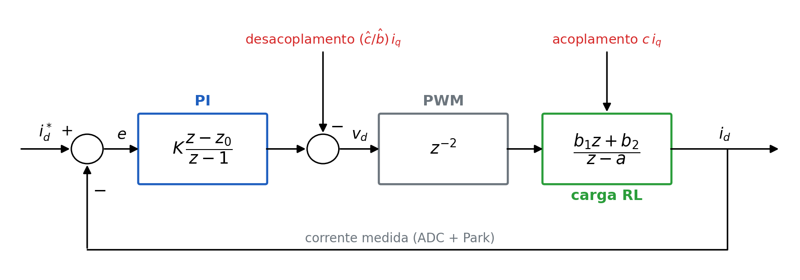{fig-align="center" width="100%"}

- O eixo q é igual, com o acoplamento de sinal oposto. O PI vê só o SISO; o desacoplamento cancela o $c\,i_q$.

## Funções de transferência e o zero do PI

$$
G(z) = \frac{b_1 z + b_2}{z^2\,(z - a)}
\qquad
C(z) = k_p + \frac{k_i T_s\,z}{z-1} = K\,\frac{z - z_0}{z - 1}
$$

com $K = k_p + k_i T_s$ e $z_0 = k_p/K$.

Escolhendo $k_p = 2\pi f_c L$ e $k_i = 2\pi f_c R$:

$$
z_0 = \frac{L}{L + R\,T_s} \approx e^{-R T_s/L} = a
\quad\Rightarrow\quad
C(z)\,G(z) \approx K\,\frac{b_1 z + b_2}{z^2\,(z-1)}
$$

- O zero do PI cancela o polo da carga (0,883 × 0,876): sobra um integrador com atraso.
- Malha fechada: $T(z) = \dfrac{C G}{1 + C G}$; a banda $f_c$ é o único parâmetro de projeto.

## Plano z

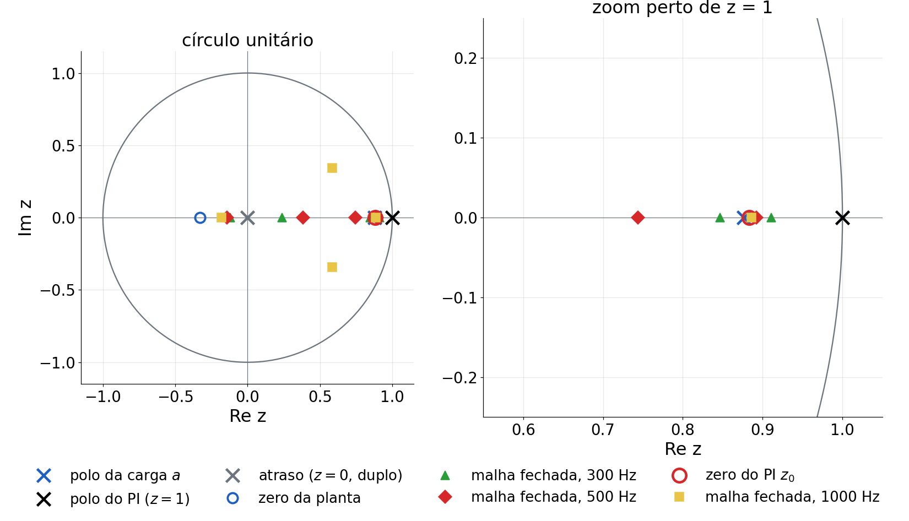{fig-align="center" width="82%"}

- Polo e zero quase sobrepostos em 0,88. Com 1000 Hz, o atraso empurra um par de polos para fora do eixo real (sobressinal).

## PI por eixo: projeto

- Zero do PI sobre o polo da carga: $k_p = 2\pi f_c L$, $k_i = 2\pi f_c R$. A malha aberta vira
  $2\pi f_c/s$ com atraso: margem de fase $= 90° - 360°\,f_c\,t_d$, $t_d \approx 2{,}3\,T_s = 115$ µs.

| [f~c~]{style="text-transform:none"} | [k~p~]{style="text-transform:none"} d / q | [k~i~]{style="text-transform:none"} d / q | Margem de fase | Resposta ao degrau (simulada) |
|---|---|---|---|---|
| 300 Hz | 18,4 / 18,8 | 48 670 / 49 990 | 77° | sem sobressinal, 1,9 ms |
| **500 Hz** | **30,7 / 31,3** | **81 110 / 83 320** | **69°** | **sem sobressinal, 1,0 ms** |
| 1000 Hz | 61,3 / 62,7 | 162 220 / 166 630 | 48° | 8 % de sobressinal, 0,25 ms |

: {tbl-colwidths="[12,18,22,16,32]"}

Ganhos em V/A e V/(A·s); a lei é $v = k_p e + k_i T_s \sum e$.

## Escolha da banda

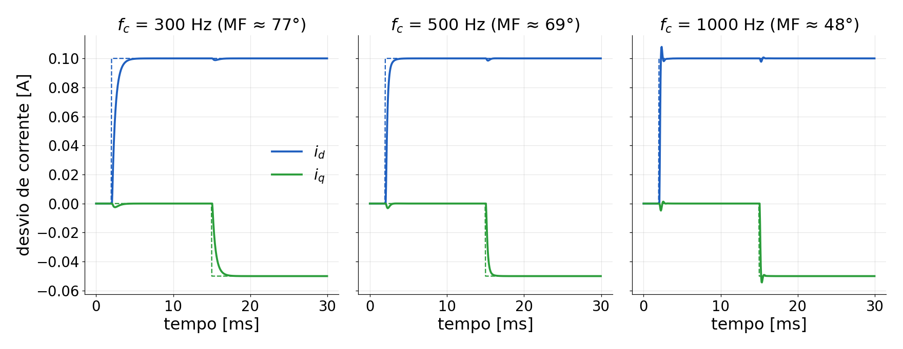{fig-align="center" width="100%"}

- MIMO 1,2,2 identificado, PI por eixo + desacoplamento. Degraus: +100 mA em i~d~ (2 ms), −50 mA em i~q~ (15 ms).
- 500 Hz: rápido e sem sobressinal; 1000 Hz já sente o atraso (MF de 48°).

## PI no sistema MIMO: desacoplamento

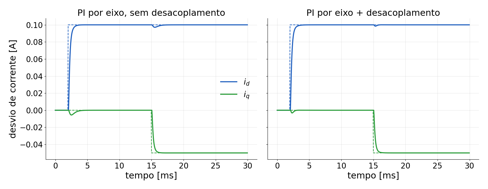{fig-align="center" width="100%"}

- PI por eixo + feedforward do acoplamento: $v_d \mathrel{-}= 3{,}5\,i_q$, $v_q \mathrel{+}= 3{,}4\,i_d$
  (identificado; ωL = 3,7 Ω). Interferência em i~q~ no degrau de i~d~: 5,6 → 3,2 mA; em i~d~ no de i~q~: 2,8 → 1,5 mA.

## Resumo para o projeto do PI

- O MIMO não exige um controlador MIMO: **um PI por eixo** (projetado no SISO 1,2,2) +
  **desacoplamento** (do termo c do MIMO). O MIMO serve para **verificar** a malha fechada.
- Proposta inicial: $f_c$ = 500 Hz, $k_p$ ≈ 31 V/A, $k_i$ ≈ 82 000 V/(A·s), desacoplamento 3,5 Ω.
- Aqui o acoplamento é fraco (ωL/R = 0,14); com R menor ele pesa mais, e o desacoplamento também.
- Próximo: levar o PI ao firmware (VSI03) e comparar com esta simulação.

Controle: `analise/siso_pi.py` (números copiados da saída do script).

## Conclusões

- O modelo físico em dq previu a estrutura: polo, ganho e acoplamento ωL com sinais opostos; os dados confirmaram.
- Modelo final: **MIMO 1,2,2** (mínimos quadrados), FIT de 96 %, R ≈ 26,2 Ω, L ≈ 9,8 mH, atraso de 2 amostras + fração.
- Por eixo: **SISO 1,2,2**, FIT de 86 %; o que falta é o acoplamento, tratado à parte.
- A média de 16 períodos reduziu o ruído de 9 para 2 mA: mínimos quadrados bastam.
- PI inicial: f~c~ = 500 Hz, k~p~ ≈ 31 V/A, k~i~ ≈ 82 000 V/(A·s), desacoplamento 3,5 Ω. Próximo: ensaio na placa (VSI03).
