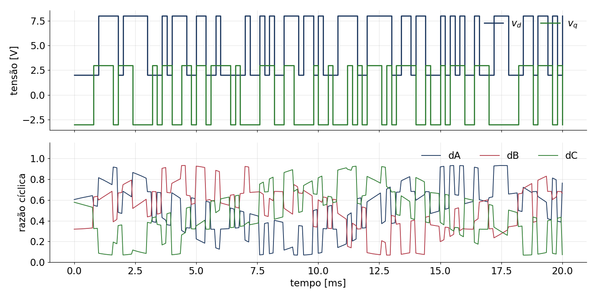
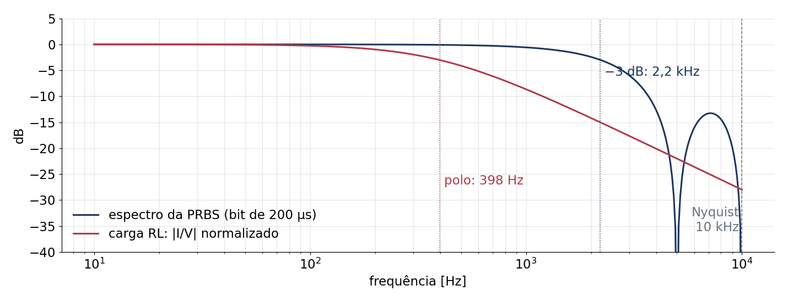
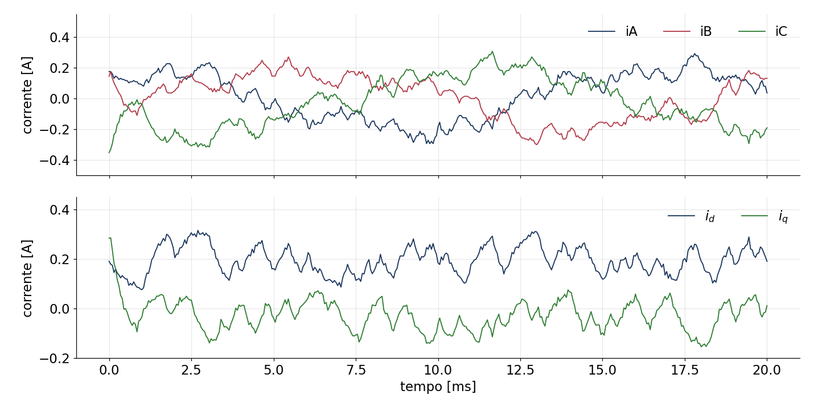
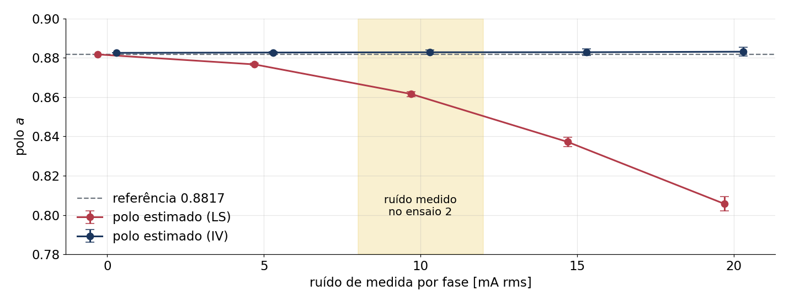
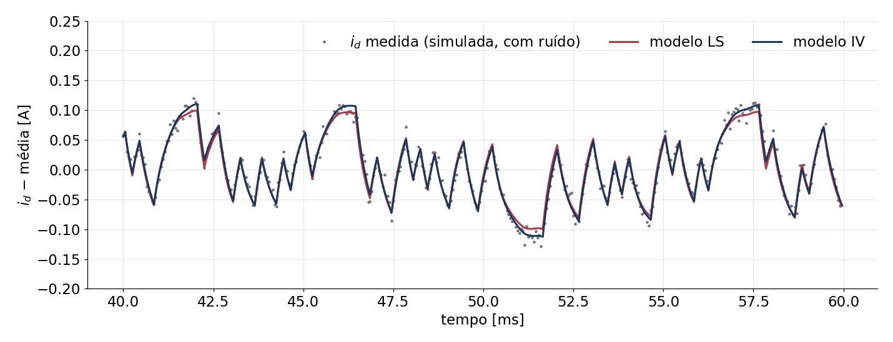
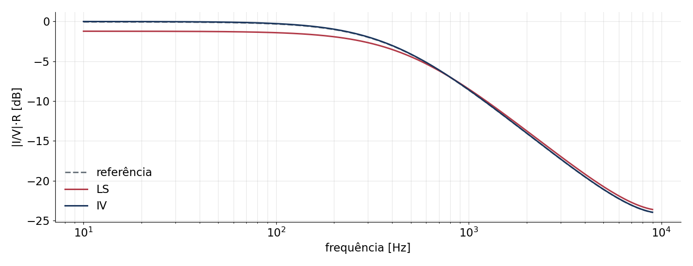
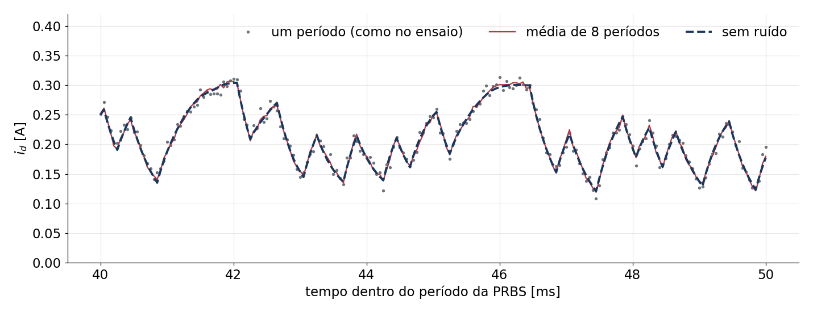

## O ensaio simulado

| Item | Valor |
|---|---|
| Carga | RL em estrela, neutro isolado: R = 25 Ω, L = 10 mH; V~dc~ = 19,85 V |
| Excitação | v~d~ = 5 ± 3 V, v~q~ = 0 ± 3 V; PRBS de 9 bits, bit de 200 µs (4 amostras) |
| PRBS | polinômios diferentes em d (x⁹+x⁵+1) e q (x⁹+x⁴+1): correlação cruzada < 0,09 |
| PWM | Park inversa a 60 Hz; razão = 0,5 + v/V~dc~, de 0,07 a 0,93 (não satura) |
| Atraso | razão escrita em *k* vale entre *k*+1 e *k*+2 (sombra do CMPA) |
| Medida | corrente com ruído de 10 mA por fase (ensaio 2) e quantização do ADC (7,32 mA) |
| Registro | 2044 amostras de 50 µs = um período da PRBS (102 ms) |

: {tbl-colwidths="[18,82]"}

A simulação reproduz a lógica do firmware `VSI02IdentificacaoARX` (`analise/simula.py`).

## Excitação

{fig-align="center" width="92%"}

- v~d~ e v~q~ trocam de nível independentemente; as razões das fases ficam entre 0,07 e 0,93.

## A PRBS cobre a dinâmica da carga

{fig-align="center" width="100%"}

- Espectro plano até 2,2 kHz; o polo da carga (398 Hz) fica bem dentro da faixa excitada.

## Correntes esperadas

{fig-align="center" width="92%"}

- i~d~ ≈ 0,19 A (de 0,07 a 0,33 A); i~q~ ≈ −0,03 A. Degrau de 3 V → 0,12 A (16 contagens).
- Ruído em i~d~ e i~q~: 8,5 mA rms.

## Modelo ARX em dq

$$
\begin{aligned}
i_d(k) &= a\,i_d(k-1) + b\,v_d(k-2) + e\,v_q(k-2) + c\,i_q(k-1)\\
i_q(k) &= a\,i_q(k-1) + b\,v_q(k-2) + e\,v_d(k-2) - c\,i_d(k-1)
\end{aligned}
$$

| Parâmetro | Significado | Esperado |
|---|---|---|
| $a$ | polo, $e^{-RT_s/L}$ | 0,8825 |
| $b$ | ganho, $(1-a)/R$ [A/V] | 0,00470 |
| $c$ | acoplamento d–q, $\approx \omega T_s$ | 0,0188 a 0,0200 |
| $e$ | entrada cruzada (rotação no atraso) | ≈ 0 |

: {tbl-colwidths="[16,52,32]"}

Atraso de 2 amostras: a razão escrita em *k* só aparece inteira na corrente em *k*+2.

## Dois estimadores

- **Mínimos quadrados (LS)**: regressores com as correntes **medidas**. O ruído entra nos
  regressores → polo puxado para baixo (viés).
- **Variável instrumental (IV)**: troca as correntes passadas nos regressores pela saída
  **simulada** do modelo (sem ruído). Começa do LS e repete 3 vezes.

Mesma estrutura, mesmos dados; muda só como se resolve.

## Viés do polo × ruído de medida

{fig-align="center" width="100%"}

- 20 registros por ponto. LS: 0,862 com 10 mA (−2,4 %). IV: 0,883 em qualquer nível de ruído.

## Validação em outro registro

{fig-align="center" width="100%"}

- Simulação livre do modelo (só com v~d~, v~q~). Ajuste: LS 82 %, IV 85 % (o resto é ruído).

## Resposta em frequência (v~d~ → i~d~)

{fig-align="center" width="100%"}

- LS: ganho estático 13 % menor (0,035 contra 0,040 A/V) e polo mais rápido. IV coincide com a referência.

## Resultado esperado (10 mA de ruído)

| | [$a$]{style="text-transform:none"} | [$b$ \[A/V\]]{style="text-transform:none"} | [$c$]{style="text-transform:none"} | [$e$]{style="text-transform:none"} | ajuste |
|---|---|---|---|---|---|
| Referência (sem ruído) | 0,8817 | 0,00470 | 0,0200 | 0,0000 | — |
| LS | 0,8604 | 0,00485 | 0,0189 | 0,0000 | 82 % |
| IV | 0,8821 | 0,00471 | 0,0196 | 0,0000 | 85 % |
| LS, PRBS só em d | 0,8420 | 0,00494 | — | — | — |
| IV, PRBS só em d | 0,8819 | 0,00468 | — | — | — |

: {tbl-colwidths="[30,14,14,14,14,14]"}

- PRBS num eixo só tem metade da potência de excitação: o LS piora; o IV não.

## Média síncrona: a ideia

{fig-align="center" width="100%"}

- A PRBS se repete a cada 102 ms e, em dq, a resposta da carga também; o ruído não se repete.
- Somar a mesma posição de P períodos e dividir por P: o sinal fica, o ruído cai √P (8 períodos: 8,3 → 3,0 mA).

## Média síncrona: quanto melhora

| [V~dc~]{style="text-transform:none"} | [v~d0~ ± ΔV]{style="text-transform:none"} | 1 período | 4 períodos | 8 períodos | 16 períodos |
|---|---|---|---|---|---|
| 20 V | 5 ± 3 V | 85 % | 92 % | 94 % | 95 % |
| 40 V | 10 ± 6 V | 92 % | 95 % | 96 % | 97 % |

: {tbl-colwidths="[14,18,17,17,17,17]"}

Ajuste (IV) em outro ensaio simulado, com 10 mA de ruído. O polo IV fica em 0,881–0,883 em todos.

- Firmware: `periodosMedia` na Watch; descarta o 1º período (transitório) e faz a média dos seguintes.
- Mais tensão aumenta o sinal; a média diminui o ruído: os dois ganhos se somam.

## O que conferir nos dados reais

- i~d~ ≈ 0,19 A e i~q~ ≈ −0,03 A em média; degraus de ≈ 0,12 A.
- Polo IV perto de 0,88: se sair diferente, a carga real difere (R ou L) ou há atraso a mais.
- Ganho estático $b/(1-a)$ ≈ 1/R = 0,040 A/V.
- Resíduo branco e ≈ 8–9 mA: ruído maior que isso aponta problema de medida.
- Acoplamento $c$ ≈ 0,02 com o sinal certo nos dois eixos.

Próximo: ensaios na placa com `eixoPRBS` = 0, 1 e 2, e a mesma análise com os dados medidos.
