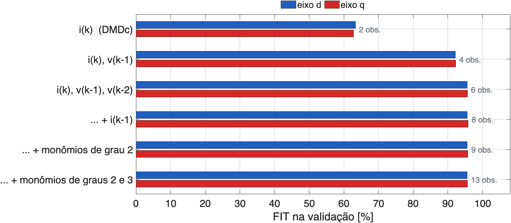
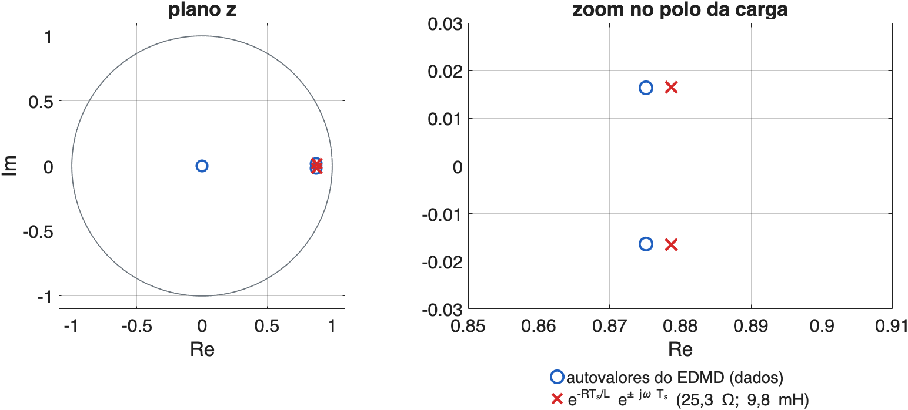
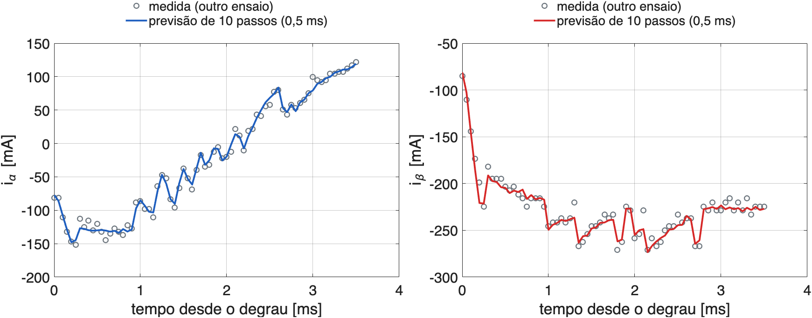
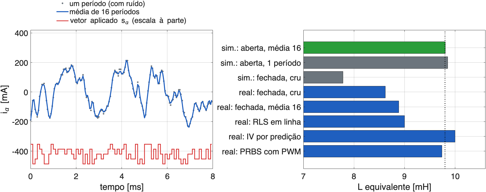
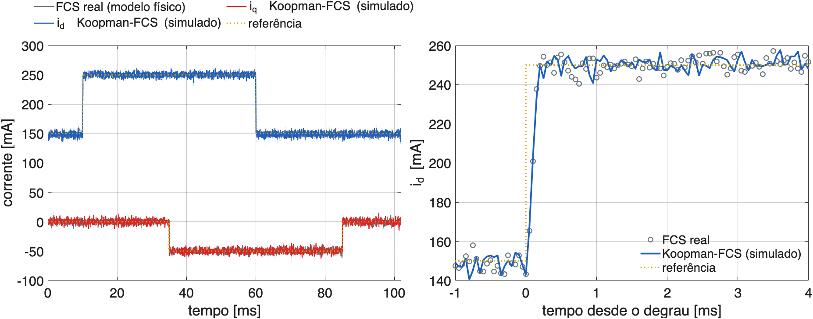
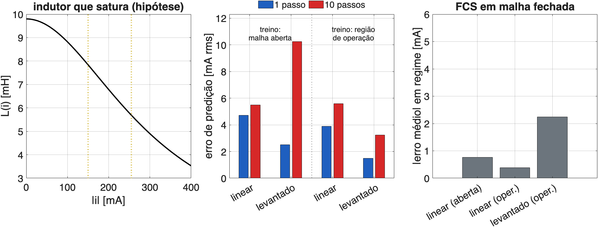

## A ideia

- **Operador de Koopman**: em vez do estado $x$, olha-se para funções dele (os **observáveis** $\psi(x)$). Nesse espaço, mesmo um sistema não linear evolui de forma **linear**.
- **EDMD** (*Extended Dynamic Mode Decomposition*): escolhe-se um dicionário de observáveis e ajusta-se o operador por mínimos quadrados, só com dados.
- Com o modelo linear no espaço levantado, o **controle preditivo** fica igual ao de sempre.

```
 dados (i, s)  →  observáveis z = ψ(i, s)  →  EDMD: z(k+1) ≈ A z(k) + B u(k)  →  FCS-MPC com A, B
```

- Aqui: o modelo da carga **aprendido dos ensaios reais**, no lugar de R e L.

## Koopman com controle e EDMD

$$
z(k+1) \approx A\,z(k) + B\,u(k),\qquad z = \psi(x)
$$

Com $M$ amostras empilhadas em colunas, $Z = [z_1 \ldots z_M]$, $U$, $Z^+ = [z_2 \ldots z_{M+1}]$:

$$
[\,A\ \ B\,] = Z^+ \begin{bmatrix} Z \\ U \end{bmatrix}^{\dagger}
\qquad (\text{mínimos quadrados: } \min \|Z^+ - A Z - B U\|)
$$

- **DMDc**: $\psi(x) = x$ (só o estado). **EDMD**: $\psi$ com atrasos, monômios, funções de base radial…
- Os **autovalores** de $A$ aproximam os do operador de Koopman: dinâmica lida diretamente dos dados.

## O que esperar de uma carga RL?

- A carga RL **já é linear**: o operador de Koopman restrito ao estado é exato.
- O que falta ao estado $i(k)$ é **memória**: o atraso de 2 amostras do PWM faz $i(k+1)$ depender de $v(k-1)$ e $v(k-2)$.
- Pergunta testada nos dados reais: o dicionário que importa é de **atrasos** (memória) ou de **monômios** (não linearidade)?
- Se for de atrasos, EDMD recupera o modelo físico, **sem conhecer R e L**. Se a carga fosse não linear, os monômios fariam diferença (simulação no fim).

## Dicionários nos dados reais (PRBS, etapa 02)

{fig-align="center" width="86%"}

- Validação cruzada (simulação livre na metade não usada). O ganho vem dos **atrasos** (63 → 96 %); monômios de grau 2 e 3 não mudam nada.

## Autovalores de Koopman

{fig-align="center" width="84%"}

- Dois autovalores em **0,875 ± j0,016**: o polo da carga ($e^{-RT_s/L}$) e a rotação de 60 Hz do referencial dq ($\omega T_s$). Os outros quatro são nulos: os atrasos.
- Lido dos dados: τ = 0,375 ms, 59,5 Hz; ganho estático R = 26,0 Ω.

## EDMD com os dados do FCS (etapa 04)

::: {style="font-size:0.9em"}
No FCS não há modulador: a entrada é o próprio vetor do inversor. Em αβ, com a temporização da placa:

$$
z(k) = \begin{bmatrix} i(k) \\ s(k-1) \end{bmatrix},\quad u(k) = s(k),\qquad
i(k+1) = G\,[\,i(k);\ s(k-1);\ s(k)\,]
$$

| Modelo | R, L equivalentes | Erro de predição (outro ensaio): 1 / 10 passos |
|---|---|---|
| físico nominal (25 Ω; 10 mH) | — | 10,8 / 8,8 mA |
| físico da bancada (25,3 Ω; 9,8 mH) | — | 10,7 / 8,5 mA |
| **EDMD, registro cru** | 25,0 Ω; 8,6 mH | 10,6 / 8,7 mA |
| **EDMD, média de 16 períodos** | 24,9 Ω; 8,9 mH | 10,6 / 8,6 mA |

: {tbl-colwidths="[38,26,36]"}
:::

- Treino no ensaio do FCS; validação no ensaio do RLS (outro dia). O erro de ≈ 10 mA é o ruído da medida.

## Predição de 10 passos (0,5 ms)

{fig-align="center" width="100%"}

- Modelo aprendido (média de 16), validado num ensaio que ele nunca viu: a previsão de 10 passos acompanha a medida.

## De onde tirar os dados

{fig-align="center" width="100%"}

- Dados de **malha fechada** dão L baixo (o controle escolhe o vetor olhando a corrente ruidosa). **Malha aberta** com vetores pseudoaleatórios e média de 16 períodos: 25,4 Ω; 9,8 mH na simulação.

## Koopman-FCS

::: {style="font-size:0.92em"}
Para cada um dos 8 estados $s_e$:

$$
\hat i(k+1) = G_i\,i(k) + G_p\,s(k-1) + G_s\,s_e,\qquad
\hat i(k+2) = G_i\,\hat i(k+1) + (G_p + G_s)\,s_e
$$

$$
g_e = \Big|\,i^*\big(k+\tfrac32\big) - \tfrac12\big(\hat i(k+1) + \hat i(k+2)\big)\Big|^2
$$

- O custo vai no **fim do intervalo** em que o vetor fica aplicado (k + 3/2), como no VSI04.
- Simulação: com o custo em k + 2 (como no VSI05), surge um erro em regime de **+5 mA** em i~d~; em k + 3/2, **+0,2 mA**. O VSI05 mediu +6 mA: a causa principal é o instante do custo, mais do que o viés de L.
:::

## Koopman-FCS em malha fechada (simulação)

{fig-align="center" width="100%"}

## Números da malha fechada (simulação, média de 16)

::: {style="font-size:1.05em"}
| Modelo do FCS | Erro médio d / q | rms | Chaveamento |
|---|---|---|---|
| físico nominal (25 Ω; 10 mH) | +0,8 / −0,5 mA | 21,6 mA | 3,5 kHz |
| físico da bancada (25,3 Ω; 9,8 mH) | +0,4 / −0,2 mA | 21,5 mA | 3,5 kHz |
| EDMD dos dados reais de malha fechada | +0,6 / −0,7 mA | 21,7 mA | 3,4 kHz |
| **EDMD do ensaio proposto** | **+0,2 / −0,3 mA** | **21,5 mA** | 3,5 kHz |
| EDMD do ensaio proposto, custo em k + 2 | +5,1 / −1,0 mA | 23,5 mA | 3,1 kHz |

: {tbl-colwidths="[40,22,18,20]"}
:::

- Sem conhecer R e L, o modelo aprendido controla tão bem quanto o físico.

## E se a carga não fosse linear?

{fig-align="center" width="100%"}

- Hipótese (não observada na bancada): indutor que satura, L cai a 59 % em 0,25 A. Com dados da **região de operação**, o dicionário levantado ($|i|^2 i$, $|i|^2 s$) prevê melhor (1,5 contra 3,9 mA em 1 passo).
- Mas em malha fechada **não ganha**: o FCS não precisa de predição longa, e a média de 16 períodos já é quase linear. Koopman vale quando a não linearidade pesa no horizonte usado.

## Firmware VSI06ControleKoopman

::: {style="font-size:0.88em"}
| Item | |
|---|---|
| Base | `VSI05MPCAdaptativoRLS`: hardware, medidas, chaveamento no topo, cenários e tempos |
| Identificação | vetores pseudoaleatórios (LFSR de 16 bits, 2 amostras por símbolo), malha aberta, média de 16 períodos |
| EDMD na placa | no laço principal, ao fim da identificação: equações normais 6 × 6 em precisão dupla, Gauss-Jordan |
| FCS | o mesmo código para G aprendido (`usaKoopman` = 1) ou físico (0); custo em k + 3/2 |
| Conferido | a sequência de vetores e o G calculado em C dão os mesmos valores do MATLAB (6 casas) |
| Gravação | cenário 1: i~α~, i~β~ (média), estado; cenários 2–4: como no VSI03/04 |

: {tbl-colwidths="[20,80]"}
:::

- Compila sem avisos (`-O2`, RAM e FLASH). **Ainda não testado na placa.**

## Roteiro do ensaio

Watch: **`habilita`**, **`cenario`**, **`grava`**, `modeloPronto` (ver: `koopmanG`, `resistenciaKoopman`, `indutanciaKoopman`, `tempoMaximoTotal`, `perdasPrazo`).

::: {style="font-size:0.95em"}
| `cenario` | O que faz | Arquivo |
|---|---|---|
| 1 | identificação em malha aberta; a placa calcula G | `Koopman01.csv` (+ `G.txt`) |
| 2 | FCS com o modelo de Koopman, média de 16 | `Koopman02.csv` |
| 3 | FCS com o modelo físico, média de 16 | `Koopman03.csv` |
| 4 | FCS com o modelo de Koopman, cru | `Koopman04.csv` (+ `Tempos04.csv`) |

: {tbl-colwidths="[12,58,30]"}
:::

Para cada cenário: `cenario = N` → espere 2 s → `grava = 1` → espere voltar a 0 → pause e exporte (`Dados3F` 16352). Análise: `matlab/k05_analisa_ensaio.m`.

## Conclusões

- **EDMD com os dados reais** recupera o modelo da carga sem conhecer R e L: polo, 60 Hz e ganho estático saem dos autovalores.
- Para a carga RL, o dicionário certo é de **atrasos** (memória do PWM); monômios não acrescentam nada, como esperado de um sistema linear.
- O **ensaio em malha aberta** com vetores pseudoaleatórios evita o viés de L dos dados de malha fechada.
- **Koopman-FCS** (simulação) controla como o FCS com o modelo físico, e o firmware já calcula o modelo na placa.
- Achado de passagem: o instante do custo (k + 3/2) explica a maior parte do erro em regime do VSI05.
- Próximos: ensaio na placa; dicionário aprendido (*deep Koopman*); combinar com o RLS (EDMD recursivo) e com aprendizagem por reforço.

Projeto: `06ControleKoopman/matlab/principal.m` (k01–k05). Firmware: `06ControleKoopman/firmware/VSI06ControleKoopman`.
