## Onde estamos e o que se quer

| Controle (etapa) | Ponto forte | Ponto fraco |
|---|---|---|
| PI em dq (03) | ondulação pequena (PWM fixo, 20 kHz) | sintonia depende de R e L; não vê limites nem o futuro |
| FCS-MPC (04, 05) | resposta muito rápida; usa um modelo | ondulação ±30 mA (chaveia a ≈ 3,4 kHz); precisa de R e L (ou do RLS) |
| Koopman (06) | modelo aprendido dos dados | ainda é **modelo**: identifica primeiro, controla depois |

: {tbl-colwidths="[22,36,42]"}

- Pergunta desta etapa: dá para fazer um **controle preditivo** (olha para o futuro, respeita limites) **com PWM** (ondulação pequena) e **sem modelo nenhum**, usando direto a tabela de dados gravados?
- Resposta proposta: **DeePC** (*Data-enabled Predictive Control*) e sua versão mais simples, **SPC** (*Subspace Predictive Control*).


## Mapa da apresentação

::::: {style="font-size:0.94em"}
::::: {style="font-size:0.93em"}
::::: {style="font-size:0.93em"}
::::: {style="font-size:0.99em"}
::: {style="font-size:0.95em"}
| Parte | Pergunta | Slides |
|---|---|---|
| 1. A ideia | Como prever e controlar só com dados gravados? | Hankel, Willems, SPC, DeePC |
| 2. Validação | Os dados reais sustentam a ideia? O simulador é confiável? | previsão do ensaio do PI, PWM chaveado |
| 3. Resultado nominal | Como fica contra o PI e o FCS? | degraus, números, sintonia |
| 4. O controle por dentro | Que controlador é esse? Que margens tem? | frequência, margens, mapas |
| 5. Robustez | E se a carga, o V~dc~, o ruído ou a quantidade de dados mudarem? | cargas, Monte Carlo, tempo morto |
| 6. Restrições e custo | Cabe na LaunchPad? Até onde? | corte × otimização, contas, memória |
| 7. Fronteira | Adaptação, limitações, variantes e o plano do artigo | adaptativo, protocolo de ensaios |

: {tbl-colwidths="[20,48,32]"}
:::

- Tudo aqui é **simulação alimentada por dados reais** (PRBS da etapa 02, ensaio do PI da etapa 03). O ensaio do DeePC na bancada é o passo que falta (protocolo no fim).
:::::
:::::
:::::
:::::

## Onde este trabalho entra na literatura

::::: {style="font-size:0.93em"}
::::: {style="font-size:0.93em"}
::::: {style="font-size:0.87em"}
::: {style="font-size:0.78em"}
| Trabalho | O que fez | O que deixou em aberto |
|---|---|---|
| Willems et al., 2005 | lema fundamental: trajetórias = combinações dos dados | — (teoria) |
| Favoreel et al., 1999 (SPC) | preditor por subespaço + MPC | ruído e implementação embarcada |
| Coulson, Lygeros, Dörfler, 2019 (DeePC) | MPC direto dos dados, com regularização | escolha de λ~g~; custo por amostra |
| Huang et al., 2019 (CDC) | DeePC em conversor conectado à rede (simulação) | bancada; microcontrolador |
| Carlet et al., 2022 (TPEL) [a conferir] | preditivo por dados na corrente de motor síncrono (bancada) | carga RL/rede; DSP de baixo custo; análise de margens |
| Dörfler, Coulson, Markovsky, 2023 (TAC) | ponte direto × indireto por regularização | evidência em conversor real |
| Berberich et al., 2021 (TAC) | garantias de estabilidade e robustez | custo computacional |
| Zhao et al., 2025; Leng et al., 2026 | controle adaptativo por dados em conversores na rede | 20 kHz em DSP; dados e código abertos |

: {tbl-colwidths="[27,40,33]"}
:::

- **Nicho proposto**: controle de corrente preditivo por dados, com PWM a 20 kHz, num DSP de baixo custo (F28379D), com dados reais, e a análise que um projetista pede: margens, ruído, quantidade de dados, custo e limites.
- As referências marcadas "a conferir" foram citadas de memória; as demais estão no Zotero do grupo.
:::::
:::::
:::::

## O caminho de sempre × o caminho direto

```
 Caminho de sempre (etapas 02 a 06):
   ensaio (PRBS) → identificação (R, L ou ARX ou EDMD) → modelo → projeto do controle → controle

 Caminho direto (esta etapa):
   ensaio (PRBS) → tabela de trechos gravados (matriz de Hankel) → controle preditivo
```

- No caminho direto **não se escolhe estrutura de modelo** (ordem, atraso, quais parâmetros): os dados já contêm tudo isso.
- O "modelo" passa a ser a própria coleção de trechos medidos. Prever o futuro = **combinar trechos gravados** que começam parecidos com o presente.
- Teoria por trás: o **lema fundamental de Willems** (2005). Os próximos slides mostram a ideia sem pressupor nada.

## A ideia em um exemplo de brinquedo

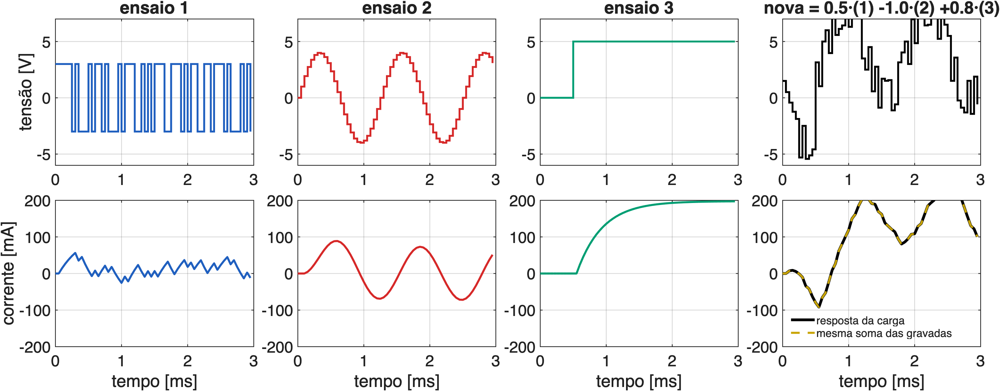{fig-align="center" width="100%"}

- Uma fase RL (25,3 Ω; 9,8 mH; atraso de 2 amostras), sem ruído. Três ensaios gravados com entradas quaisquer.
- Uma entrada nova que é **combinação** das três (0,5·(1) − 1·(2) + 0,8·(3)) dá uma corrente que é **a mesma combinação** das correntes gravadas. É a **superposição** de sistemas lineares.
- Não foi preciso conhecer R nem L: bastaram os pesos $g = (0{,}5;\ -1;\ 0{,}8)$.

## De onde vêm os "ensaios gravados": a matriz de Hankel

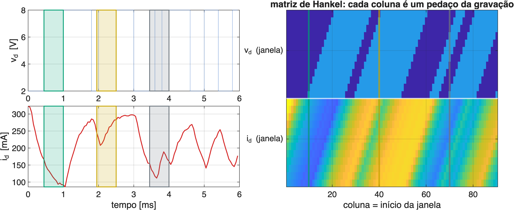{fig-align="center" width="92%"}

- Não é preciso fazer vários ensaios: **um registro longo** (a PRBS da etapa 02, 2044 amostras) é cortado em **janelas** de L amostras, cada uma começando uma amostra depois da anterior.
- Cada janela vira **uma coluna** da matriz. As colunas são "ensaios curtos" com entradas diferentes: a matriz de Hankel é o catálogo de trajetórias.

## Lema fundamental de Willems (em palavras)

::: {style="font-size:0.85em"}
Monte a matriz de Hankel com janelas de L amostras de entrada e saída:

$$
\mathcal H = \begin{bmatrix} w(1) & w(2) & \cdots & w(M) \\ \vdots & \vdots & & \vdots \\ w(L) & w(L+1) & \cdots & w(M+L-1) \end{bmatrix},
\qquad w = \begin{bmatrix} u \\ y \end{bmatrix}
$$

**Se** o sistema é linear e a entrada do ensaio foi "rica o bastante" (**excitação persistente**), **então** toda trajetória de L amostras que o sistema pode fazer é uma combinação das colunas:

$$
\begin{bmatrix} u_\text{nova} \\ y_\text{nova} \end{bmatrix} = \mathcal H\, g \quad \text{para algum vetor de pesos } g
$$

- "Rica o bastante": a entrada não pode se repetir de um jeito previsível. A **PRBS** foi feita para isso (por isso o ensaio da etapa 02 serve aqui sem mudança).
- É o exemplo de brinquedo, mas com milhares de colunas e garantia de que **nenhuma** trajetória fica de fora.
:::


## Excitação persistente em números

::::: {style="font-size:0.90em"}
::: {style="font-size:0.92em"}
Para janelas de $L = T_\text{ini} + N$ amostras, $m$ entradas e sistema de ordem $n$, o lema pede no mínimo

$$
T \;\ge\; (m+1)(L+n) - 1 \;=\; 3\,(12 + 4) - 1 \;=\; 47 \text{ amostras}
\qquad (m = 2,\ T_\text{ini} = 2,\ N = 10,\ n = 4)
$$

| Item | Valor nesta bancada |
|---|---|
| Ordem $n$ | 4: duas correntes (d, q) + as duas tensões "a caminho" (atraso do PWM) |
| PRBS | 9 bits, polinômios diferentes em d e q (correlação cruzada < 0,09), 4 amostras por bit |
| Um período | 2044 amostras = 102 ms (43 vezes o mínimo) |
| Com ruído real (8,5 mA) | **100 amostras (5 ms) já dão o controle final** (Monte Carlo, adiante) |

: {tbl-colwidths="[30,70]"}
:::

- O mínimo teórico vale sem ruído. Com ruído, o que conta é quantas colunas a mais existem para "tirar a média".
:::::

## O que os dados reais mostram

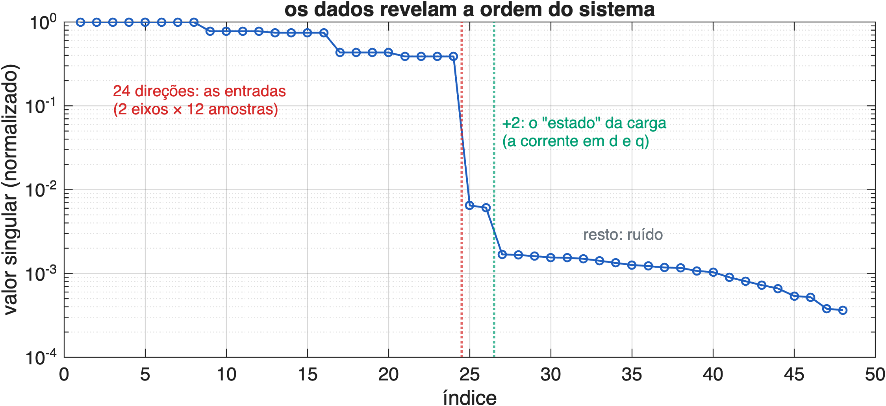{fig-align="center" width="78%"}

- Valores singulares da matriz de Hankel dos dados reais (L = 12 amostras, 2 entradas v~d~, v~q~ e 2 saídas i~d~, i~q~): **24 grandes** (as entradas: 2 eixos × 12 amostras, livres) **+ 2** (o estado: as correntes d e q) e o resto é **ruído**.
- Ou seja: os dados "dizem" sozinhos que a carga tem **ordem 2** em dq, sem nenhuma hipótese sobre R e L.

## Passado, futuro e a previsão

::: {style="font-size:0.85em"}
Divide-se cada janela em duas partes:

$$
\underbrace{\begin{bmatrix} u_p \\ y_p \end{bmatrix}}_{\text{passado: } T_\text{ini} \text{ amostras}}
\qquad
\underbrace{\begin{bmatrix} u_f \\ y_f \end{bmatrix}}_{\text{futuro: } N \text{ amostras}}
$$

- O **passado** (T~ini~ amostras já medidas) faz o papel do **estado**: fixa "onde o sistema está agora".
- O **futuro** é o que se quer escolher (u~f~, as tensões) e prever (y~f~, as correntes).
- Com o passado medido e um u~f~ candidato, procura-se g que reproduz os dois; a mesma combinação dá o **y~f~ previsto**:

$$
\begin{bmatrix} U_p \\ Y_p \\ U_f \end{bmatrix} g = \begin{bmatrix} u_\text{ini} \\ y_\text{ini} \\ u_f \end{bmatrix}
\quad\Longrightarrow\quad \hat y_f = Y_f\, g
$$
:::


## Por que T~ini~ ≥ 2, e por que mais passado ajuda

- A tensão calculada em *k* só chega à carga em *k* + 1 (registrador de sombra): em cada instante há uma tensão **já decidida e ainda não aplicada**. Ela faz parte do estado, junto com as correntes.
- Com T~ini~ = 2 o passado contém as duas últimas tensões e as duas últimas correntes: o suficiente **sem ruído**.
- **Com ruído**, o passado também serve de filtro: mais amostras = melhor estimativa de "onde o sistema está". No ensaio do PI (dados reais, fora do ajuste), o erro de previsão de 10 passos cai de 8,9 mA (T~ini~ = 2) para 4,7 mA (4) e 3,4 mA (6); o piso do ruído é 2,7 mA.
- Preço: 4 contas a mais por amostra para cada unidade de T~ini~. Na malha fechada o ganho é pequeno com o SPC e grande com o DeePC mal regularizado (slide de T~ini~ adiante).

## Por que em incrementos (Δu, Δy)

:::: {.columns}
::: {.column width="40%"}
::: {style="font-size:0.88em"}
- Se a carga muda (R aquece, offset do sensor), um preditor em valores absolutos erra um valor constante: sobra **erro em regime**.
- Com **variações** $\Delta u$, $\Delta y$, prevê-se quanto a corrente **vai mudar** e soma-se à medida atual. O erro constante some na diferença: é o "integrador" do PI.
- Teste: R 20 % maior que nos dados. Absoluto: **+24,6 mA** de erro em regime. Incremental: **0,0 mA**.
:::
:::
::: {.column width="60%"}
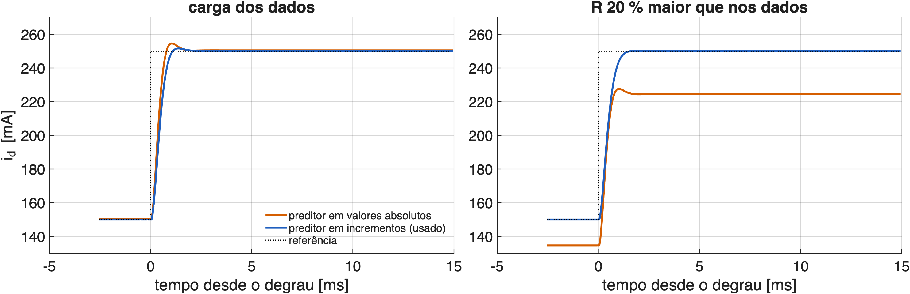{width="100%"}
:::
::::

## SPC: a previsão vira uma conta de mínimos quadrados

::: {style="font-size:0.88em"}
Em vez de buscar g a cada amostra, ajusta-se **uma vez**, nos dados, a matriz que leva (passado, futuro da entrada) ao futuro da saída:

$$
Y_f \approx K \begin{bmatrix} Z_p \\ U_f \end{bmatrix}
\quad\Rightarrow\quad
K = Y_f W^\top (W W^\top)^{-1},\qquad W = \begin{bmatrix} Z_p \\ U_f \end{bmatrix}
$$

$$
\hat y_f = \underbrace{F\, z_p}_{\text{efeito do passado}} + \underbrace{K_u\, u_f}_{\text{efeito das tensões futuras}}
$$

- **SPC** = *Subspace Predictive Control* (Favoreel, De Moor e Van Overschee, 1999). É um "ARX de N passos à frente" tirado direto da tabela.
- **DeePC** (Coulson, Lygeros e Dörfler, 2019) guarda a tabela inteira e escolhe g em cada amostra; com regularização, dá praticamente o mesmo resultado (slide adiante).
:::

## A previsão funciona nos dados reais?

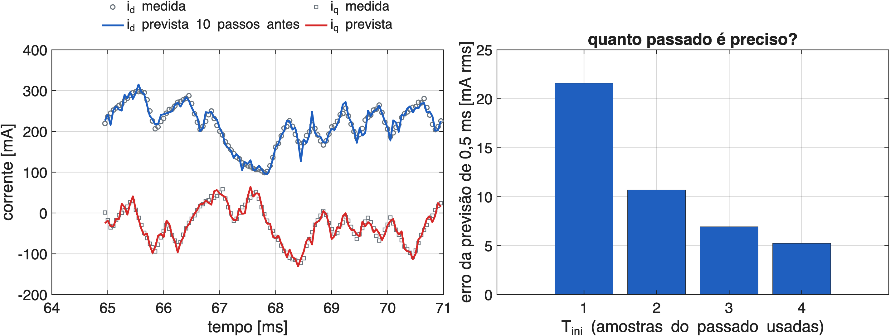{fig-align="center" width="94%"}

- Previsão de **10 passos** (0,5 ms) com o preditor SPC, num trecho dos dados reais que não foi usado no ajuste.
- Erro médio de 10 passos por tamanho do passado: T~ini~ = 1 → 21,6 mA; **2 → 10,7 mA**; 3 → 6,9 mA; 4 → 5,2 mA. Com T~ini~ = 1 o passado não "vê" o atraso de 2 amostras do PWM.

## O controle preditivo (MPC), passo a passo

::: {style="font-size:0.88em"}
1. Mede a corrente agora e guarda o passado (T~ini~ amostras).
2. Para um horizonte de N amostras, procura as tensões futuras $\Delta u_f$ que minimizam

$$
J = \underbrace{q\sum_{j=1}^{N} \big\|r(k+j) - \hat y(k+j)\big\|^2}_{\text{seguir a referência}}
\;+\; \underbrace{r_u\sum_{j=0}^{N-1} \big\|\Delta u(k+j)\big\|^2}_{\text{não mexer demais na tensão}}
$$

3. Aplica **só a primeira** tensão. Na amostra seguinte, mede de novo e recomeça (**horizonte deslizante**).

- q e r~u~ são os botões de sintonia: r~u~ grande = controle mais calmo; pequeno = mais agressivo.
- A diferença para o FCS: aqui a tensão é **contínua** (vai para o PWM a 20 kHz); no FCS é um dos 8 vetores.
:::


## Validação independente: prever o ensaio do PI

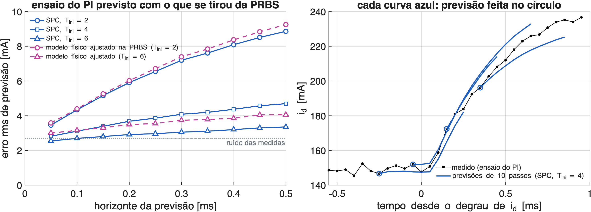{fig-align="center" width="92%"}

- O ensaio do PI (etapa 03: malha fechada, degraus) **não entrou** no ajuste. Com as tensões medidas nele, o que saiu da PRBS prevê as correntes.
- Em simulação livre (só as tensões entram): erro de **2,4 mA rms**, FIT de **94 %**, perto do ruído das medidas (1,9 mA). O modelo nominal de placa (25 Ω, 10 mH) dá 5,8 mA (85 %).
- Com T~ini~ = 6 o preditor direto (3,4 mA em 10 passos) supera o modelo físico ajustado com o mesmo passado (4,1 mA).

## O controle preditivo (MPC), passo a passo

::: {style="font-size:0.88em"}
1. Mede a corrente agora e guarda o passado (T~ini~ amostras).
2. Para um horizonte de N amostras, procura as tensões futuras $\Delta u_f$ que minimizam

$$
J = \underbrace{q\sum_{j=1}^{N} \big\|r(k+j) - \hat y(k+j)\big\|^2}_{\text{seguir a referência}}
\;+\; \underbrace{r_u\sum_{j=0}^{N-1} \big\|\Delta u(k+j)\big\|^2}_{\text{não mexer demais na tensão}}
$$

3. Aplica **só a primeira** tensão. Na amostra seguinte, mede de novo e recomeça (**horizonte deslizante**).

- q e r~u~ são os botões de sintonia: r~u~ grande = controle mais calmo; pequeno = mais agressivo.
- A diferença para o FCS: aqui a tensão é **contínua** (vai para o PWM a 20 kHz); no FCS é um dos 8 vetores.
:::


## DeePC e o peso da regularização λ~g~

::: {style="font-size:0.85em"}
$$
\min_{g,\ \sigma}\; J \;+\; \lambda_g \|g\|^2 \;+\; \lambda_\text{ini}\|\sigma\|^2
\quad\text{com}\quad
\begin{bmatrix} Z_p \\ U_f \\ Y_f \end{bmatrix} g = \begin{bmatrix} z_\text{ini} + \sigma \\ u_f \\ y_f \end{bmatrix}
$$
:::

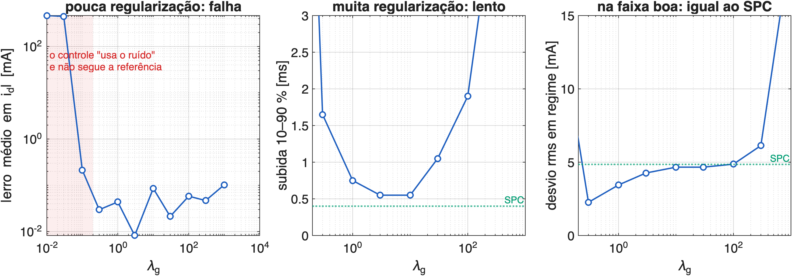{fig-align="center" width="92%"}

- Com ruído nos dados e λ~g~ pequeno, o DeePC "usa o ruído" para inventar trajetórias e **falha**. Grande demais, fica lento. No meio, coincide com o SPC.

## Três caminhos para a mesma lei de controle

::::: {style="font-size:0.93em"}
::::: {style="font-size:0.93em"}
::::: {style="font-size:1.00em"}
::: {style="font-size:0.85em"}
| | DeePC | SPC | Indireto (ARX ou modelo físico) |
|---|---|---|---|
| O que se guarda | a tabela inteira (ou sua SVD) | a matriz K do preditor | os parâmetros do modelo |
| Parâmetros ajustados | — (g a cada amostra) | 20 × 28 = 560 | 12 (ARX) ou 4 (físico) |
| Escolhas do projetista | T~ini~, N, **λ~g~**, λ~ini~ | T~ini~, N | **estrutura**: ordem, atraso, acoplamento |
| Sensível a | λ~g~ × ruído × nº de colunas | pouco dado com muito ruído | estrutura errada |
| Custo fora da malha | SVD de 48 × 2044 | mínimos quadrados 28 × 28 | mínimos quadrados pequeno |
| Na malha (sem restrições) | **a mesma conta**: uma matriz de ganhos | idem | idem |

: {tbl-colwidths="[22,26,24,28]"}
:::

- Sem ruído, os três dão **exatamente** o mesmo controle (teste `t00_confere`: diferença de 10⁻¹⁵ A na malha fechada).
- Com ruído eles se separam: é o estudo de Monte Carlo da parte 5.
:::::
:::::
:::::

## O controle vira uma matriz

::: {style="font-size:0.82em"}
- Sem restrições, o mínimo de J tem **fórmula fechada**:

$$
\Delta v(k) = K_e\,\big(r(k) - i(k)\big) \;-\; K_z\, z_p(k) \qquad (\text{ou } G_1 r_f \text{ com prévia da referência})
$$

```
 i*(k) ─►(+)─► Ke ─►(+)─► Σ ─► limite |v| ─► PWM ─► carga ──┬─► i(k)
          ▲ −         ▲ −                                    │
          │           └─ Kz ◄─ passado: Δv(k−2), Δv(k−1), Δi(k−1), Δi(k)
          └───────────────────────── i(k) ◄──────────────────┘
```

- K~e~ (2 × 2), K~z~ (2 × 8), G~1~ (2 × 20) são calculadas **uma vez** a partir dos dados.
- Por amostra: **20 multiplicações e somas** (56 com a prévia). O passado usa a tensão **de fato aplicada** (depois do limite): é isso que evita o *windup*.
:::

## Como foi a simulação (respeitando a bancada)

::: {style="font-size:0.68em"}
| Item | Valor (de onde vem) |
|---|---|
| Dados para o controle | PRBS real da etapa 02 (`Dados01A`), v~dq~ 5 ± 3 V, média de 16 períodos, 2044 amostras |
| Planta, modelo médio | R = 25,3 Ω, L = 9,8 mH (regime do PI, etapa 03), ZOH exato em dq, 60 Hz |
| Planta, PWM chaveado | portadora de 20 kHz, três braços, tempo morto, tensão parada em abc durante o período |
| Atraso | 2 amostras (a tensão calculada em k é aplicada de k + 1 a k + 2) |
| Medida | ruído de 8,5 mA rms + quantização do ADC (7,3 mA) |
| Limites | V~dc~ = 19,85 V, \|v\| ≤ 0,45 V~dc~ = 8,9 V |
| Ensaio | perfil das etapas 03–05: i~d~ 0,15 → 0,25 A (10–60 ms), i~q~ 0 → −0,05 A (35–85 ms) |
| Comparação | PI 500 Hz com desacoplamento; FCS (simulador da etapa 06); MPC com o modelo certo |
| Nota única (J) | erro rms de rastreamento no período inteiro, corrente verdadeira, d e q somados |

: {tbl-colwidths="[24,76]"}

- O controle **não recebe** R nem L: só a tabela de dados. R e L ficam dentro da planta simulada.
:::

## O simulador é confiável? PI medido × simulado

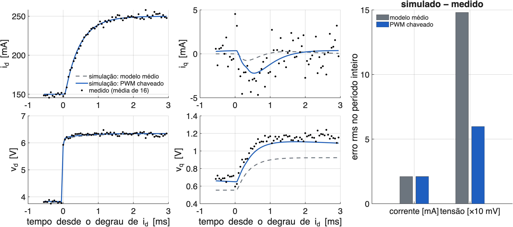{fig-align="center" width="86%"}

- PI de 300 Hz da etapa 03: corrente simulada − medida = **2,1 mA rms** no período inteiro, o tamanho do ruído das medidas (1,9 mA).
- A tensão v~q~ em regime só fecha com a planta chaveada: medido 1,17 V; PWM 1,10 V; modelo médio 0,92 V.

## Um achado: o referencial gira durante o atraso

::: {style="font-size:0.92em"}
- A tensão calculada em *k* (com o ângulo θ~k~) fica **parada em abc** de *k* + 1 a *k* + 2, enquanto o referencial dq continua girando: em média, 1,5 amostra = **1,6°** a 60 Hz.
- Efeito: um acoplamento a mais entre d e q, que o modelo físico usual em dq **não tem**.

| PRBS em malha aberta | Real | Simulação PWM | Modelo médio em dq |
|---|---|---|---|
| i~q~ médio | −35,2 mA | −33,0 mA | −28,1 mA |
| erro rms contra o real | — | **4,2 mA** | 6,8 mA |

: {tbl-colwidths="[34,22,22,22]"}

- O preditor por dados **já contém** esse efeito (foi medido junto). O projeto por modelo precisaria compensar o ângulo (θ + 1,5 ω T~s~) para chegar ao mesmo lugar.
- Para o artigo: é um exemplo concreto do que "não escolher estrutura" compra numa bancada real.
:::

## Resultado: DeePC × PI × FCS

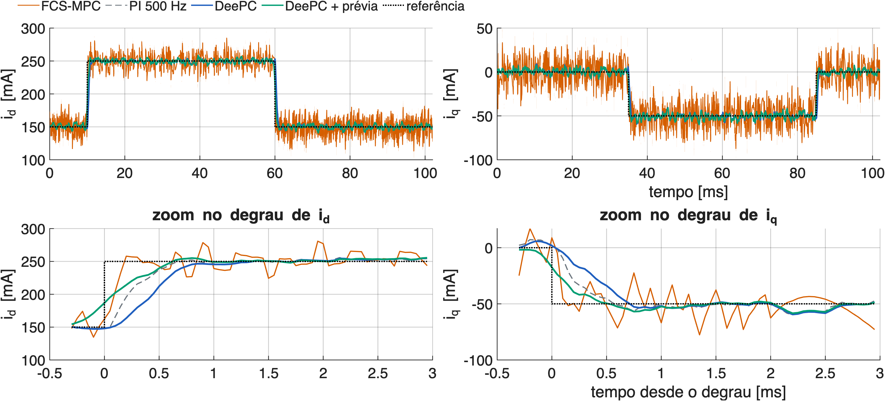{fig-align="center" width="100%"}

## Números (simulação, modelo médio, T~ini~ = 2, N = 10, λ~g~ = 3)

::::: {style="font-size:0.85em"}
::: {style="font-size:1.0em"}
| Controle | Subida [ms]{style="text-transform:none"} | t~50~ [ms]{style="text-transform:none"} | Sobressinal | Ondulação rms [mA]{style="text-transform:none"} | Interferência d→q [mA]{style="text-transform:none"} | \|v\| máx. [V]{style="text-transform:none"} |
|---|---|---|---|---|---|---|
| PI 500 Hz | 0,45 | 0,25 | 4 % | 4,1 | 5,2 | 7,6 |
| FCS | 0,20 | 0,10 | 16 % | 17,8 | 17,4 | — (3,5 kHz) |
| **DeePC** | 0,55 | 0,45 | 4 % | 4,3 | 8,3 | 7,4 |
| **DeePC + prévia** | 0,60 | **0,10** | 4 % | 4,3 | 6,8 | 7,2 |

: {tbl-colwidths="[20,12,10,13,15,16,14]"}
:::

- DeePC (sem R e L) tem a ondulação do PI (4 mA, **4 vezes menor que o FCS**) e resposta comparável.
- **Prévia**: o MPC pode usar a referência futura (conhecida no ensaio): começa a subir antes e chega à metade em 0,10 ms, como o FCS, sem o sobressinal dele.
:::::

## As tensões

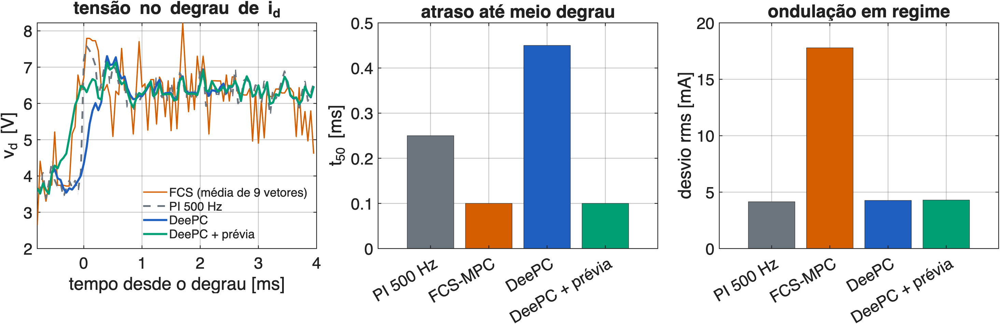{fig-align="center" width="100%"}

- Tensões contínuas e suaves (vão para o PWM). Com a prévia, a tensão muda **um pouco antes** do degrau, pois o controle "sabe" que ele vem.


## Sintonia

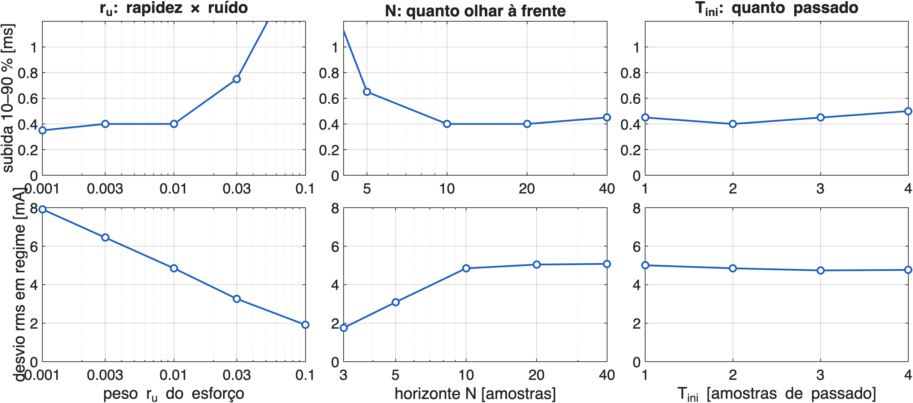{fig-align="center" width="88%"}

- **r~u~**: maior = mais lento e menos ondulação. **N**: curto (3) é lento; de 10 em diante pouco muda. **T~ini~** quase não muda a malha fechada (com dados de média de 16).

## Por dentro: o DeePC sem restrições é um controlador linear

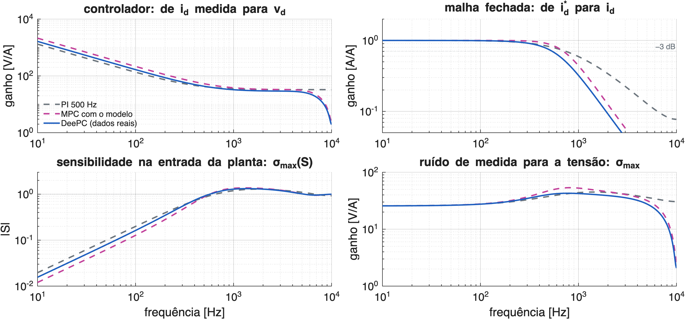{fig-align="center" width="80%"}

- Ordem 6: **integrador** (ganho alto em baixa frequência), região plana (≈ 30 V/A) e **filtro** perto de 10 kHz, que o PI não tem.
- Por ser linear, valem as ferramentas clássicas: polos, margens, sensibilidade. Nenhuma depende de conhecer R e L para o **projeto**; aqui R e L entram só para **avaliar**.

## Margens e ganhos de ruído

::::: {style="font-size:0.93em"}
::::: {style="font-size:0.78em"}
::: {style="font-size:0.92em"}
| Controle | Raio espectral | Banda [Hz]{style="text-transform:none"} | Pico de S | Margem de ganho [dB]{style="text-transform:none"} | Margem de fase | Ruído → corrente | Ruído → tensão [V/A]{style="text-transform:none"} |
|---|---|---|---|---|---|---|---|
| PI 300 Hz (ensaiado) | 0,905 | 368 | 1,19 | 14,7 | 69° | 0,24 | 21,5 |
| PI 500 Hz | 0,887 | 730 | 1,29 | 12,2 | 63° | 0,33 | 35,7 |
| MPC com o modelo certo | 0,858 | 696 | 1,37 | 9,8 | 54° | 0,38 | 32,2 |
| **SPC (dados reais)** | 0,857 | 692 | 1,38 | 9,7 | 54° | 0,38 | 33,1 |
| **DeePC, λ~g~ = 3 (dados reais)** | 0,861 | 534 | 1,32 | 11,0 | 58° | 0,34 | 27,7 |

: {tbl-colwidths="[25,10,9,9,13,10,11,13]"}
:::

- Margens de disco na entrada da planta (ganho e fase simultâneos nos dois eixos). "Ruído → corrente": rms da corrente por rms do ruído de medida (8,5 mA × 0,38 = 3,2 mA).
- SPC com dados reais = MPC com o modelo certo, até a segunda casa. O λ~g~ do DeePC age como um r~u~ maior: menos banda, mais margem.
- Na mesma banda do PI de 500 Hz (730 Hz), o SPC fica com 9,4 dB e 53° contra 12,2 dB e 63° do PI: **o PI bem sintonizado tem margem maior** nesta carga de 1ª ordem.
:::::
:::::

## Rapidez × robustez × ruído

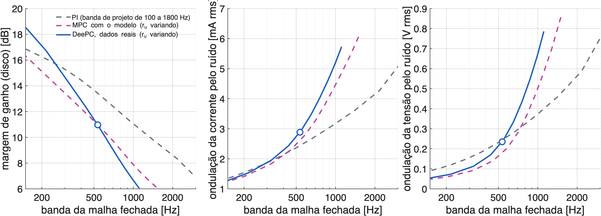{fig-align="center" width="96%"}

- Cada curva é uma família de sintonias (r~u~ no DeePC/MPC, banda de projeto no PI). O círculo é a sintonia de referência.
- Até ≈ 500 Hz as três famílias se equivalem. Acima disso o preditivo paga mais margem e mais ondulação por hertz de banda: o horizonte de 10 amostras "aperta" a malha.

## Mapa de estabilidade: carga diferente da dos dados

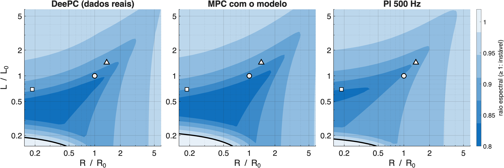{fig-align="center" width="94%"}

- Controle fixo (dados da carga nominal ○), carga real variando de 0,15 a 6 vezes em R e em L. Linha preta: limite de estabilidade.
- **Estável em 99 % da grade** (PI: 99 %; MPC com modelo: 97 %). Só indutância abaixo de ≈ 0,2 L~0~ desestabiliza. ▲ = carga do cenário do RLS (35 Ω; 14 mH); □ = carga antiga (4,7 Ω; 6,8 mH).

## Margem de ganho e de atraso

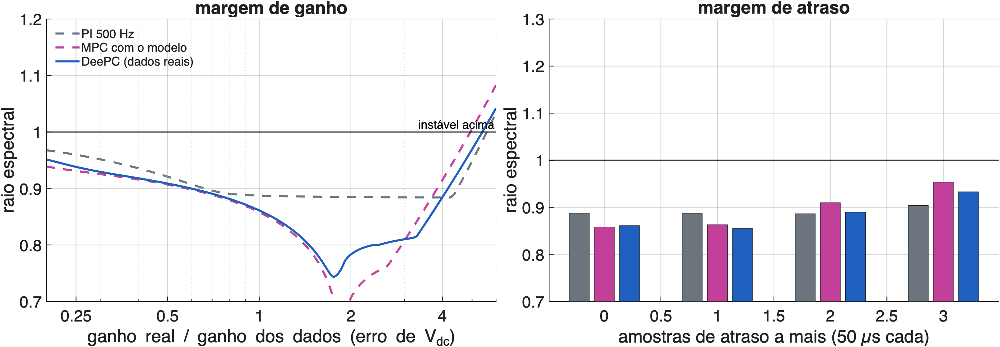{fig-align="center" width="92%"}

- Erro de ganho (V~dc~ real ≠ V~dc~ usado na conta): estável até **5,5 vezes** (PI: 5,7; MPC com modelo: 5,1).
- Atraso a mais: estável com até **3 amostras extras** (150 µs), nos três controles.

## Carga diferente da dos dados, e o ensaio refeito

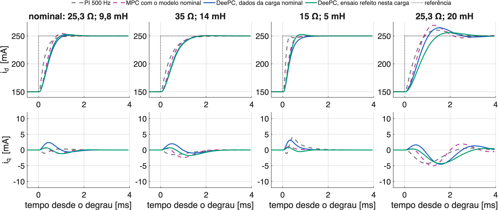{fig-align="center" width="92%"}

- Com os dados da carga nominal, o controle continua estável e sem erro em regime nas quatro cargas; o pior caso é L dobrada (sobressinal de 13 %; MPC com modelo nominal: 18 %).
- **Refazer a PRBS na carga nova** (102 ms) devolve o projeto: sobressinal volta a 4 %. Nenhum parâmetro é reescolhido.

## Queda de V~dc~ e perturbação de tensão

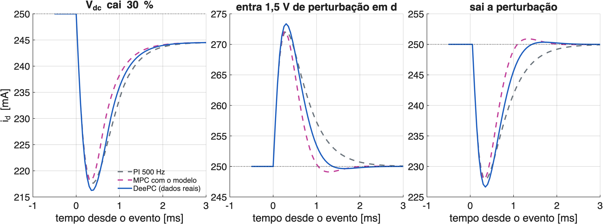{fig-align="center" width="94%"}

- V~dc~ cai 30 % sem o controle saber: desvio de ≈ 33 mA, igual nos três; recuperação em 3 ms (limitada pela tensão disponível).
- Perturbação de 1,5 V em d (como uma força contraeletromotriz ou a rede): o DeePC volta a 10 % em **1,05 ms**; PI, 1,5 ms; MPC com modelo, 0,85 ms. Erro em regime nulo nos três.

## Limitação: dados de 60 Hz valem perto de 60 Hz

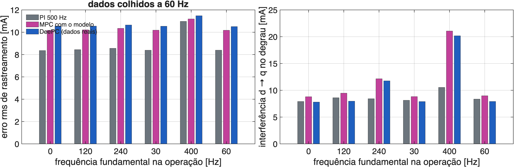{fig-align="center" width="90%"}

- O modelo em dq depende da frequência (ωL). Dados colhidos a 60 Hz embutem o acoplamento de 60 Hz.
- Até 120 Hz nada muda. A 400 Hz a interferência d → q dobra (20 mA contra 10,5 mA do PI, que conhece ω para desacoplar). Continua estável (raio espectral 0,92).
- Saídas: colher dados na frequência de uso, trabalhar em αβ (o modelo não depende de ω) ou incluir ω como parâmetro (LPV).

## Ruído e quantidade de dados: como foi o Monte Carlo

::: {style="font-size:0.95em"}
1. Repete-se o **ensaio de PRBS em simulação** (a mesma sequência real), com ruído de 0,5 a 32 mA por amostra, 20 sorteios por nível.
2. De cada conjunto de dados, cinco caminhos constroem o controle: **SPC**, **SPC causal**, **DeePC** (λ~g~ = 3 e o melhor λ~g~ de cada ruído), **ARX → MPC** e **modelo físico → MPC**.
3. Cada controle roda na malha fechada com o ruído da bancada (8,5 mA) e recebe a nota J.
4. Referência: o MPC feito com o **modelo certo** (J = 10,2 mA). O resultado é a **piora percentual** sobre ele.

- Os pontos "dados reais" usam a PRBS medida na bancada: média de 16 períodos (ruído efetivo 2,1 mA) e um período só (8,5 mA).
:::

## Resultado: ruído e quantidade de dados

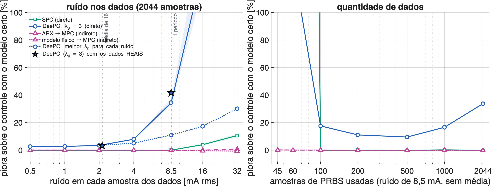{fig-align="center" width="92%"}

- **SPC**: igual ao modelo certo até 8,5 mA (o ruído real sem média); +4 % a 16 mA e +11 % a 32 mA. Com 8,5 mA, **100 amostras bastam**.
- **Indiretos**: iguais ao modelo certo em toda a faixa (poucos parâmetros = pouca variância), já com 45 amostras.
- **DeePC com λ~g~ fixo**: +3 % com pouco ruído, **+35 % a 8,5 mA**. As estrelas (dados reais) caem sobre a curva simulada: +3 % e +42 %.

## Leitura: viés × variância, e o papel do λ~g~

::: {style="font-size:0.95em"}
- **Variância**: quanto mais parâmetros livres (560 no SPC, 12 no ARX, 4 no físico), mais dados o ruído exige. Nesta carga simples, **saber a estrutura ajuda**: o caminho indireto nunca perde.
- **Viés**: o preço do indireto aparece quando a estrutura suposta está errada. Aqui esse preço é pequeno (próximo slide).
- **λ~g~ não é universal**: o melhor valor cresce com o ruído (3 → 10 → 30 → 100 para 2 → 8,5 → 16 → 32 mA) e com o número de colunas. Mesmo o melhor λ~g~ perde para o SPC (+11 % a 8,5 mA).
- **Recomendação para a placa**: forma **SPC** (sem λ~g~), dados com média síncrona, T~ini~ ≥ 2. O DeePC regularizado fica como a formulação geral, necessária quando há restrições dentro da otimização.
:::

## Quanto passado usar, e estrutura inesperada

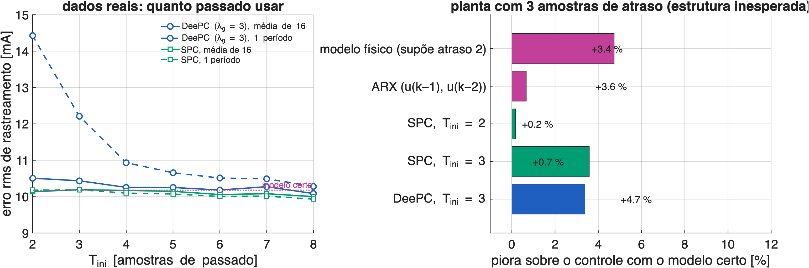{fig-align="center" width="92%"}

- **T~ini~** (dados reais): o SPC não liga; o DeePC com λ~g~ = 3 e dados de um período melhora de 14,4 para 10,3 mA com T~ini~ de 2 a 8 (mais passado = mais filtro).
- **Planta com 3 amostras de atraso** (uma a mais que o suposto): o modelo físico e o ARX com a estrutura errada pioram só **+3 % a +4 %**; o SPC, 0 %. A forma incremental com realimentação perdoa bem o erro de estrutura **nesta carga**.

## Planta chaveada, tempo morto e a previsão do ensaio

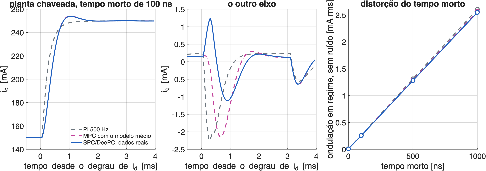{fig-align="center" width="92%"}

::: {style="font-size:0.8em"}
| Previsão para a bancada (PWM, 100 ns, ruído) | Subida [ms]{style="text-transform:none"} | t~50~ [ms]{style="text-transform:none"} | Sobressinal | rms regime [mA]{style="text-transform:none"} | Interferência [mA]{style="text-transform:none"} | J [mA]{style="text-transform:none"} |
|---|---|---|---|---|---|---|
| PI 500 Hz | 0,45 | 0,25 | 4 % | 4,4 | 8,0 | 8,4 |
| SPC/DeePC | 0,45 | 0,40 | 5 % | 5,2 | 9,1 | 10,2 |
| SPC/DeePC + prévia | 0,45 | **0,10** | 7 % | 5,2 | 8,8 | **6,4** |
:::

- Tempo morto de 100 ns: 0,26 mA rms de ondulação a mais (1 µs: 2,6 mA), igual nos três controles.

## E o limite de tensão?

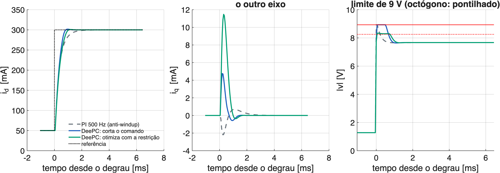{fig-align="center" width="94%"}

- O MPC pode tratar o limite **dentro** da otimização (QP, limite circular aproximado por um octógono). Mas o QP levou **1,4 ms por amostra** no MATLAB: não cabe em 50 µs sem um solver dedicado.
- Degrau grande (0,05 → 0,30 A): **cortar** a tensão calculada (como o anti-windup do PI) dá t~90~ = 0,65 ms; o QP, 0,80 ms (mais conservador). Para esta carga, **cortar basta**.


## Otimizar com a restrição em poucas contas

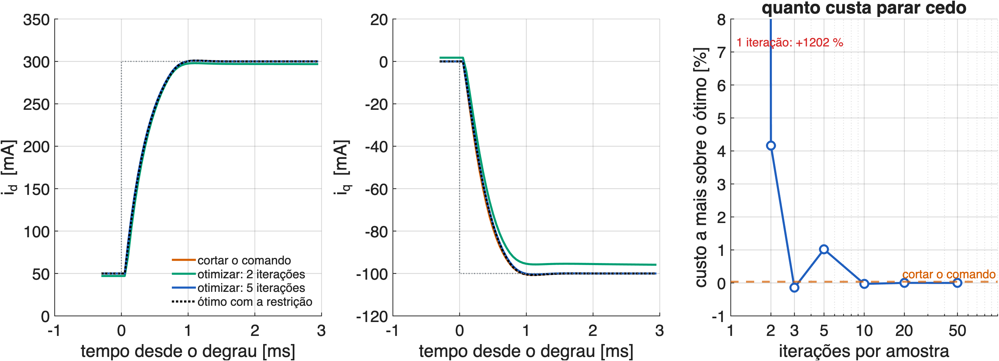{fig-align="center" width="92%"}

- Gradiente rápido projetado: variáveis = as 10 tensões futuras; cada uma é projetada no círculo \|v\| ≤ 8,9 V; partida quente com a solução anterior.
- Degrau grande em d e q juntos: **3 iterações** chegam ao ótimo (1 iteração não basta: +1200 %).
- E o corte simples dá **o mesmo custo do ótimo** (+0,0 %): como o passado usa a tensão de fato aplicada, o corte já é quase ótimo nesta carga. Otimizar com a restrição só se justifica com **limite de corrente** ou horizonte longo.

## Custo computacional

::::: {style="font-size:0.83em"}
::: {style="font-size:0.86em"}
| Tarefa | Contas (multiplica e soma) | Estimativa no F28379D | Onde roda |
|---|---|---|---|
| Lei de controle, T~ini~ = 2 | 20 (56 com prévia) | ≈ 1 a 4 µs | interrupção de 50 µs |
| Lei de controle, T~ini~ = 6 | 52 (88 com prévia) | ≈ 2 a 6 µs | interrupção |
| Restrição: 3 iterações, N = 10 | 3 × 440 | ≈ 20 a 65 µs | CPU2/CLA, ou N = 5 na interrupção |
| Matrizes de Gram, durante a PRBS | 966 por amostra | ≈ 15 a 50 µs por amostra | laço principal ou CPU2 |
| Ganhos: Cholesky 28 × 28 + MPC | ≈ 41 mil | ≈ 1 a 3 ms, uma vez | laço principal |
| Memória | 1344 floats (Gram) + 56 (ganhos) | 2,8 mil palavras | os dados **não** são guardados |

: {tbl-colwidths="[30,22,24,24]"}
:::

- Estimativas com 3 a 15 ciclos de 5 ns por conta (laço em C com -O2 e FPU, ou biblioteca em assembly). **A medir** com o CPU Timer, como no VSI05 (FCS + RLS: 15,9 µs medidos).
- No MATLAB deste computador: SPC 3,8 ms; DeePC (SVD) 8,3 ms.
:::::

## Ganhos calculados na própria placa: dá certo em precisão simples?

::: {style="font-size:0.80em"}
- A placa não precisa guardar a Hankel (48 × 2044): basta **acumular** $G = \sum w\,w^\top$ (28 × 28) e $H = \sum y_f\,w^\top$ (20 × 28) enquanto a PRBS roda, e resolver $K = H\,G^{-1}$ no fim.
- Refeito em **float de 32 bits** (como na placa), com Cholesky:

| Verificação | Resultado |
|---|---|
| Condicionamento de G | 4,9 × 10⁵ (cabe com folga em 7 dígitos) |
| Erro relativo dos ganhos (32 × 64 bits) | 1,2 × 10⁻⁶ |
| Nota J com os ganhos de 32 bits | 10,137 mA (idêntica à de 64 bits) |
| Erro aleatório de 5 % em cada ganho | J de 10,13 a 10,25 mA |

: {tbl-colwidths="[55,45]"}

- A lei de controle é pouco sensível a erro nos ganhos: quantização e arredondamento não são problema.
:::

## Cabe na LaunchPad? Até onde?

::: {style="font-size:0.86em"}
| Nível | O que roda na placa | Cabe? |
|---|---|---|
| 1 | ganhos vindos do MATLAB + corte da tensão | sim, com muita folga |
| 2 | PRBS + Gram + ganhos na placa (sem PC, sem modelo) | sim (como o EDMD do VSI06) |
| 3 | re-ensaio rápido de 5 a 10 ms quando o desempenho piora | sim |
| 4 | restrição de tensão dentro da otimização (3 iterações) | sim com N = 5, ou na CPU2/CLA |
| 5 | FCS com preditor por dados (8 vetores × preditor) | sim (carga do VSI04) |
| 6 | restrição de corrente (QP geral), horizonte longo, DeePC não linear | não a 20 kHz; a 5–10 kHz ou com MPC explícito |

: {tbl-colwidths="[8,62,30]"}
:::

- O F28379D tem a **CPU2 parada** e um coprocessador (CLA) por CPU: os níveis 2 a 4 podem sair da interrupção de controle.

## E se a carga mudar? Adaptar com os dados da malha fechada

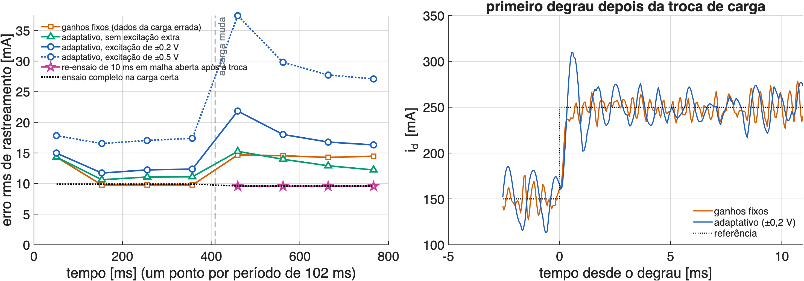{fig-align="center" width="92%"}

- Cenário: o controle começa com dados de uma carga errada (35 Ω; 14 mH); aos 0,41 s a indutância cai 4 vezes (12 Ω; 2,5 mH).
- Atualizar as matrizes de Gram com os dados da **malha fechada** melhora devagar (15,3 → 12,2 mA em 0,4 s) e, antes da troca, é **pior** que o ganho fixo (11,1 contra 9,8 mA). Com excitação extra, piora mais.

## Leitura: o viés da malha fechada e o re-ensaio rápido

- Em malha fechada a tensão depende do ruído de medida (pela realimentação): o preditor por mínimos quadrados fica **viesado**. É o mesmo viés de L visto no RLS da etapa 05.
- A excitação extra (*dither*) ajuda a identificar, mas ela própria vira erro de corrente: com ±0,5 V a nota vai a 27–37 mA.
- **Alternativa que funciona**: parar o controle por **10 ms**, aplicar 200 amostras de PRBS em malha aberta e refazer os ganhos. Resultado: J = **9,6 mA** (de 9,4 a 9,9 em 10 sorteios), igual ao ensaio completo.
- Fronteira de pesquisa: SPC de malha fechada com **variável instrumental** (a referência e a excitação como instrumentos), que o grupo já usou no RLS.

## Vantagens e desafios, com os números desta bancada

::: {style="font-size:0.74em"}
| Vantagens (verificadas) | Desafios (verificados) |
|---|---|
| Sem escolher estrutura: o atraso e a rotação no atraso entram sozinhos | Nesta carga simples, o indireto (4 a 12 parâmetros) nunca perde para o direto |
| Igual ao MPC com o modelo certo com o ruído real e 100 amostras (SPC) | DeePC com λ~g~ fixo: +35 % com ruído de 8,5 mA; λ~g~ depende do ruído e do nº de colunas |
| Ondulação do PI (4 mA), 4 vezes menor que a do FCS | Na mesma banda, margem menor que a do PI (9,4 contra 12,2 dB) |
| Prévia da referência: t~50~ de 0,10 ms e J de 6,4 mA (PI: 8,4) | Dados de 60 Hz valem até ≈ 120 Hz; a 400 Hz a interferência dobra |
| Erro em regime nulo com carga, V~dc~ e perturbação diferentes | Adaptação com dados de malha fechada é viesada |
| 20 contas por amostra; ganhos calculáveis na placa em float de 32 bits | Restrição de corrente exige QP por amostra (não cabe a 20 kHz) |
| Re-ensaio de 10 ms devolve o desempenho após troca de carga | Sem interpretação física (não entrega R e L) |

: {tbl-colwidths="[50,50]"}
:::

## Limitações e ameaças à validade

- **Sem ensaio do DeePC na bancada ainda**: os resultados de malha fechada são de simulação. O que há de real: os dados que constroem o controle, a validação do preditor e a validação do simulador contra o PI medido.
- **Carga RL passiva e linear**: é o caso mais favorável ao PI e ao modelo físico. A vantagem do caminho direto deve crescer com filtro LCL, rede fraca ou indutor saturando (não testado aqui).
- **Ruído modelado como branco** por eixo, com quantização; o ruído real tem componentes do chaveamento.
- **Margens calculadas com o modelo nominal**: servem para comparar controles, não como garantia para qualquer carga.
- **Tempos de execução estimados**, não medidos.
- **Um único ponto de operação** (60 Hz, 20 V, 0,15 a 0,30 A).

## Variantes e combinações a explorar

::: {style="font-size:0.79em"}
| Linha | Ideia | Por que aqui |
|---|---|---|
| Ruído | SPC causal; γ-DDPC; variável instrumental; DeePC robusto | tirar a dependência do λ~g~ |
| Malha fechada | SPC com variável instrumental; excitação na referência | adaptação sem viés |
| Sem otimização online | ganho de realimentação por LMI direto dos dados (De Persis e Tesi) | garantia de estabilidade, custo zero |
| Híbrido com FCS | FCS com preditor SPC (versão por dados do VSI04) | comparar com o Koopman-FCS do VSI06 |
| Não linear | DeePC + Koopman/EDMD; preditor por faixas de corrente | indutor saturando |
| Rede | tensão da rede como perturbação medida na Hankel; filtro LCL | onde o caminho direto mais se justifica |
| Supervisão | monitor de erro de previsão dispara o re-ensaio de 10 ms | recomissionamento automático |

: {tbl-colwidths="[18,50,32]"}
:::

## O que falta para o artigo: protocolo de ensaios na bancada

::::: {style="font-size:0.97em"}
::::: {style="font-size:1.00em"}
::::: {style="font-size:0.75em"}
::: {style="font-size:0.82em"}
| Ensaio | O que mede | Compara com |
|---|---|---|
| E1 | DeePC/SPC com ganhos do MATLAB, perfil de degraus das etapas 03–05 (média de 16 e cru) | tabela de previsão (PWM) e PI/FCS medidos |
| E2 | prévia da referência ligada | t~50~ e J previstos (0,10 ms; 6,4 mA) |
| E3 | T~ini~ = 2, 4, 6 e dados de 1 período × média de 16 | curva de T~ini~ |
| E4 | degrau grande com saturação (0,05 → 0,30 A): corte | figura das restrições |
| E5 | ganhos calculados na placa (PRBS + Gram + Cholesky em float) | ganhos do MATLAB |
| E6 | carga trocada (resistor/indutor em série) com ganhos antigos e re-ensaio de 10 ms | mapa e figura das cargas |
| E7 | V~dc~ 15 V e 20 V com os mesmos ganhos | margem de ganho |
| E8 | tempos da interrupção (CPU Timer 1) | tabela de custo |

: {tbl-colwidths="[8,56,36]"}
:::

- Firmware `VSI07ControleDeePC`: base VSI03 (PWM, medidas, dq, `Dados3F`, média síncrona); `modo` 3 = DeePC, 1 = PI.
:::::
:::::
:::::

## Proposta de artigo (IEEE Access)

::: {style="font-size:0.81em"}
**Título provisório**: Controle preditivo de corrente habilitado por dados para inversor trifásico em DSP de baixo custo: projeto em forma fechada, robustez e custo computacional.

Contribuições pretendidas:

1. Controle preditivo direto dos dados com **PWM a 20 kHz** num F28379D, com a lei em forma fechada (20 contas por amostra) e ganhos calculáveis na própria placa.
2. Comparação **direto × indireto** com ruído e quantização reais: quando o SPC iguala o modelo certo (ruído ≤ 8,5 mA, ≥ 100 amostras) e por que o DeePC com λ~g~ fixo falha.
3. Análise da lei como **controlador linear**: margens, mapas de estabilidade e compromisso rapidez × robustez × ruído, contra o PI e o FCS.
4. Evidência com **dados reais**: o preditor prevê um ensaio independente (FIT de 94 %) e capta a rotação do referencial no atraso, que o modelo em dq ignora.
5. Limites documentados: frequência, adaptação em malha fechada, restrição de corrente. **Dados e código abertos.**

- A prévia do artigo (em português, modelo do IEEE Access) está em `~/Artigos/ArtigoDeePC/`.
:::

## Conclusões

- O controle preditivo direto dos dados **funciona nesta bancada em simulação fiel**: sem R e L, iguala o MPC com o modelo certo, tem a ondulação do PI e, com prévia, o t~50~ do FCS.
- A forma que vai para a placa é a **SPC em incrementos**: sem λ~g~, 20 contas por amostra, erro em regime nulo, corte da tensão quase ótimo.
- O ganho sobre o PI **não é desempenho bruto** nesta carga: é dispensar a escolha de estrutura, tratar o MIMO e a prévia de graça, e refazer o projeto em 10 ms.
- Os pontos fracos estão medidos: λ~g~, frequência diferente da dos dados, adaptação em malha fechada.
- Próximo passo: firmware `VSI07ControleDeePC` e os ensaios E1 a E8.

## Referências principais

::::: {style="font-size:0.93em"}
::::: {style="font-size:0.93em"}
::::: {style="font-size:0.94em"}
::: {style="font-size:0.72em"}
- J. C. Willems, P. Rapisarda, I. Markovsky, B. De Moor, "A note on persistency of excitation", *Systems & Control Letters*, 2005. [a conferir]
- W. Favoreel, B. De Moor, M. Gevers, "SPC: Subspace predictive control", IFAC World Congress, 1999. [a conferir]
- J. Coulson, J. Lygeros, F. Dörfler, "Data-enabled predictive control: In the shallows of the DeePC", ECC 2019, doi 10.23919/ECC.2019.8795639.
- L. Huang, J. Coulson, J. Lygeros, F. Dörfler, "Data-enabled predictive control for grid-connected power converters", CDC 2019, doi 10.1109/CDC40024.2019.9029522.
- F. Dörfler, J. Coulson, I. Markovsky, "Bridging direct and indirect data-driven control formulations via regularizations and relaxations", *IEEE TAC*, 2023, doi 10.1109/TAC.2022.3148374.
- J. Berberich, J. Köhler, M. A. Müller, F. Allgöwer, "Data-driven model predictive control with stability and robustness guarantees", *IEEE TAC*, 2021, doi 10.1109/TAC.2020.3000182.
- C. De Persis, P. Tesi, "Formulas for data-driven control: stabilization, optimality, and robustness", *IEEE TAC*, 2020, doi 10.1109/TAC.2019.2959924.
- L. Huang, J. Zhen, J. Lygeros, F. Dörfler, "Robust data-enabled predictive control: tractable formulations and performance guarantees", arXiv:2105.07199.
- J. Berberich, F. Allgöwer, "An overview of systems-theoretic guarantees in data-driven model predictive control", *Annual Review of Control, Robotics, and Autonomous Systems*, 2025.
- F. Zhao et al., "Direct adaptive control of grid-connected power converters via output-feedback data-enabled policy optimization", arXiv:2411.03909, 2025.
- P. G. Carlet, A. Favato, S. Bolognani, F. Dörfler, "Data-driven continuous-set predictive current control for synchronous motor drives", *IEEE TPEL*, 2022. [a conferir]
:::

Projeto: `07ControleDeePC/matlab/principal.m` (t00, d00–d12); resultados numéricos em `matlab/resultados/`.
:::::
:::::
:::::

