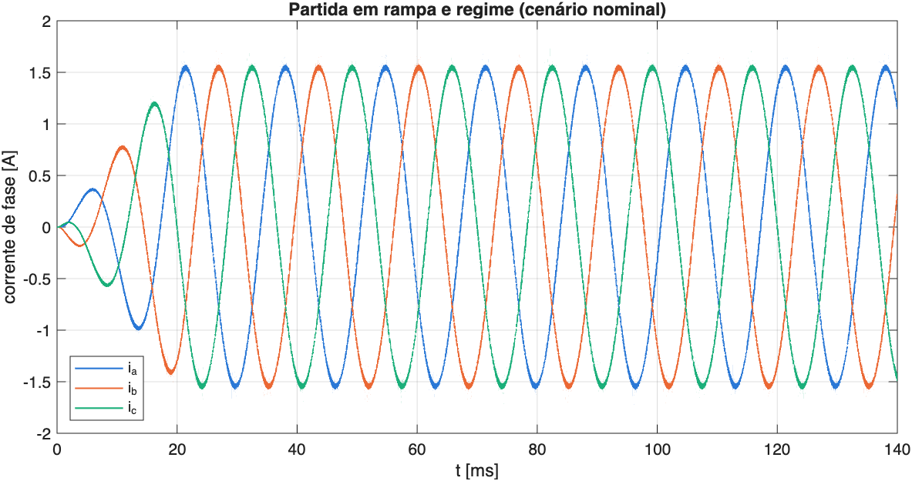
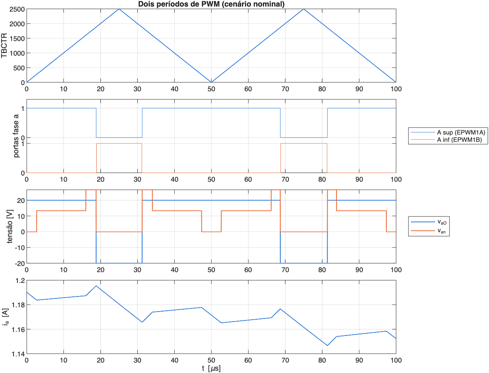
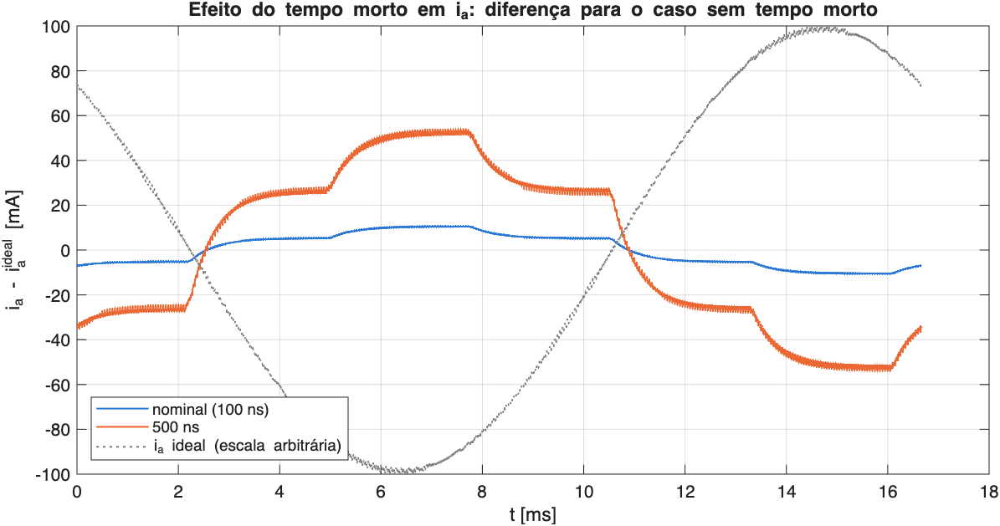
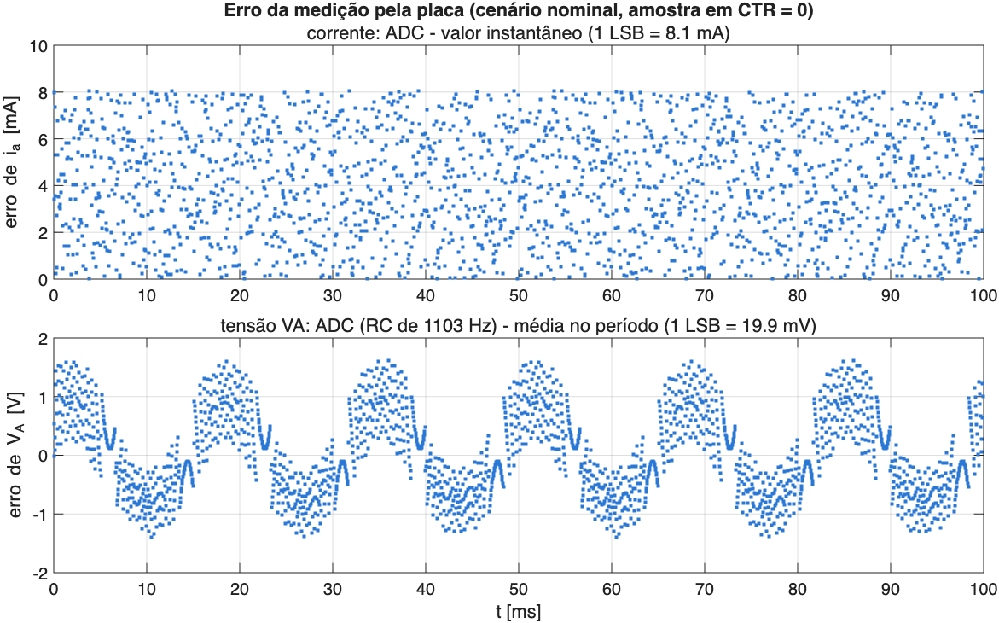
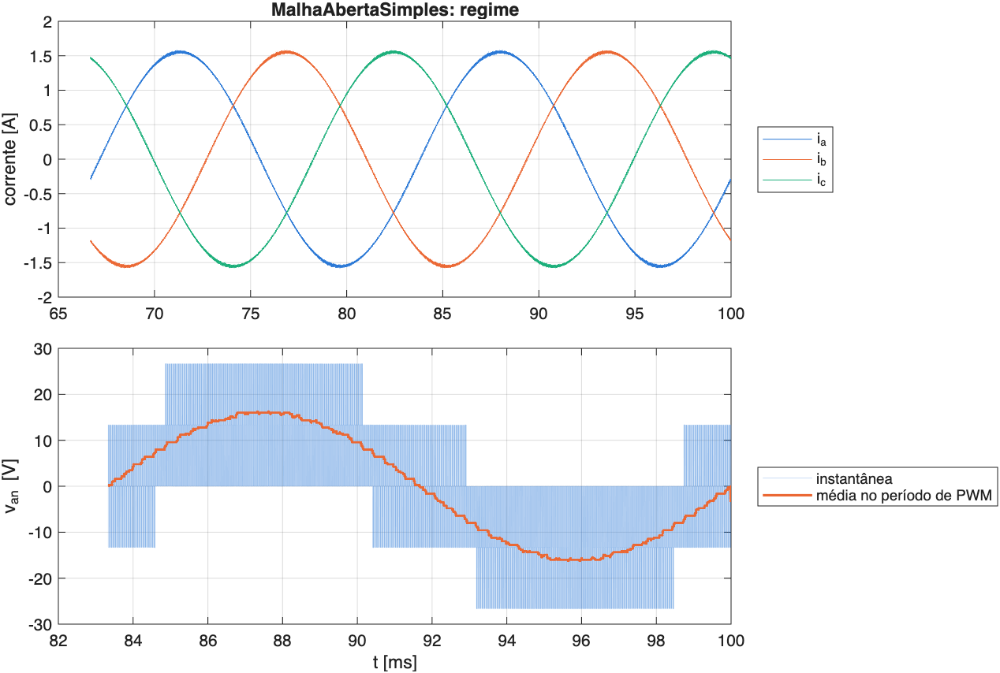

# A bancada

- LaunchPad
- Inversor GaN
- Circuito

## Do PC à carga

::: {.nova-svg data-nova-diagram="bancada"}
:::

::: {.takeaway .fragment}
Simular **antes** de energizar: o modelo deve prever o que o ADC vai medir.
:::

## LAUNCHXL-F28379D

| Recurso | Uso no VSI |
|:--|:--|
| CPU C28x a 200 MHz, FPU, TMU | ISR de 50 µs: [10 000 ciclos]{.hl} por período de PWM |
| ePWM 1–3, relógio de 100 MHz | PWM simétrico (contador sobe e desce, TBPRD = 2500), banda morta |
| 4 ADC de 12 bits | correntes e tensões, disparados pelo ePWM no início do período |
| CMPSS + trip zone | desligamento por sobrecorrente em hardware, sem passar pela CPU |
| CLA | processador auxiliar: MPC, RLS em paralelo à CPU (etapas futuras) |

: {tbl-colwidths="[38,62]"}

::: {.takeaway .fragment}
A ISR tem folga de sobra: o gargalo será o **sensor de corrente**, não o processador.
:::

## BOOSTXL-3PHGANINV

:::: {.columns}
::: {.column width="58%"}
| Item | Valor |
|:--|:--|
| Barramento CC | 12–60 V (nominal 48 V) |
| Corrente | 10 A de pico, OCP em 12 A |
| Chaves | 3 × LMG5200 (GaN 80 V, < 2 ns) |
| Corrente medida | shunt 5 mΩ + INA240 (× 20): ±16,5 A |
| Tensões medidas | fundo de 81,5 V, RC de 1,1 kHz |

: {tbl-colwidths="[42,58]"}

[Fonte: @ti2018boostxl e MotorControl SDK da TI.]{.muted .smaller}
:::
::: {.column width="42%"}
::: {.callout-warning title="Enable ativo em nível baixo" .fragment}
`GPIO124 = 0` **liga** o inversor. O firmware atual do VSI01 faz o contrário e a placa não chaveia.
:::
::: {.callout-note title="Sinal da corrente" .fragment}
O INA240 tem polaridade invertida: $v = 1{,}65 - 0{,}1\,i$ (V, A).
:::
:::
::::

## O inversor de dois níveis

::: {.nova-svg data-nova-diagram="vsi-circuito"}
:::

# O modelo

- Tensão média
- Carga RL
- Limites da modulação

## Do PWM à tensão de fase

::: {.eqx}
:::: {.columns}
::: {.column width="48%"}
$$
\eq{a}{\bar v_{xO}} = \left(\eq{b}{d_x} - \tfrac{1}{2}\right)\eq{c}{V_{cc}}
$$
$$
\eq{d}{v_{nO}} = \tfrac{1}{3}\left(v_{aO} + v_{bO} + v_{cO}\right)
$$
$$
\eq{e}{v_{an}} = v_{aO} - v_{nO}
$$
:::
::: {.column width="52%"}
::: {.eqx-defs}
- [$\bar v_{xO}$]{.t-a} tensão média da perna $x$ no período de PWM
- [$d_x$]{.t-b} razão cíclica: $d_x = \frac12 + v_x^*/V_{cc}$
- [$V_{cc}$]{.t-c} barramento CC (40 V)
- [$v_{nO}$]{.t-d} neutro da carga em relação ao ponto médio O (carga equilibrada)
- [$v_{an}$]{.t-e} tensão aplicada à fase a da carga
:::
:::
::::
:::

::: {.takeaway .fragment}
Com referências senoidais equilibradas, $v_{nO}$ só tem componentes de chaveamento: $\bar v_{an} = v_a^*$.
:::

## Carga RL: dinâmica e regime

::: {.eqx .deriv}
::: {.step}
[$v_{an}$]{.lhs} [$= R\,i_a + L\,\frac{di_a}{dt}$]{.rhs} [malha da fase a, neutro isolado]{.why}
:::
::: {.step .fragment}
[$\eq{a}{\tau}$]{.lhs} [$= L/R = 0{,}5\ \text{ms}$]{.rhs} [constante de tempo]{.why}
:::
::: {.step .fragment}
[$\eq{b}{I}$]{.lhs} [$= V_p\,/\,(R' + j\omega L)$]{.rhs} [regime a 60 Hz; $R' = R + R_{on} + R_L$]{.why}
:::
::: {.step .fragment}
[$\eq{b}{I}$]{.lhs} [$= 1{,}555\ \text{A}\ \angle -10{,}56^\circ$]{.rhs} [$V_p$ = 16 V, $R'$ = 10,12 Ω, $\omega L$ = 1,885 Ω]{.why}
:::
:::

::: {.takeaway .fragment}
[$\tau$ = 0,5 ms]{.t-a} ≪ 16,7 ms: carga [quase resistiva]{.t-b} a 60 Hz.
:::

## Limites da modulação

| Restrição | $V_p$ máximo com $V_{cc}$ = 40 V |
|:--|:-:|
| PWM senoidal, região linear: $V_p \le V_{cc}/2$ | 20,0 V |
| Injeção de sequência zero (≡ SVPWM): $V_p \le V_{cc}/\sqrt{3}$ | 23,1 V |
| Razão cíclica em [0,08; 0,95], PWM senoidal | 16,8 V |
| Razão cíclica em [0,08; 0,95], sequência zero | 19,4 V |

: {tbl-colwidths="[66,34]"}

::: {.takeaway .fragment}
Escolha: $V_p$ = [16 V]{.hl} ($m$ = 0,8), com $d \in [0{,}10;\ 0{,}90]$.
:::

# Dimensionamento

- Tensão e corrente
- PWM e amostragem
- Tempo morto
- Carga

## Limites da placa e escolhas

| Grandeza | Limite | Escolha |
|:--|:--|:--|
| $V_{cc}$ | placa 12–60 V; GaN 80 V | [40 V]{.hl}: 2× abaixo dos 80 V do GaN |
| Corrente | 10 A de pico; OCP 12 A | [1,56 A]{.hl} de pico (16 %); trip por software em 5 A |
| $f_{PWM}$ | INA240: ~2 µs após cada comutação | [20 kHz]{.hl}: acima do audível, $d \ge 0{,}08$ |
| $T_s$ | ISR no início do período | [50 µs]{.hl}: uma amostra e uma atualização por período |
| Tempo morto | descasamento de poucos ns | [100 ns]{.hl} (SDK da TI: 500–600 ns) |

: {tbl-colwidths="[18,38,44]"}

## Por que 20 kHz

::: {.nova-svg data-nova-diagram="amostragem"}
:::

## O atraso de implementação

::: {.nova-svg data-nova-diagram="atraso"}
:::

::: {.callout-important title="Herança para as próximas etapas" .fragment}
Esse atraso entra no projeto do PI (VSI03) e na compensação de atraso do MPC (VSI04/05).
:::

## O tempo morto

::: {.nova-svg data-nova-diagram="tempo-morto"}
:::

## Quanto custa o tempo morto

::: {.eqx}
$$
\eq{a}{\Delta V_1} = \frac{4}{\pi}\,\eq{b}{f_{PWM}}\,\eq{c}{t_m}\,\eq{d}{V_{cc}}
$$

::: {.eqx-text}
O erro é uma onda quadrada em fase com a corrente; sua [1ª harmônica]{.t-a} cresce com a [frequência de chaveamento]{.t-b}, o [tempo morto]{.t-c} e o [barramento]{.t-d} [@holmes2003pwm].
:::
:::

| $t_m$ | $\Delta V_1$ | perda na fundamental | 5ª harmônica de $v_{an}$ |
|:-:|:-:|:-:|:-:|
| 500 ns (SDK) | 0,509 V | 3,1 % | 102 mV |
| [100 ns]{.hl} | 0,102 V | 0,6 % | 21 mV |

: {tbl-colwidths="[22,22,28,28]"}

## A carga é boa?

| $R$ | $L$ | $\tau$ | fase | $\lvert I\rvert$ de pico | P por resistor |
|:-:|:-:|:-:|:-:|:-:|:-:|
| [10 Ω]{.hl} | [5 mH]{.hl} | 0,5 ms | 10,7° | 1,56 A | 12 W |
| 10 Ω | 10 mH | 1,0 ms | 20,7° | 1,48 A | 11 W |
| 5 Ω | 10 mH | 2,0 ms | 37,0° | 2,52 A | 16 W |
| 5 Ω | 5 mH | 1,0 ms | 20,7° | 2,94 A | 22 W |

: $V_p$ = 16 V, $V_{cc}$ = 40 V {tbl-colwidths="[14,14,16,16,20,20]"}

::: {.callout-insight .fragment}
10 Ω + 5 mH é segura e serve para a malha aberta, mas é quase resistiva. Para ver a dinâmica e o acoplamento $dq$ no PI, 5 Ω + 10 mH é mais interessante.
:::

# Simulação

- Modelo fiel ao firmware
- Modelo simples

## Modelo fiel ao firmware

::: {.nova-svg data-nova-diagram="modelo-firmware"}
:::

## A ISR em C e em MATLAB

:::: {.columns}
::: {.column width="50%"}
```c
// senoides.c + placa.c (firmware)
*va = V * sinf(theta);
*vb = V * sinf(theta - DOIS_PI_3);
*vc = V * sinf(theta + DOIS_PI_3);
theta += dTheta;

float d = 0.5f + v[i] / Vcc;
if (d < 0.0f) d = 0.0f;
if (d > 1.0f) d = 1.0f;
EPWM_setCounterCompareValue(base,
    EPWM_COUNTER_COMPARE_A,
    (uint16_t)(d * (float)periodo));
```
:::
::: {.column width="50%"}
```matlab
% bloco LacoPWM (MalhaAberta.slx)
vs = [V*sin(theta);
      V*sin(theta - DOIS_PI_3);
      V*sin(theta + DOIS_PI_3)];
theta = theta + dTheta;

d = single(0.5) + vs/Vcc;
d = min(max(d, single(0)), single(1));
cmpa = double(floor(d*periodo));
% floor = cast (uint16_t) do C
```
:::
::::

::: {.takeaway .fragment}
Mesmas contas, mesma precisão (float de 32 bits), mesmo truncamento do CMPA.
:::

## Modelo simples

::: {.nova-svg data-nova-diagram="modelo-simples"}
:::

::: {.muted .smaller .fragment}
`MalhaAbertaSimples.slx`: passo de 0,1 µs, 0,1 s simulado em ~5 s. Serve para aula e estudos rápidos.
:::

# Resultados

- Simulação × teoria
- Tempo morto
- Medição pela placa

## Partida em rampa e regime

{height="700px" fig-align="center"}

## Dois períodos de PWM

{height="680px" fig-align="center"}

## Simulação × teoria

| Cenário | $\lvert I_{a,1}\rvert$ simulado | teoria | fase de $i_a$ | teoria |
|:--|:-:|:-:|:-:|:-:|
| sem tempo morto | 1,5550 A | 1,5550 A | −12,18° | −12,18° |
| tempo morto de 100 ns | 1,5453 A | 1,5453 A | −12,12° | — |
| tempo morto de 500 ns | 1,5063 A | 1,5064 A | −11,87° | — |
| modelo simples | 1,5544 A | 1,5550 A | −10,56° | −10,56° |

: {tbl-colwidths="[30,20,16,18,16]"}

::: {.takeaway .fragment}
Concordância em **quatro algarismos**: valida o ePWM emulado, o atraso de $1{,}5\,T_s$ (−1,62°) e o modelo de tempo morto.
:::

## Efeito do tempo morto na corrente

{height="660px" fig-align="center"}

## O que o ADC vai medir

:::: {.columns}
::: {.column width="62%"}
{width="100%"}
:::
::: {.column width="38%"}
- Corrente: 8,1 mA/LSB, fundamental com [192 LSB]{.hl}
- Amostra em CTR = 0 = média do período (erro ≤ 3 mA)
- Viés de ½ LSB do truncamento: a calibração de offset absorve
- Tensão: RC de 1,1 kHz atrasa 3,1° e deixa passar ondulação

::: {.takeaway .fragment}
Corrente: pronta para realimentar. Tensão: só para monitorar.
:::
:::
::::

## Modelo simples: regime

{height="690px" fig-align="center"}

# Para a bancada

- Firmware
- Primeira energização
- Próximos passos

## Correções no firmware

1. **Enable:** `GPIO124 = 1` na configuração, `0` em `IniciaPWM()`.
2. **Medição:** ADC disparado pelo ePWM1 em CTR = 0 ($I_{abc}$, $V_{DC}$, $V_{abc}$); hoje só a referência é gravada.
3. **Proteção:** CMPSS + trip zone por fase (5 A), limites de $V_{DC}$, sobretemperatura.
4. **Parâmetros:** $V_{cc}$ = 40 V, $V_p$ = 16 V, tempo morto de 100 ns, $d$ limitado a [0,08; 0,95].
5. **$V_{DC}$ medido** na conversão $v \to d$, em vez de constante.

::: {.callout-caution title="Bloqueantes" .fragment}
Sem os itens 1 e 2, o inversor não chaveia e o ensaio não valida nada.
:::

## Primeira energização

- [ ] Jumper **J6** do BOOSTXL removido se a LaunchPad estiver na USB
- [ ] Fonte em 40 V com **limite de corrente** (~2 A)
- [ ] Offsets do INA240 calibrados com o PWM desligado
- [ ] Tempo morto em 500 ns; reduzir até 100 ns olhando o nó de comutação
- [ ] **Ponteira diferencial**: o neutro tem 12,9 V rms de modo comum
- [ ] Comparar os códigos do ADC com `log_adc` da simulação

## Próximos passos

::: {.panels}
::: {.panel}
**VSI01**

Malha aberta validada contra a bancada
:::
::: {.arrow}
:::
::: {.panel}
**VSI03**

PI de corrente em $dq$ com o atraso de $1{,}5\,T_s$
:::
::: {.arrow}
:::
::: {.panel}
**VSI05**

Potência $P$/$Q$ sobre o PI de corrente
:::
::: {.arrow}
:::
::: {.panel}
**VSI04–05**

MPC-FSC de corrente e de potência
:::
:::

## Referências {.smaller}

::: {#refs}
:::

<script src="anims/vsi.js"></script>


