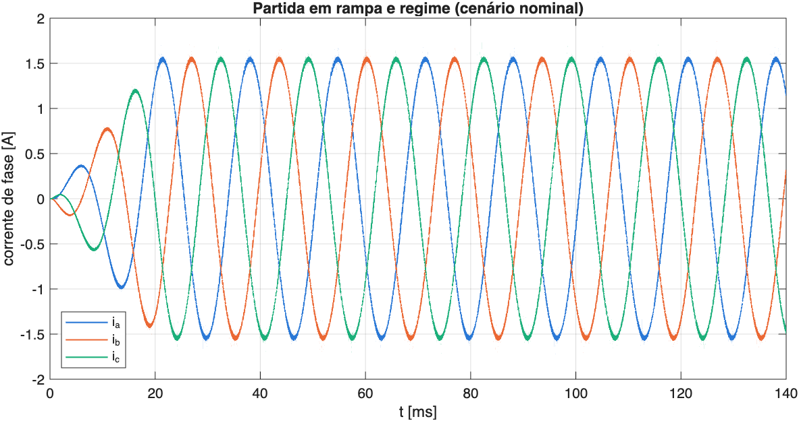
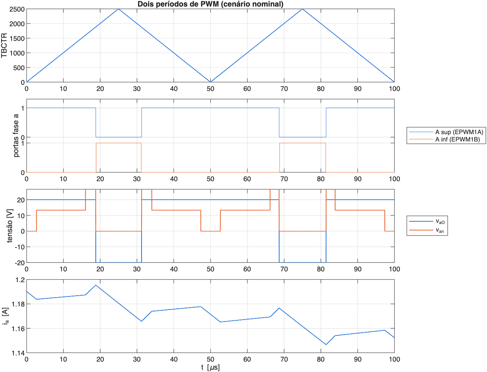
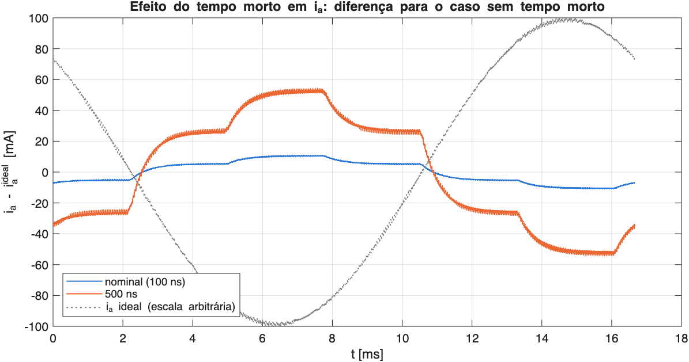
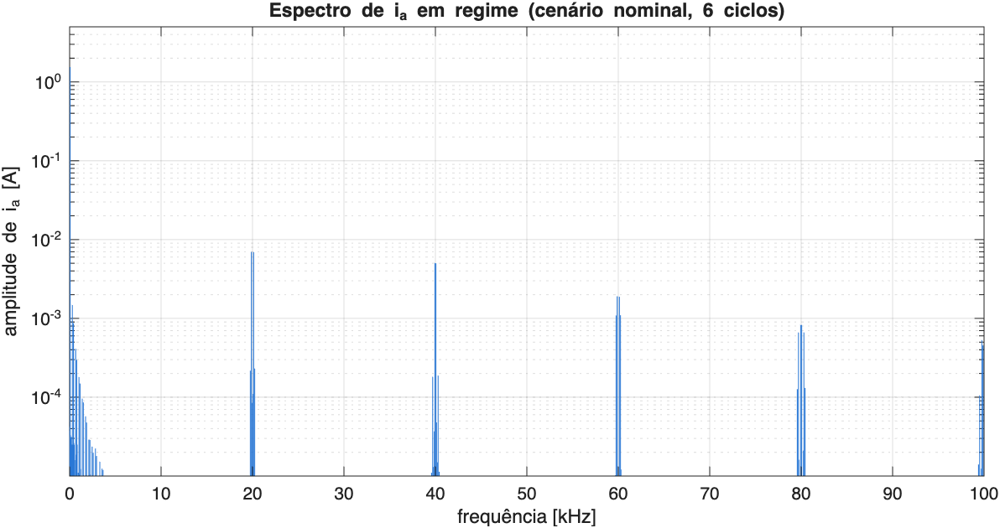
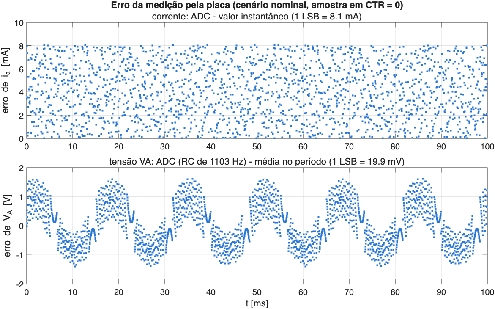

::: {.callout-note}
**Simulação pronta** (2026-10-16). O modelo reproduz o firmware
[Firmware/VSI01MalhaAberta](https://github.com/raphateixeira/ConversoresPotencia/tree/main/InversorTrifasico/Firmware/VSI01MalhaAberta)
contagem a contagem do ePWM. **O firmware tem um erro que impede o inversor de chavear**
(polaridade do enable, ver [Avaliação crítica](#avaliação-crítica)). Os parâmetros de operação
foram redimensionados para a placa (ver [Dimensionamento](#dimensionamento)): $V_{cc}$ = 40 V,
$V_p$ = 16 V, tempo morto de 100 ns, carga de 10 Ω + 5 mH. O `main.c` ainda usa 24 V, 8 V e 0,5 µs.
:::

## Objetivo

Reproduzir no Simulink o ensaio de malha aberta da bancada. Três tensões senoidais
defasadas de 120° são sintetizadas por PWM senoidal,

$$
v_a^* = V\sin(2\pi f t), \quad v_b^* = V\sin(2\pi f t - 120^\circ), \quad v_c^* = V\sin(2\pi f t + 120^\circ),
$$

com rampa de amplitude de 0 a $V_p$ na partida. O modelo serve para validar o modelo da planta
(filtro L e carga) contra as medições da placa antes de fechar qualquer malha, e para fixar o
que as próximas etapas herdam: o atraso de implementação, o efeito do tempo morto e a cadeia
de medição.

Na ISR do ePWM1 (início de cada período, $T_s = 50\,\mu$s), a razão cíclica de cada braço é
$d = 1/2 + v^*/V_{cc}$ e o CMPA é carregado da sombra no próximo $\text{CTR} = 0$. A tensão
média aplicada no período $[(k+1)T_s, (k+2)T_s]$ é portanto a calculada no instante $kT_s$:
um atraso de $1{,}5\,T_s$ (1,62° a 60 Hz) entre referência e tensão média.

## Dimensionamento

Os limites vêm da placa (guia SLUUBP1A, `user_mtr1.h` do SDK) e do microcontrolador (F28379D a
200 MHz, ePWM a 100 MHz, ADC de 12 bits):

| Grandeza | Limite | Escolha | Margem / justificativa |
|---|---|---|---|
| $V_{cc}$ | placa 12–60 V (nominal 48 V); GaN de 80 V | **40 V** | teto da bancada; 2× abaixo dos 80 V do LMG5200, folga para sobretensão de comutação |
| corrente | 10 A de pico nominal, OCP de hardware em 12 A, ADC até ±16,5 A | **1,56 A de pico** | 16 % da placa; a carga, não a placa, limita a corrente. Proteção de software sugerida em 5 A (`Bancada.Itrip`) |
| $f_{PWM}$ | GaN: centenas de kHz; INA240 precisa de ~2 µs após cada comutação; ISR | **20 kHz** | acima do audível. A amostra em `CTR = 0` exige $d \ge 2\cdot 2\,\mu\text{s}/T_s$: 0,08 a 20 kHz, mas 0,16 a 40 kHz, que cortaria a faixa de modulação. ISR com 10 000 ciclos; contador de 2500 contagens (11,3 bits) |
| $T_s$ | ISR no início do período do ePWM1 | **50 µs** | uma amostra e uma atualização por período; atraso de $1{,}5\,T_s$ = 75 µs (27° a 1 kHz, aceitável para um PI de corrente com banda até ~1 kHz) |
| tempo morto | descasamento driver + buffer: poucos ns; GaN comuta em < 2 ns | **100 ns** | o SDK da TI usa 500–600 ns, padrão de motor; com GaN isso custa 3,2 % da fundamental. Com 100 ns são 0,6 %. Conferir no osciloscópio na primeira energização |
| $d$ | ≥ 0,08 (INA240), ≤ 0,95 (bootstrap do lado alto) | **[0,10; 0,90]** | com $V_p$ = 16 V; máximo de 16,8 V em SPWM, 19,4 V com injeção de sequência zero |
| $V_p$ | linear: $V_{cc}/2$ = 20 V (SPWM), $V_{cc}/\sqrt{3}$ = 23,1 V (SVPWM) | **16 V** ($m$ = 0,8) | respeita a faixa de $d$ e deixa margem para malha fechada |

**Carga (10 Ω + 5 mH).** É segura e suficiente para o VSI01–VSI05: 1,56 A de pico, 36 W
no total, 12 W por resistor (usar resistores de pelo menos 25 W), ondulação de ~46 mA pp e 192
LSB de corrente no ADC. A dinâmica, porém, é pouco indutiva: $\tau = L/R$ = 0,5 ms e a corrente
atrasa só 10,7° da tensão, e o acoplamento $dq$ ($\omega L$ = 1,9 Ω contra 10 Ω) é fraco. Para
ver melhor a dinâmica e o desacoplamento no PI em $dq$ (VSI03), é melhor uma carga mais indutiva:

| R | L | $\tau$ | fase | $\lvert I\rvert$ pico | P por resistor | ondulação |
|---|---|---|---|---|---|---|
| **10 Ω** | **5 mH** | 0,5 ms | 10,7° | 1,56 A | 12 W | 43 mA |
| 10 Ω | 10 mH | 1,0 ms | 20,7° | 1,48 A | 11 W | 21 mA |
| 5 Ω | 10 mH | 2,0 ms | 37,0° | 2,52 A | 16 W | 21 mA |
| 5 Ω | 5 mH | 1,0 ms | 20,7° | 2,94 A | 22 W | 43 mA |

($V_p$ = 16 V, $V_{cc}$ = 40 V; ondulação estimada.) Todas ficam bem dentro da placa. Se houver
indutores de 10 mH, a combinação 5 Ω + 10 mH dá a dinâmica mais interessante com potência
moderada.

## O modelo

`MalhaAberta.slx` (powergui discreto, passo $T_{sim}$ = 20 ns):

| Bloco | O que faz |
|---|---|
| `LacoPWM` | espelho de `senoides.c` + `PWM2v` (`placa.c`) em `single`, como o float do C28x, inclusive o truncamento do CMPA |
| `Sombra CMPA` | atraso de um período: o CMPA escrito pela ISR só vale no próximo `CTR = 0` |
| `ePWM` | ePWM 1–3 emulados: contador sobe/desce (TBPRD = 2500), AQ, banda morta RED/FED (`Bancada.tMorto`, 10 contagens) |
| `Inversor` | `Two-Level Converter` (Specialized Power Systems) no modo *Switching function*, com os 6 pulsos `[AH AL BH BL CH CL]` do `ePWM`: braço ideal e bidirecional com o pulso ligado, como o GaN ($R_{on}$ = 15 mΩ); com os dois pulsos em 0 (tempo morto), a corrente define a tensão pelos diodos internos. Entrada `BL` (bloqueio) em 0 = enable da placa ativo |
| `Medidor inversor` | `Three-Phase V-I Measurement` na saída do inversor: $i_{abc}$ e tensões fase-terra; como o terra está no ponto médio O do barramento, são as tensões de perna $v_{aO}, v_{bO}, v_{cO}$ |
| `Carga` | `Three-Phase Series RLC Branch` ($R_{Lf} + R_c$ e $L_f$ por fase), com os terminais unidos no neutro isolado $n$ |
| `vnO`, `Vdc` | voltímetros simples para as duas grandezas escalares: neutro da carga em relação a O (dá $v_{an} = v_{aO} - v_{nO}$) e barramento |
| `FiltroRC`, `ADC` | medição do BOOSTXL: INA240 (5 mΩ, ganho 20, 1,65 V, polaridade invertida), divisores de tensão (81,5 V de fundo de escala) com RC de 1,1 kHz, ADC de 12 bits amostrado em `CTR = 0` |
| `Integral v` | média exata das tensões em cada período de PWM (para as métricas) |

Os parâmetros ficam em `Comum/Parametros.m`, na struct `Bancada` (separada das variáveis do
VSI conectado à rede de 350 V, usadas pelo VSI06–09).

## Arquivos

| Arquivo | Conteúdo |
|---|---|
| `MalhaAberta.slx` | modelo chaveado fiel ao firmware (R2024a) |
| `MalhaAbertaSimples.slx` | versão didática, sem emular o firmware (R2024a); ver [abaixo](#versão-simples) |
| `SimulaVSI01.m` | roda um dos dois modelos (escolhido na linha `modelo = ...`), compara a corrente com a teoria e faz uma figura |
| `AnaliseFirmwareVSI01.m` | análise detalhada do `MalhaAberta`: três cenários de tempo morto, medição pelo ADC; gera as figuras e os números desta página |
| `blocos/*.m` | código dos blocos MATLAB Function (gerado por `scripts/extrai_blocos.py`) |
| `figuras/*.png` | figuras de `AnaliseFirmwareVSI01.m` e, com o nome do modelo, de `SimulaVSI01.m` |

## Como rodar

```matlab
SimulaVSI01             % de dentro de VSI01MalhaAberta/ (simples: ~5 s; firmware: ~30 s)
AnaliseFirmwareVSI01    % análise detalhada (~1,5 min: 3 cenários de 0,14 s)
```

Da raiz do repositório: `run VSI01MalhaAberta/SimulaVSI01`. Os scripts rodam `IniciarProjeto` e o arquivo único `Comum/Parametros.m` pelo caminho relativo à
própria pasta, então funciona de qualquer pasta atual.

Para abrir o modelo: `Parametros`, `open_system('VSI01MalhaAberta/MalhaAberta.slx')`. Com
`Bancada.tRampa = 1` (valor do firmware) a simulação cobre 1,12 s, o que leva alguns minutos.
Os scripts encurtam a rampa para 20 ms. A carga tem $L/R$ = 0,5 ms, então o regime
depois da rampa é o mesmo.

## Versão simples

`MalhaAbertaSimples.slx` é a malha aberta "de livro", independente do firmware: senoides de
amplitude $V_p$ → normalização $2/V_{cc}$ → `PWM Generator (2-Level)` (portadora triangular de
$f_{PWM}$, amostragem natural) → `Two-Level Converter` (*Switching devices*) → medidor
trifásico → carga RL em Y, com scopes de referências, tensões ($v_{xO}$ e $v_{an}$) e correntes.
Ela não tem tempo morto, atraso de amostragem, rampa nem modelo de ADC, e usa passo de 0,1 µs
($T_s/500$). Usa a mesma struct `Bancada`.

```matlab
IniciarProjeto; Parametros
open_system('VSI01MalhaAberta/MalhaAbertaSimples.slx')    % 0,1 s simulados em ~5 s
```

Conferência: $\lvert I_{a,1}\rvert$ = 1,5544 A (teoria 1,5550 A), fase −10,56° (só a carga, sem
atraso), fases a 120°, THD de $i_a$ até h50 de 0,04 %, $v_{an}$ com os níveis $\pm\frac{2}{3}V_{cc}$ = ±26,7 V.
As variáveis `iabc`, `vabcO` e `vabcn` ficam em `out` (amostradas a 1 µs).

## Resultados

Parâmetros de [Dimensionamento](#dimensionamento): $V_{cc}$ = 40 V, $V_p$ = 16 V ($m$ = 0,8),
carga $R$ = 10 Ω ($+R_{Lf}$ = 0,1 Ω provisório) e $L$ = 5 mH. Regime de 6 ciclos; tensões são
médias por período de PWM; a fase de $i_a$ é medida em relação a $v_a^*$.

| cenário | $\lvert V_{an,1}\rvert$ [V] | teoria | $\lvert I_{a,1}\rvert$ [A] | teoria | fase de $i_a$ | THD $i_a$ (até h50) | h5 de $v_{an}$ [mV] |
|---|---|---|---|---|---|---|---|
| tempo morto 100 ns (nominal) | 15,877 | 15,877 | 1,5453 | 1,5453 | −12,12° | 0,12 % | 21 |
| tempo morto 500 ns (SDK TI, `main.c` atual) | 15,476 | 15,477 | 1,5063 | 1,5064 | −11,87° | 0,60 % | 102 |
| sem tempo morto | 15,977 | 15,977 | 1,5550 | 1,5550 | −12,18° | 0,005 % | 0,5 |

- **Teoria.** Impedância $R + R_{on} + j\omega L$, tensão aplicada $V_p$ atrasada de $1{,}5\,T_s$ e
  erro de tempo morto modelado como onda quadrada em fase com a corrente, de 1ª harmônica
  $\frac{4}{\pi} f_{PWM}\, t_m V_{cc}$ (0,102 V com 100 ns; 0,509 V com 500 ns). A concordância em
  quatro algarismos valida o emulador do ePWM, o atraso de $1{,}5\,T_s$ (−12,18° = −10,56° da
  carga − 1,62°) e o modelo de tempo morto.
- **Tempo morto.** Com 100 ns, $\lvert I_{a,1}\rvert$ cai 0,6 % e os degraus nos cruzamentos por
  zero da corrente são de ~5 mA. Com os 500 ns do SDK, a queda é de 3,1 % e os degraus são de
  ~25 mA. Na placa o erro é um pouco maior: a queda reversa do GaN ($V_{sd}$ ≈ 2 V) não está no
  modelo.
- **Ondulação de corrente:** 46 mA pp. Pico de 1,57 A (placa: 10 A nominal, OCP em 12 A).
  Potência na carga: 36 W, 12 W por resistor.
- **Modo comum** $v_{nO}$: 12,9 V rms em alta frequência. Medir com ponteiras diferenciais.
- **Corrente pelo ADC.** 8,1 mA/LSB, então a fundamental tem 192 LSB. A amostra em `CTR = 0`
  coincide com a média do período (erro ≤ 3 mA). O truncamento do ADC introduz um viés de +½
  LSB (4 mA), que a calibração de offset deve absorver.
- **Tensão pelo ADC.** O RC de 1,1 kHz atrasa 3,1° e deixa passar a ondulação de 20 kHz. Serve
  para monitorar e calibrar, não para realimentação amostra a amostra sem compensação.











## Avaliação crítica

### Firmware (InversorTrifasico/Firmware/VSI01MalhaAberta)

1. **Bloqueante: polaridade do enable invertida.** O guia SLUUBP1A diz que o enable do PWM do
   BOOSTXL-3PHGANINV é ativo em nível baixo. O exemplo da TI para F2837x com esta placa
   (`dual_axis_servo_drive.c`, MotorControl SDK 5.04) liga o driver com `GPIO_writePin(124, 0)`
   e desliga com `1`. O `placa.c` faz o contrário: escreve 0 na configuração, deixando o buffer
   habilitado enquanto os ePWM ainda são configurados, e 1 em `IniciaPWM()`, o que **desliga**
   o inversor. Correção: 1 em `ConfiguraGPIO()` e 0 em `IniciaPWM()`. O comentário "como no
   MotorControl SDK" está errado.
2. **Bloqueante para o objetivo da etapa: não há medição.** `vaV`, `vbV`, `vcV` gravam a
   *referência* calculada na ISR, não grandezas medidas, então não validam planta nenhuma. É
   preciso disparar o ADC pelo ePWM1 (SOCA em `CTR = 0`) e gravar $I_A, I_B, I_C$ e $V_{DC}$,
   mais $V_A, V_B, V_C$ para conferir. O mapeamento do SDK para o F2837x no sítio J1–J4 é
   IU → C2, IV → B2, IW → A2, VDC → D14 (conferir os pinos de tensão de fase no esquemático).
   Os offsets do INA240 (código 2048 nominal) devem ser calibrados com o PWM desligado.
3. **Sem proteção.** Não há trip zone, CMPSS nem leitura de sobretemperatura (`/PCB OT`). O SDK
   usa CMPSS + trip zone (OST) por fase e desliga o enable no trip. Com carga de baixa
   impedância em malha aberta, isso é obrigatório antes de subir $V_{cc}$.
4. **$V_{cc}$ fixo** (24 V hoje, 40 V no novo dimensionamento) na conversão $v \to d$. Qualquer variação da fonte vira erro de
   tensão proporcional. Usar o $V_{DC}$ medido (fundo de escala de 81,5 V, 20 mV/LSB).
5. **Tempo morto de 0,5 µs:** é o valor do exemplo da TI (`EPWM_DB_DELAY_RISE = 50`) e é seguro,
   mas conservador para o LMG5200 (transições < 2 ns). Com 40 V custa 3,1 % da tensão
   fundamental e distorção de 5ª/7ª harmônicas. Usar 100 ns (`Bancada.tMorto`; cai para 0,6 %),
   começando com 500 ns na primeira energização e reduzindo enquanto se observa o nó de
   comutação no osciloscópio. Nas etapas em malha fechada, compensar por $\text{sinal}(i)$.
6. **Modulação senoidal pura** limita $V_p \le V_{cc}/2$. Com injeção de sequência zero
   (min-max, equivalente ao SVPWM), o limite sobe para $V_{cc}/\sqrt{3}$ (+15,5 %), o que importa
   na conexão à rede.
7. **Limite da razão cíclica em [0, 1].** O driver do lado alto do LMG5200 é alimentado por
   bootstrap e precisa do lado baixo ligado periodicamente. Além disso, a corrente amostrada em
   `CTR = 0` precisa de ~2 µs depois do chaveamento (acomodação do INA240), o que pede $d$ acima
   de 0,08. Limitar a [0,08; 0,95] (`Bancada.dMin`, `Bancada.dMax`). Com $V_p$ = 16 V,
   $d \in [0{,}10; 0{,}90]$.
8. **Atraso de $1{,}5\,T_s$** (sombra carregada em `CTR = 0`): irrelevante em malha aberta, mas
   tem de entrar no projeto do PI (VSI03) e na compensação de atraso do MPC-FSC (VSI04/05). O
   modelo já o reproduz.
9. **Jumper J6 do BOOSTXL:** remover quando a LaunchPad for alimentada pela USB (aviso do guia).
   A saída de corrente tem polaridade invertida (sinal −1 no SDK).

### Parâmetros

- `Comum/Parametros.m` descrevia só o VSI de 350 V conectado a uma rede de 110 V de pico, com
  $L_s$ = 10 mH e $T_s$ = 1/48 kHz, incompatível com o BOOSTXL (12–60 V). A struct `Bancada` tem
  os valores da placa e o [dimensionamento](#dimensionamento) acima.
- **Conexão à rede nas etapas seguintes:** com $V_{cc}$ = 40 V, a tensão de fase máxima é
  $V_{cc}/\sqrt{3}$ = 23,1 V de pico com SVPWM. A rede da bancada precisa ser rebaixada por
  transformador para bem menos que isso, descontada a queda no filtro (por exemplo, ~10 V rms de
  fase).
- **MPC-FSC (VSI04/05):** sem modulador, a frequência de chaveamento é variável e menor que
  $1/T_s$. Com $T_s$ = 25 µs (40 kHz) a ISR ainda tem 5000 ciclos, o que é suficiente para 8
  vetores com compensação de atraso. Fica para avaliar naquelas etapas.
- **$R_{Lf}$ é provisório:** medir a resistência série dos indutores (ponte LCR).
- `Parametros.m` começa com `clear, clc`: apaga o workspace de quem o chama. Scripts precisam
  chamá-lo antes de criar variáveis.

### Limitações do modelo

- O `Two-Level Converter` usa chaves ideais com $R_{on}$: o modelo não tem capacitância de saída
  ($C_{oss}$) nem transitórios de comutação. Com corrente alta, a carga de $C_{oss}$ comuta a perna durante o
  tempo morto, e o erro real fica menor que o modelado.
- A queda reversa do GaN no tempo morto ($V_{sd}$ ≈ 2 V) não é representada: no modo
  *Switching function* o `Vf_Diode` fica em série com toda a condução, então foi zerado. O erro
  de tempo morto simulado é ~15 % menor que o esperado na placa.
- O bloco não acelera a simulação, que é dominada pelo passo de 20 ns (~25 s por cenário). Para
  as etapas em malha fechada, o modo *Average model (Uref-controlled)* com passo $T_s$ seria
  ordens de grandeza mais rápido, mas sem ondulação de PWM nem tempo morto.
- O modelo usa fonte CC ideal (sem impedância nem capacitores do barramento), não inclui a
  banda do INA240 nem a acomodação de 2 µs, e o ADC é ideal, sem ruído e sem erro de offset ou
  de ganho.
- Os eventos do ePWM são quantizados em 2 contagens (20 ns).

## Pendências

- [ ] Corrigir a polaridade do enable (GPIO124) no firmware.
- [ ] Acrescentar ao firmware ADC disparado pelo ePWM1 ($I_{abc}$, $V_{DC}$, $V_{abc}$) e gravação das medições.
- [ ] Acrescentar proteção: CMPSS + trip zone, limites de $V_{DC}$, sobretemperatura.
- [ ] Atualizar `main.c` para o dimensionamento: $V_{cc}$ = 40 V, $V_p$ = 16 V, tempo morto de 100 ns, $d$ limitado a [0,08; 0,95].
- [ ] Medir $L_f$, $R_{Lf}$, $R_c$ da bancada e atualizar `Bancada` em `Parametros.m`.
- [ ] Ensaio: comparar $I_{abc}$ medidas (códigos do ADC) com `log_adc` da simulação.
- [ ] Primeira energização com 500 ns de tempo morto; reduzir para 100 ns observando o nó de comutação.
- [ ] Opcional: injeção de sequência zero e uso do $V_{DC}$ medido em `PWM2v`.
