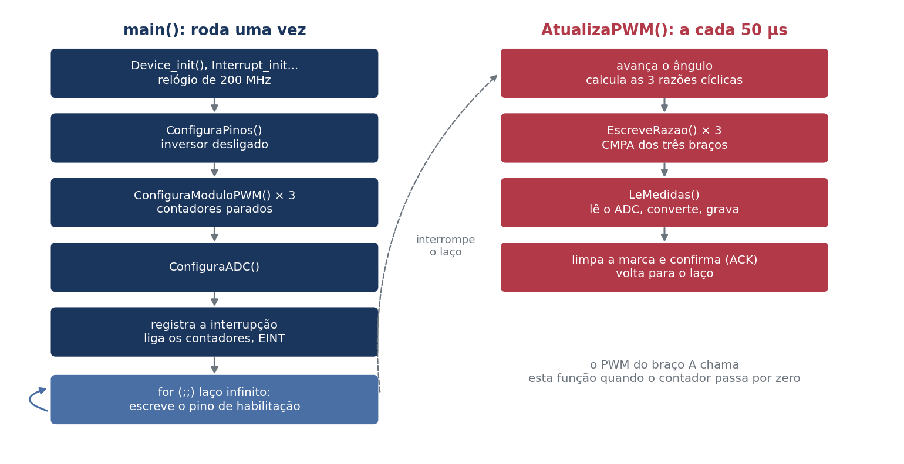
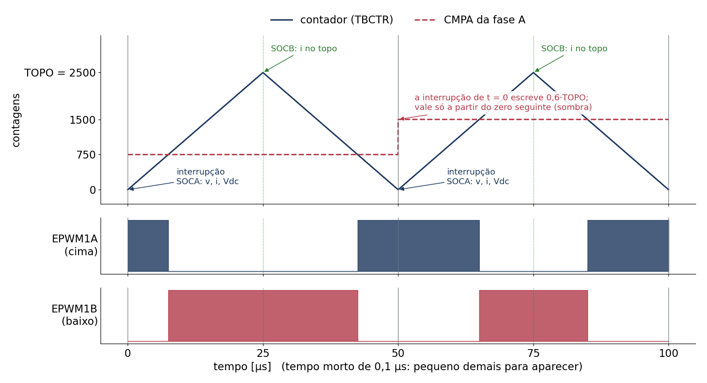
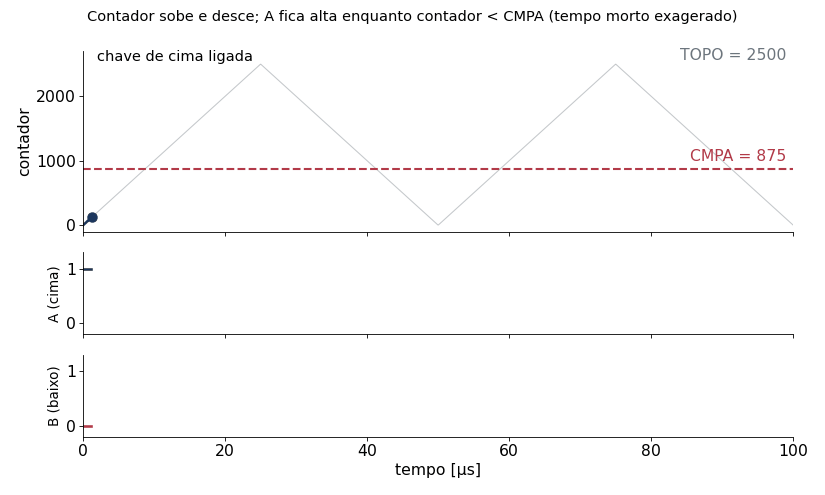
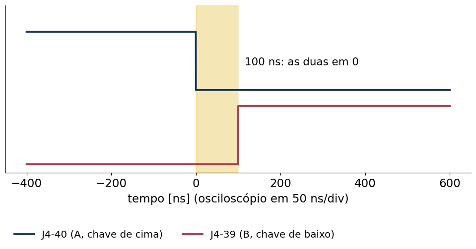
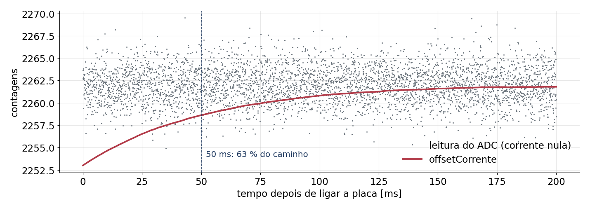

## Como o arquivo está organizado {.smaller}

O programa inteiro está num arquivo só: `main.c`, com cerca de 400 linhas.

| Parte | Linhas | O que faz |
|---|---|---|
| Comentário de abertura | 1–40 | o que o programa faz e quais variáveis usar |
| `#include` e `#define` | 42–73 | bibliotecas e parâmetros (frequência, tempo morto, conversões) |
| Variáveis | 75–120 | as da janela Watch e os vetores de gravação |
| `main()` | 130–170 | configura tudo uma vez e fica num laço infinito |
| `AtualizaPWM()` | 174–197 | **interrupção**: chamada a cada 50 µs |
| `EscreveRazao()` | 203–212 | razão cíclica → valor de comparação do PWM |
| `LeMedidas()` | 218–283 | lê o ADC, converte para V e A, grava |
| `ConfiguraADC()`, `ConfiguraModuloPWM()`, `ConfiguraPinos()` | 295–398 | configuração dos periféricos |

: {tbl-colwidths="[34,10,56]"}

Os outros arquivos do projeto (`device/`, `.cproject`, `.cmd`) vêm do exemplo vazio da TI;
só os `.cmd` foram editados (para os vetores de gravação).

## Duas coisas acontecem ao mesmo tempo

{fig-align="center" width="88%"}

- `main()` configura tudo **uma vez** e fica num laço infinito.
- A cada 50 µs o hardware **interrompe** o laço e chama `AtualizaPWM()`; depois o laço continua.

## Um período de PWM, no tempo

{fig-align="center" width="85%"}

- Contador sobe e desce: 50 µs. Saída de cima ligada enquanto contador < CMPA.
- No zero: interrupção e conversões (SOCA). No topo: corrente de novo (SOCB).

## C em 5 minutos: comentários, `#include`, `#define`

```c
// texto depois de // e comentario: o compilador ignora
#include "driverlib.h"   // funcoes da TI para os perifericos (PWM, ADC, pinos)
#include "device.h"      // relogio e configuracao basica da placa
#include <math.h>        // funcoes matematicas: sinf(), fabsf()...

#define FREQ_PWM   20e3f // "apelido": onde estiver FREQ_PWM, o compilador poe 20e3f
```

- `#define` é **troca de texto** antes de compilar: não ocupa memória e não muda durante a execução.
- Sufixo `f`: número `float` (`20e3f` = 20000,0). Sufixo `U`: inteiro sem sinal (`124U`).
- Por convenção, nomes em MAIÚSCULAS são constantes; `camelCase` são variáveis e funções.

## Tipos de variáveis

| Tipo | O que guarda | Exemplos no arquivo |
|---|---|---|
| `uint16_t` | inteiro de 0 a 65535 (16 bits) | `habilita`, `grava`, CMPA, contagem do ADC |
| `uint32_t` | inteiro de 32 bits | endereços dos periféricos (`EPWM1_BASE`) |
| `float` | número real, 32 bits | tensões, correntes, ângulo, razões |

: {tbl-colwidths="[16,38,46]"}

```c
float tensaoAgora[3];   // vetor de 3 floats: tensaoAgora[0], [1], [2] = fases A, B, C
```

- Índices começam em **0**. Neste código, 0 = A, 1 = B, 2 = C.
- No C28x a menor unidade de memória é a **palavra de 16 bits**: um `float` ocupa 2 palavras.

## `volatile`, `static` e `const`

```c
volatile uint16_t habilita   = 0;       // muda "por fora": pela Watch ou pela interrupcao
static float      angulo = 0.0f;        // so este arquivo usa; guarda o valor entre chamadas
static const uint32_t modulo[3] = {EPWM1_BASE, EPWM2_BASE, EPWM3_BASE};   // nunca muda
```

- `volatile`: "releia da memória toda vez". Sem isso, o compilador pode guardar `habilita` num
  registrador e o laço nunca veria a mudança feita na Watch.
- `static` fora de função: a variável só existe para este arquivo.
- `const`: valor fixo; o compilador avisa se alguém tentar mudar.

## Funções

```c
static float EscreveRazao(uint32_t base, float razao);      // prototipo (linha 125)

razaoAplicada[fase] = EscreveRazao(modulo[fase], razaoCiclica[fase]);   // chamada (linha 190)

static float EscreveRazao(uint32_t base, float razao)       // definicao (linha 203)
{
    ...
    return (float)cmpa / (float)TOPO;                        // valor devolvido
}
```

- O **protótipo** avisa ao compilador, antes do uso, os tipos dos argumentos e da resposta.
- `void`: a função não devolve nada (`void LeMedidas(void)` também não recebe nada).
- Os argumentos chegam como **cópias**: mudar `razao` dentro da função não muda quem chamou.

## Controle de fluxo usado no arquivo

```c
for (fase = 0U; fase < 3U; fase++) { ... }       // repete com fase = 0, 1 e 2
if (angulo >= DOIS_PI) { angulo -= DOIS_PI; }    // a -= b e o mesmo que a = a - b
while ((ADC_getInterruptStatus(...) == false) && (espera < 1000U)) { espera++; }
GPIO_writePin(PINO_HABILITA, (habilita == 1U) ? 0U : 1U);   // condicao ? se_sim : se_nao
if (++contaDecimacao >= DECIMACAO)                // soma 1 primeiro, depois compara
for (;;) { ... }                                  // laco que nunca termina
```

- `==` **compara**; `=` **atribui**. Trocar um pelo outro é o erro mais comum em C.
- `&&` é "e"; `||` é "ou"; `!` é "não".

## As funções da driverlib (TI)

Cada periférico é um conjunto de **registradores** num endereço fixo. A driverlib esconde os
registradores atrás de funções com nomes legíveis: `PERIFERICO_verbo(base, ...)`.

```c
EPWM_setTimeBasePeriod(EPWM1_BASE, TOPO);           // periodo do contador do ePWM1
ADC_readResult(ADCCRESULT_BASE, ADC_SOC_NUMBER0);   // resultado do SOC0 do conversor C
GPIO_writePin(124U, 0U);                            // pino 124 em nivel baixo
```

- `base` diz **qual** periférico: `EPWM1_BASE`, `EPWM2_BASE`... são endereços de memória.
- No CCS, ⌘ + clique (Ctrl + clique) no nome abre a definição, com o comentário da TI.

## Parâmetros (linhas 47–53)

```c
#define FREQ_RELOGIO_PWM   100e6f    // relogio dos modulos de PWM: 200 MHz / 2 = 100 MHz
#define FREQ_PWM           20e3f     // frequencia de chaveamento: 20 kHz (periodo de 50 us)
#define TEMPO_MORTO        100e-9f   // tempo morto entre as chaves de um braco: 100 ns
#define RAZAO_MINIMA       0.05f     // limites da razao ciclica: evitam pulsos mais
#define RAZAO_MAXIMA       0.95f     // curtos que o tempo morto
#define PINO_HABILITA      124U      // GPIO124 (J2-13): /PWM enable do BOOSTXL, ativo em nivel BAIXO
#define AMPLITUDE          0.4f      // amplitude da razao ciclica: varia de 0,1 a 0,9
```

- Para mudar o ensaio, mexa **aqui** e compile de novo.
- `AMPLITUDE` = 0,4: razão de 0,5 − 0,4 = 0,1 a 0,5 + 0,4 = 0,9.

## Constantes calculadas (linhas 57–60)

```c
#define TOPO               ((uint16_t)(FREQ_RELOGIO_PWM / (2.0f * FREQ_PWM)))
#define CONTAGENS_MORTO    ((uint16_t)(TEMPO_MORTO * FREQ_RELOGIO_PWM + 0.5f))   // 10
#define PERIODO_AMOSTRA    (1.0f / FREQ_PWM)                                     // 50 us
#define DOIS_PI            6.283185307f
```

| Constante | Conta | Valor |
|---|---|---|
| `TOPO` | 100 MHz / (2 × 20 kHz) | 2500 contagens de 10 ns |
| `CONTAGENS_MORTO` | 100 ns × 100 MHz + 0,5 = 10,5 → corta | 10 |
| `PERIODO_AMOSTRA` | 1 / 20 kHz | 50 µs |

- `(uint16_t)(...)` converte para inteiro **cortando** a parte decimal; o `+ 0.5f` faz arredondar.

## Conversão das medidas (linhas 69–71)

```c
#define VOLTS_POR_CONTAGEM   (3.0f / 4096.0f * 24.7f)          // 18,1 mV
#define AMPERES_POR_CONTAGEM (-3.0f / (4096.0f * 0.1f))        // -7,32 mA
#define PESO_ZERO            0.001f  // media do zero dos sensores: constante de tempo de 50 ms
```

- O ADC tem 12 bits: dá um número de 0 a 4095 para 0 a 3,0 V no pino.
- Tensão: a placa divide por 24,7 → cada contagem vale 3/4096 × 24,7 = 18,1 mV.
- Corrente: 0,1 V por ampère em torno de 1,65 V (≈ 2253 contagens). O sinal é **negativo**
  porque o sensor da placa está ligado invertido.
- Exemplo: contagem 2212 → (2212 − 2253) × (−7,32 mA) = **+0,30 A**.

## Variáveis da janela Watch (linhas 76–86)

```c
volatile uint16_t habilita   = 0;       // 1 = liga o inversor | 0 = desliga
volatile float    frequencia = 60.0f;   // frequencia das senoides [Hz]
volatile uint16_t grava      = 0;       // 1 = comecar a gravar | 2 = gravando | 0 = parado

volatile float    razaoAplicada[3];     // razoes de fato escritas: CMPA/TOPO, limitadas (so leitura)
volatile float    tensaoAgora[3];       // tensoes vA, vB, vC [V], em relacao ao GND (so leitura)
volatile float    correnteAgora[3];     // correntes iA, iB, iC [A] no zero do contador (so leitura)
volatile float    offsetCorrente[3] = {2253.0f, 2253.0f, 2253.0f};   // zero dos sensores [contagens]
```

- **Para escrever** na Watch: `habilita`, `frequencia`, `grava`.
- **Só para ler**: as outras; o programa as atualiza a cada 50 µs.
- Todas são `volatile`: mudam fora do fluxo normal (Watch, interrupção).

## Vetores de gravação e a memória (linhas 91–117)

```c
#pragma DATA_SECTION(tensaoA, "ramgs0")
...
float tensaoA[N_AMOSTRAS];              // [V]
```

- 2000 `float` = 4000 palavras. Cada bloco de RAM `RAMGS` tem 4096 palavras: **um vetor por bloco**.
- `#pragma DATA_SECTION` dá um nome de "seção" ao vetor; o arquivo `.cmd` (do *linker*) diz
  em que bloco cada seção fica:

```
   ramgs0           : > RAMGS0,    PAGE = 1
```

- São 13 vetores em 13 blocos (RAMGS0–6 e RAMGS8–13).

## Tabelas de endereços (linhas 119–120)

```c
static const uint32_t modulo[3] = {EPWM1_BASE, EPWM2_BASE, EPWM3_BASE};   // fases A, B, C
static const uint32_t resultado[3] = {ADCCRESULT_BASE, ADCBRESULT_BASE, ADCARESULT_BASE}; // A, B, C
```

- Guardando os endereços num vetor, um único `for` trata as três fases:
  `modulo[fase]`, `resultado[fase]`.
- Atenção à ordem: a fase **A** é lida pelo conversor **C** e a fase **C** pelo conversor **A**.
  É assim que a placa liga os pinos.

## `main()`: começo (linhas 130–139)

```c
void main(void)
{
    uint16_t fase;

    Device_init();                  // relogio de 200 MHz e perifericos ligados
    Device_initGPIO();
    Interrupt_initModule();         // controlador de interrupcoes
    Interrupt_initVectorTable();

    ConfiguraPinos();               // inversor desligado desde o inicio
```

- `Device_init()` (arquivo `device/device.c`, da TI): relógio de 200 MHz, desliga o *watchdog*,
  liga os periféricos.
- `Interrupt_init...`: prepara o controlador de interrupções (PIE) e a sua tabela.
- `ConfiguraPinos()` vem logo: o inversor fica **desligado** antes de qualquer outra coisa.

## `main()`: os três PWMs juntos (linhas 141–149)

```c
    SysCtl_setEPWMClockDivider(SYSCTL_EPWMCLK_DIV_2);           // 100 MHz
    SysCtl_disablePeripheral(SYSCTL_PERIPH_CLK_TBCLKSYNC);
    for (fase = 0U; fase < 3U; fase++)
    {
        ConfiguraModuloPWM(modulo[fase]);
    }
    ConfiguraADC();                 // conversoes disparadas pelo PWM da fase A
```

- Relógio dos PWMs: 200 MHz ÷ 2 = 100 MHz → cada contagem dura 10 ns.
- `TBCLKSYNC` é a "chave geral" dos contadores: desligada, os três são configurados parados; na
  linha 160 ela é ligada e os três **partem juntos**, alinhados.

## `main()`: a interrupção (linhas 153–163)

```c
    EPWM_setInterruptSource(EPWM1_BASE, EPWM_INT_TBCTR_ZERO);
    EPWM_setInterruptEventCount(EPWM1_BASE, 1U);
    EPWM_enableInterrupt(EPWM1_BASE);
    EPWM_clearEventTriggerInterruptFlag(EPWM1_BASE);
    Interrupt_register(INT_EPWM1, &AtualizaPWM);
    Interrupt_enable(INT_EPWM1);

    SysCtl_enablePeripheral(SYSCTL_PERIPH_CLK_TBCLKSYNC);       // os tres contadores partem

    EINT;                           // libera as interrupcoes
    ERTM;                           // modo de depuracao em tempo real
```

- O ePWM1 pede interrupção quando o contador passa por **zero**, a cada período (`1U`).
- `Interrupt_register` liga esse pedido à função `AtualizaPWM` (`&` = endereço da função).
- `EINT` libera as interrupções; `ERTM` deixa a Watch ler as variáveis com o programa rodando.

## `main()`: o laço infinito (linhas 165–169)

```c
    for (;;)
    {
        // Habilitacao do inversor (ativa em nivel baixo): 0 liga, 1 desliga
        GPIO_writePin(PINO_HABILITA, (habilita == 1U) ? 0U : 1U);
    }
}
```

- Um programa embarcado **não termina**: depois de configurar, fica aqui para sempre.
- A habilitação da placa é **ativa em nível baixo**: `habilita` = 1 → pino em 0 → inversor ligado.
- Como o laço repete sem parar, mudar `habilita` na Watch muda o pino quase na hora.

## PWM: o contador (linhas 343–348)

:::: {.columns}
::: {.column width="55%"}
```c
// Contador: sobe e desce entre 0 e TOPO,
// com o relogio de 100 MHz
EPWM_setClockPrescaler(base,
    EPWM_CLOCK_DIVIDER_1,
    EPWM_HSCLOCK_DIVIDER_1);
EPWM_setTimeBaseCounterMode(base,
    EPWM_COUNTER_MODE_UP_DOWN);
EPWM_setTimeBasePeriod(base, TOPO);
EPWM_setTimeBaseCounter(base, 0U);
EPWM_disablePhaseShiftLoad(base);
```
:::
::: {.column width="45%"}
{width="100%"}
:::
::::

- Um módulo ePWM = um braço do inversor. A função é chamada três vezes (`base` = ePWM1, 2, 3).
- Sobe de 0 a 2500 e desce: 2 × 2500 × 10 ns = **50 µs**.

## PWM: comparação e "sombra" (linhas 352–361)

```c
    EPWM_setCounterCompareShadowLoadMode(base, EPWM_COUNTER_COMPARE_A,
                                         EPWM_COMP_LOAD_ON_CNTR_ZERO);
    EPWM_setCounterCompareValue(base, EPWM_COUNTER_COMPARE_A, TOPO / 2U);

    EPWM_setActionQualifierAction(base, EPWM_AQ_OUTPUT_A, EPWM_AQ_OUTPUT_LOW,
                                  EPWM_AQ_OUTPUT_ON_TIMEBASE_UP_CMPA);
    EPWM_setActionQualifierAction(base, EPWM_AQ_OUTPUT_A, EPWM_AQ_OUTPUT_HIGH,
                                  EPWM_AQ_OUTPUT_ON_TIMEBASE_DOWN_CMPA);
```

- Saída A **desce** quando o contador, subindo, alcança CMPA; **sobe** quando, descendo, passa por
  CMPA. Fica ligada enquanto contador < CMPA → razão = CMPA / TOPO.
- **Sombra**: o CMPA novo espera num registrador reserva e só vale no próximo zero. Nunca corta um
  pulso pela metade, mas atrasa a razão em um período.

## PWM: tempo morto (linhas 365–372)

:::: {.columns}
::: {.column width="55%"}
```c
EPWM_setRisingEdgeDeadBandDelayInput(base,
    EPWM_DB_INPUT_EPWMA);
EPWM_setFallingEdgeDeadBandDelayInput(base,
    EPWM_DB_INPUT_EPWMA);
EPWM_setDeadBandDelayPolarity(base,
    EPWM_DB_RED, EPWM_DB_POLARITY_ACTIVE_HIGH);
EPWM_setDeadBandDelayPolarity(base,
    EPWM_DB_FED, EPWM_DB_POLARITY_ACTIVE_LOW);
EPWM_setDeadBandDelayMode(base, EPWM_DB_RED, true);
EPWM_setDeadBandDelayMode(base, EPWM_DB_FED, true);
EPWM_setRisingEdgeDelayCount(base, CONTAGENS_MORTO);
EPWM_setFallingEdgeDelayCount(base, CONTAGENS_MORTO);
```
:::
::: {.column width="45%"}
{width="100%"}
:::
::::

- A chave de baixo (saída B) é a de cima **invertida**. As duas ligam com 10 contagens (100 ns) de
  atraso: nunca ficam ligadas juntas, o que seria um curto no barramento.

## PWM: segurança ao pausar (linhas 377–379)

```c
    EPWM_enableTripZoneSignals(base, EPWM_TZ_SIGNAL_CBC6);
    EPWM_setTripZoneAction(base, EPWM_TZ_ACTION_EVENT_TZA, EPWM_TZ_ACTION_LOW);
    EPWM_setTripZoneAction(base, EPWM_TZ_ACTION_EVENT_TZB, EPWM_TZ_ACTION_LOW);
```

- Quando você pausa no CCS (‖), o contador congela: uma chave ficaria ligada direto.
- O sinal de parada do depurador (TZ6) força as saídas A e B em **nível baixo**: as duas chaves
  desligam enquanto o programa está pausado.

## Os pinos (linhas 383–397)

```c
    GPIO_writePin(PINO_HABILITA, 1U);
    GPIO_setPadConfig(PINO_HABILITA, GPIO_PIN_TYPE_PULLUP);
    GPIO_setPinConfig(GPIO_124_GPIO124);
    GPIO_setDirectionMode(PINO_HABILITA, GPIO_DIR_MODE_OUT);

    GPIO_setPadConfig(0U, GPIO_PIN_TYPE_STD);  GPIO_setPinConfig(GPIO_0_EPWM1A);  // A, chave de cima
    GPIO_setPadConfig(1U, GPIO_PIN_TYPE_STD);  GPIO_setPinConfig(GPIO_1_EPWM1B);  // A, chave de baixo
```

- Cada pino tem várias funções possíveis; `GPIO_setPinConfig` escolhe uma.
  `GPIO_0_EPWM1A`: o pino 0 vira a saída A do ePWM1 (J4-40).
- A habilitação recebe **1 antes** de virar saída: o inversor nunca liga por acidente.
- Pinos 0–5 = saídas A e B dos três braços (J4-40 a J4-35).

## A interrupção: as três senoides (linhas 174–186)

```c
__interrupt void AtualizaPWM(void)
{
    uint16_t fase;

    // Senoides defasadas de 120 graus: B atrasada e C adiantada em relacao a A
    angulo += DOIS_PI * frequencia * PERIODO_AMOSTRA;
    if (angulo >= DOIS_PI)
    {
        angulo -= DOIS_PI;
    }
    razaoCiclica[0] = 0.5f + AMPLITUDE * sinf(angulo);
    razaoCiclica[1] = 0.5f + AMPLITUDE * sinf(angulo - DOIS_PI / 3.0f);
    razaoCiclica[2] = 0.5f + AMPLITUDE * sinf(angulo + DOIS_PI / 3.0f);
```

- `__interrupt` (da TI): a função guarda e restaura os registradores, porque interrompeu o laço.
- A cada chamada o ângulo avança 2π × 60 × 50 µs = 0,0188 rad: 333 chamadas por ciclo de 60 Hz.
- Passou de 2π, volta 2π: o número não cresce para sempre (e não perde precisão).

## Fim da interrupção (linhas 188–196)

```c
    for (fase = 0U; fase < 3U; fase++)
    {
        razaoAplicada[fase] = EscreveRazao(modulo[fase], razaoCiclica[fase]);
    }

    LeMedidas();                    // le o ADC

    EPWM_clearEventTriggerInterruptFlag(EPWM1_BASE);
    Interrupt_clearACKGroup(INTERRUPT_ACK_GROUP3);
}
```

- Escreve o CMPA dos três braços e lê as medidas.
- **Limpa a marca** do ePWM1: sem isso, ele não pede a próxima interrupção.
- **ACK do grupo 3**: o controlador junta as interrupções em grupos (o ePWM1 está no 3); sem o
  ACK, nenhuma outra interrupção desse grupo chega.

## `EscreveRazao()` (linhas 203–212)

```c
static float EscreveRazao(uint32_t base, float razao)
{
    uint16_t cmpa;

    if (razao < RAZAO_MINIMA) razao = RAZAO_MINIMA;
    if (razao > RAZAO_MAXIMA) razao = RAZAO_MAXIMA;
    cmpa = (uint16_t)(razao * (float)TOPO);
    EPWM_setCounterCompareValue(base, EPWM_COUNTER_COMPARE_A, cmpa);
    return (float)cmpa / (float)TOPO;
}
```

- Limita a 5–95 %: um pulso mais curto que o tempo morto não sairia direito.
- Converte para o inteiro CMPA (cortando a parte decimal) e escreve no módulo.
- Devolve a razão **de fato aplicada**: 0,1234 → CMPA = 308 → 0,1232. É ela que vai para `razaoA/B/C`.

## O ADC do F28379D

- **4 conversores** (A, B, C, D), de 12 bits, trabalhando ao mesmo tempo.
- **SOC** (*start of conversion*): um "pedido" com canal, gatilho e tempo de amostragem.
  Cada conversor atende os seus SOCs em fila (SOC0, depois SOC1...).
- O resultado de cada SOC fica num registrador próprio (`ADCxRESULT`).

| Fase | Conversor | Tensão (SOC0) | Corrente (SOC1 e SOC2) |
|---|---|---|---|
| A | C | ADCINC3, J3-24 | ADCINC2, J3-27 |
| B | B | ADCINB3, J3-25 | ADCINB2, J3-28 |
| C | A | ADCINA3, J3-26 | ADCINA2, J3-29 |
| barramento | D | ADCIN14, J3-23 (SOC0) | — |

## ADC: ligar os conversores (linhas 300–307)

```c
    for (k = 0U; k < 4U; k++)
    {
        ADC_setPrescaler(adc[k], ADC_CLK_DIV_4_0);                       // 50 MHz
        ADC_setMode(adc[k], ADC_RESOLUTION_12BIT, ADC_MODE_SINGLE_ENDED);
        ADC_setInterruptPulseMode(adc[k], ADC_PULSE_END_OF_CONV);
        ADC_enableConverter(adc[k]);
    }
    DEVICE_DELAY_US(1000U);         // espera os ADCs ligarem
```

- Relógio do ADC: 200 MHz ÷ 4 = 50 MHz. Resolução de 12 bits, entrada simples (em relação ao GND).
- A "marca de pronto" sobe no **fim** da conversão.
- Os conversores precisam de 1 ms para estabilizar depois de ligados.

## ADC: pedidos de conversão (linhas 310–319)

```c
ADC_setupSOC(ADCC_BASE, ADC_SOC_NUMBER0, ADC_TRIGGER_EPWM1_SOCA, ADC_CH_ADCIN3, 20U);  // vA
ADC_setupSOC(ADCD_BASE, ADC_SOC_NUMBER0, ADC_TRIGGER_EPWM1_SOCA, ADC_CH_ADCIN14, 20U); // barramento
ADC_setupSOC(ADCC_BASE, ADC_SOC_NUMBER1, ADC_TRIGGER_EPWM1_SOCA, ADC_CH_ADCIN2, 20U);  // iA
ADC_setupSOC(ADCC_BASE, ADC_SOC_NUMBER2, ADC_TRIGGER_EPWM1_SOCB, ADC_CH_ADCIN2, 20U);  // iA no topo
```

(só as linhas da fase A e do barramento; as fases B e C são iguais com `ADCB` e `ADCA`)

- `ADC_setupSOC(conversor, número do SOC, gatilho, canal, janela)`.
- Janela de amostragem: 20 ciclos de 5 ns = 100 ns.
- **SOCA** (zero do contador): SOC0 = tensão, SOC1 = corrente. **SOCB** (topo): SOC2 = corrente.

## ADC: marca de pronto e gatilhos (linhas 322–335)

```c
    ADC_setInterruptSource(ADCA_BASE, ADC_INT_NUMBER1, ADC_SOC_NUMBER1);
    ADC_enableContinuousMode(ADCA_BASE, ADC_INT_NUMBER1);
    ADC_enableInterrupt(ADCA_BASE, ADC_INT_NUMBER1);
    ADC_clearInterruptStatus(ADCA_BASE, ADC_INT_NUMBER1);

    EPWM_setADCTriggerSource(EPWM1_BASE, EPWM_SOC_A, EPWM_SOC_TBCTR_ZERO);
    EPWM_setADCTriggerEventPrescale(EPWM1_BASE, EPWM_SOC_A, 1U);
    EPWM_enableADCTrigger(EPWM1_BASE, EPWM_SOC_A);

    EPWM_setADCTriggerSource(EPWM1_BASE, EPWM_SOC_B, EPWM_SOC_TBCTR_PERIOD);
    EPWM_setADCTriggerEventPrescale(EPWM1_BASE, EPWM_SOC_B, 1U);
    EPWM_enableADCTrigger(EPWM1_BASE, EPWM_SOC_B);
```

- A marca INT1 do conversor A sobe quando o SOC1 dele termina: é a **última** conversão do zero.
  Ela não chama função nenhuma: o programa só a **consulta** (próximo slide).
- O ePWM1 dispara SOCA no zero e SOCB no topo, em todo período.

## `LeMedidas()`: esperar o ADC (linhas 224–232)

```c
    while ((ADC_getInterruptStatus(ADCA_BASE, ADC_INT_NUMBER1) == false) && (espera < 1000U))
    {
        espera++;                   // limite: nunca trava a interrupcao
    }
    ADC_clearInterruptStatus(ADCA_BASE, ADC_INT_NUMBER1);
    if (ADC_getInterruptOverflowStatus(ADCA_BASE, ADC_INT_NUMBER1))
    {
        ADC_clearInterruptOverflowStatus(ADCA_BASE, ADC_INT_NUMBER1);   // marca perdida (pausa)
    }
```

- A interrupção e as conversões começam no **mesmo** instante (zero do contador): o programa
  espera cerca de 1 µs pela marca de pronto.
- `espera < 1000U`: se o ADC falhar, o laço desiste em vez de travar tudo.
- Depois de uma pausa no CCS, sobra uma marca "perdida" (*overflow*); ela é limpa aqui.

## De contagem para V e A (linhas 234–250)

```c
    tensaoBarramento = VOLTS_POR_CONTAGEM * (float)ADC_readResult(ADCDRESULT_BASE, ADC_SOC_NUMBER0);

    for (fase = 0U; fase < 3U; fase++)
    {
        tensaoAgora[fase] = VOLTS_POR_CONTAGEM * (float)ADC_readResult(resultado[fase], ADC_SOC_NUMBER0);

        contagem = ADC_readResult(resultado[fase], ADC_SOC_NUMBER1);
        if (habilita != 1U)         // desligado: corrente nula, a leitura e o zero
        {
            offsetCorrente[fase] += PESO_ZERO * ((float)contagem - offsetCorrente[fase]);
        }
        correnteAgora[fase] = AMPERES_POR_CONTAGEM * ((float)contagem - offsetCorrente[fase]);

        contagem = ADC_readResult(resultado[fase], ADC_SOC_NUMBER2);
        correnteTopoAgora[fase] = AMPERES_POR_CONTAGEM * ((float)contagem - offsetCorrente[fase]);
    }
```

- Tensão: contagem × 18,1 mV. Corrente: (contagem − zero) × (−7,32 mA).
- O SOC2 (topo) foi convertido meio período antes, mas o resultado continua guardado.

## O zero do sensor de corrente (linhas 241–244)

{fig-align="center" width="85%"}

$$z \leftarrow z + 0{,}001\,(\text{leitura} - z)$$

- Média móvel: a cada amostra, o zero anda 0,1 % na direção da leitura (1000 amostras = 50 ms).
- Só com o inversor **desligado**, quando a corrente é certamente zero.

## A gravação (linhas 252–282)

:::: {.columns}
::: {.column width="55%"}
```c
    if (grava == 1U)                // pedido de gravacao: comeca do zero
    {
        amostra = 0U;
        contaDecimacao = 0U;
        grava = 2U;
    }
    if (grava == 2U)
    {
        if (++contaDecimacao >= DECIMACAO)
        {
            contaDecimacao = 0U;
            tensaoA[amostra]   = tensaoAgora[0];
            ...
            amostra++;
            if (amostra >= N_AMOSTRAS)
            {
                grava = 0U;         // vetores completos
            }
        }
    }
```
:::
::: {.column width="45%"}
- `grava` é uma **máquina de estados**: 1 (pedido) → 2 (gravando) → 0 (pronto).
- `DECIMACAO` = 1 grava todo período; com 5, uma amostra a cada 250 µs (500 ms de registro).
:::
::::

## O caminho de uma amostra

1. O contador passa por **zero**: o ePWM1 dispara as conversões (SOCA) e pede a interrupção.
2. `AtualizaPWM()` calcula as razões novas e escreve os CMPA (valem só no **próximo** zero).
3. `LeMedidas()` espera o ADC, converte para V e A e, se `grava` = 2, guarda nos vetores.
4. No **topo** do contador, o SOCB converte as correntes de novo (lidas na próxima interrupção).
5. No zero seguinte, os CMPA novos entram em vigor e tudo recomeça.

Por isso a razão gravada na amostra *k* só aparece inteira na corrente a partir da amostra *k* + 2.

## Para praticar

1. Mude `AMPLITUDE` para 0,3. Qual a faixa da razão cíclica? Compile e confira em `razaoAplicada`.
2. Com `frequencia` = 30 na Watch, quanto o ângulo avança por interrupção?
3. Com `DECIMACAO` = 5, quanto tempo cabe nos 2000 pontos?
4. Calcule `TOPO` e `CONTAGENS_MORTO` para 10 kHz e 200 ns.
5. Onde, no código, está a informação "a fase C é lida pelo conversor A"?
6. Por que `habilita` precisa ser `volatile`? O que poderia acontecer sem isso?
