## A ideia

O inversor só tem **8 estados** das chaves. Em vez de um modulador, a cada 50 µs:

1. mede a corrente;
2. **prevê** a corrente que cada um dos 8 estados produziria;
3. calcula um **custo** (distância à referência) para cada um;
4. aplica o estado de menor custo até a próxima decisão.

- Sem PWM, sem PI: o "controlador" é o modelo + a busca. Frequência de chaveamento variável.
- Referências: Kouro et al., IEEE TIE 2009; Rodríguez e Cortés, *Predictive Control of Power Converters and Electrical Drives*, Wiley, 2012.

## Os estados e os vetores de tensão

:::: {.columns}
::: {.column width="45%"}
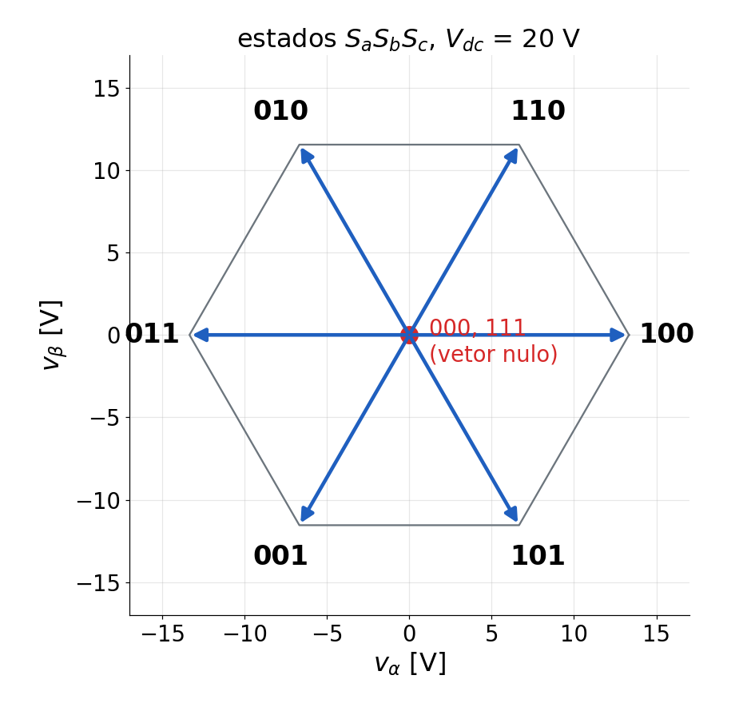{width="100%"}
:::
::: {.column width="55%"}
$S_x = 1$: chave de cima da fase $x$ ligada.

$$
\begin{aligned}
v_\alpha &= \tfrac{2}{3}V_{dc}\Big(S_a - \frac{S_b + S_c}{2}\Big)\\
v_\beta &= \frac{V_{dc}}{\sqrt3}\,(S_b - S_c)
\end{aligned}
$$

- 6 vetores ativos de módulo $\tfrac{2}{3}V_{dc}$ = 13,3 V (20 V).
- 000 e 111: vetor nulo.
- O controle só "vê" estes 7 pontos do plano αβ; a tensão média resulta da alternância entre eles.
:::
::::

## Modelo de predição (αβ)

Em αβ a carga RL não tem acoplamento (o ωL só aparece em dq):

$$
L\,\frac{d i_{\alpha\beta}}{dt} = v_{\alpha\beta} - R\,i_{\alpha\beta}
\quad\Rightarrow\quad
i(k+1) = a\,i(k) + b\,v(k),\qquad a = e^{-RT_s/L},\;\; b = \frac{1-a}{R}
$$

- Com R = 25,3 Ω (regime do ensaio do PI) e L = 9,8 mH: a = 0,879, b = 0,0048 A/V.
- Vale para α e β separadamente: 2 contas por estado, 16 no total.
- Referência em αβ: Park inversa de $(i_d^*, i_q^*)$ com o ângulo do instante previsto.

## Temporização e compensação do atraso

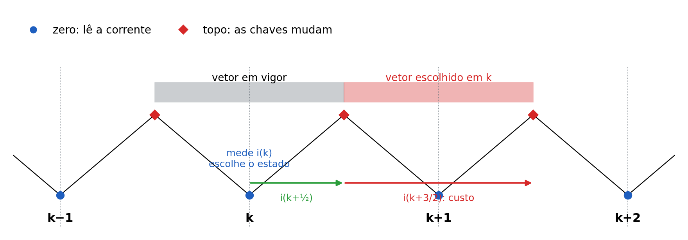{fig-align="center" width="100%"}

- As chaves mudam no **topo** do contador; a corrente é lida no **zero**, longe das comutações.
- Em *k* o vetor anterior ainda vale meio período: prevê-se $i(k+\tfrac12)$ com ele e, a partir daí, $i(k+\tfrac32)$ para cada estado.

## Custo e algoritmo

$$
g_e = \big(i_\alpha^* - \hat i_\alpha\big)^2 + \big(i_\beta^* - \hat i_\beta\big)^2 + \lambda\, n_e
\qquad (n_e = \text{comutações em relação ao estado atual})
$$

```c
ia2 = ah*ialfa + bh*vAlfaAplicado;           // i(k+1/2): compensa o atraso
for (e = 0; e < 8; e++) {                    // os 8 estados
    va = (2/3)Vdc (Sa - (Sb+Sc)/2);  vb = Vdc (Sb - Sc)/sqrt(3);
    pa = a*ia2 + b*va;  pb = a*ib2 + b*vb;   // i(k+3/2)
    g = (refA-pa)^2 + (refB-pb)^2 + lambda*n;
    if (g < gMin) { gMin = g; melhor = e; }
}
forca as saidas A, B, C conforme "melhor"    // vale a partir do topo
```

- λ = 0: só a corrente. λ > 0: troca erro por menos comutações.

## Simulação do ensaio: FCS × PI

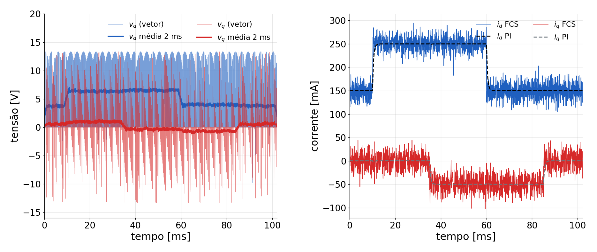{fig-align="center" width="100%"}

- Mesmos degraus do ensaio do PI. Tensão do FCS: o vetor aplicado (claro) e a média de 2 ms (escuro).

## Degrau em i~d~: estados e corrente

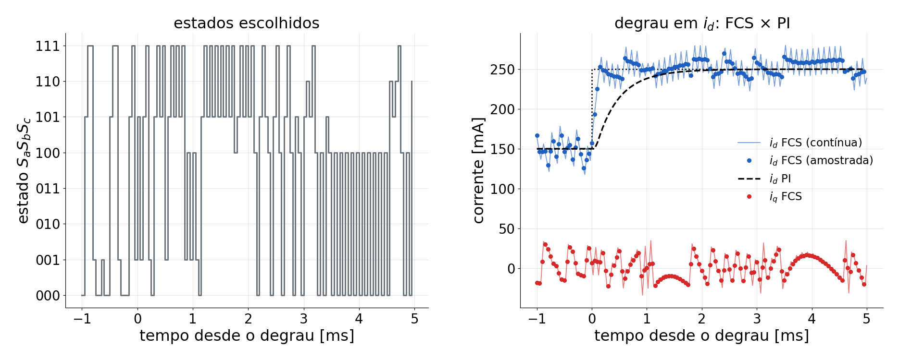{fig-align="center" width="100%"}

- O FCS alcança a referência em ≈ 0,1 ms (o PI de 300 Hz em ≈ 1 ms), mas com ondulação de ± 30 mA.

## Ondulação × frequência de chaveamento

:::: {.columns}
::: {.column width="55%"}
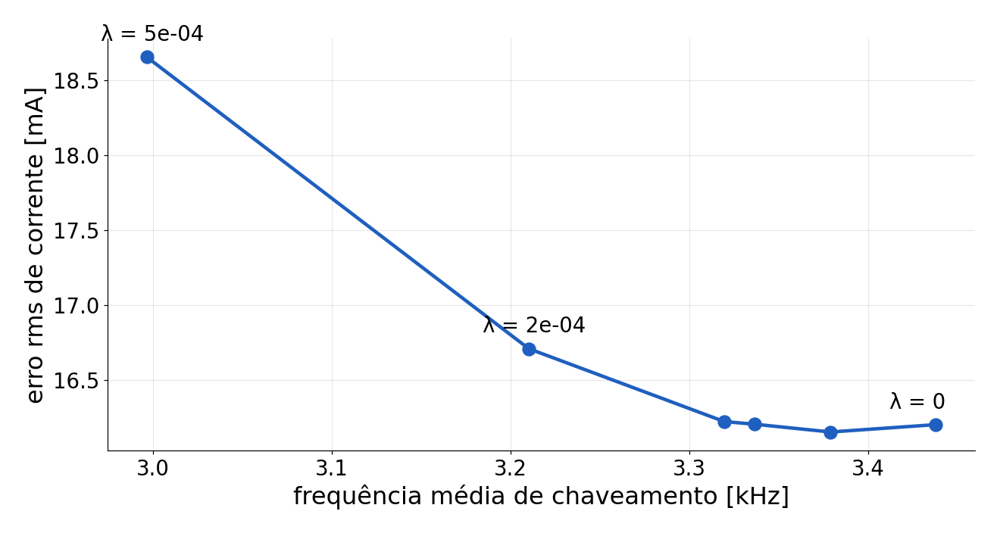{width="100%"}
:::
::: {.column width="45%"}
::: {style="font-size:0.9em"}
| [V~dc~]{style="text-transform:none"} | f~sw~ média | erro rms |
|---|---|---|
| 20 V | 3,4 kHz | 16 mA |
| 15 V | 3,4 kHz | 12 mA |
| 12 V | 3,2 kHz | 10 mA |

: {tbl-colwidths="[30,35,35]"}
:::

- Ondulação ∝ V~dc~·T~s~/L: menos tensão, menos ondulação, mas é preciso |v| ≈ 7 V < V~dc~/√3.
- PI (média): erro de 4 mA, só nos transitórios.
:::
::::

## Firmware VSI04ControleFCS

::: {style="font-size:0.92em"}
| Item | |
|---|---|
| Base | `VSI03ControlePI`: mesmo hardware, medidas, calibração, referências, proteção e gravação |
| `modo` | 0 malha aberta · 1 PI (para comparar) · **2 FCS-MPC** (padrão) |
| Chaves | forçamento contínuo das saídas do PWM, carregado no topo; B = complemento com tempo morto |
| Modelo | `resistencia` = 25,3 Ω, `indutancia` = 9,8 mH → `ganhoA`, `ganhoB` (passo e meio passo) |
| Novas variáveis | `lambdaComutacao`, `estadoAtual`, `frequenciaChaveamento`, `custoMinimo` |
| Gravação | `Dados3F` igual ao VSI03: i\*, i e v (vetor aplicado, em dq), i~A~, i~B~ |

: {tbl-colwidths="[18,82]"}
:::

## Roteiro do ensaio

1. *Build* e *Debug* do `VSI04ControleFCS`; fonte em 20 V (limite 0,5 A); espere o zero dos sensores.
2. `habilita = 1` (calibração a 50 %, depois o FCS). Veja `frequenciaChaveamento` (≈ 3,4 kHz) e `correnteD`.
3. `periodosMedia = 1`, `grava = 1`: um registro cru (ondulação e estados). Exporte `Dados3F` (16352).
4. `periodosMedia = 16`, `grava = 1`: a resposta média, para comparar com o PI.
5. `modo = 1` e grave de novo: PI e FCS no mesmo dia, mesma carga.
6. Opcional: `lambdaComutacao` = 2e-4 e V~dc~ = 15 V.

Simulação: `analise/simula_fcs.py`.

## O ensaio realizado

::: {style="font-size:1.1em"}
| Item | Valor |
|---|---|
| Firmware | `VSI04ControleFCS`, `modo` = 2, λ = 0, R = 25,3 Ω, L = 9,8 mH, V~dc~ ≈ 19,85 V |
| Referências | as do PI: i~d~\* 0,15 → 0,25 A (10–60 ms), i~q~\* 0 → −0,05 A (35–85 ms) |
| `ControleFCS01.csv` | `periodosMedia` = 1: registro cru (ondulação, chaveamento) |
| `ControleFCS02.csv` | `periodosMedia` = 16: resposta média |
| Comparação | PI de 300 Hz (`DadosControlePI01.csv`, 16 períodos), mesma carga |

: {tbl-colwidths="[24,76]"}
:::

## Registro cru

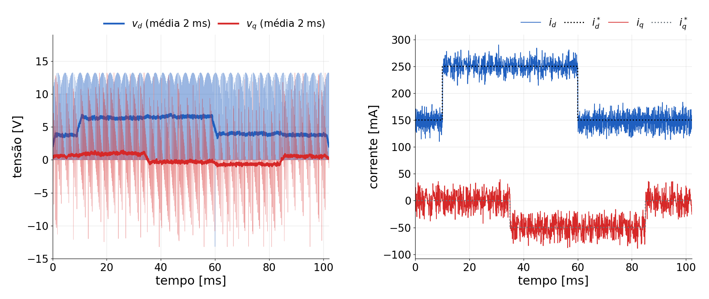{fig-align="center" width="100%"}

- Tensão: o vetor aplicado (claro, ±13,2 V) e a média de 2 ms (escuro). A corrente segue a referência com ondulação de ≈ ±30 mA.

## No degrau: estados e corrente

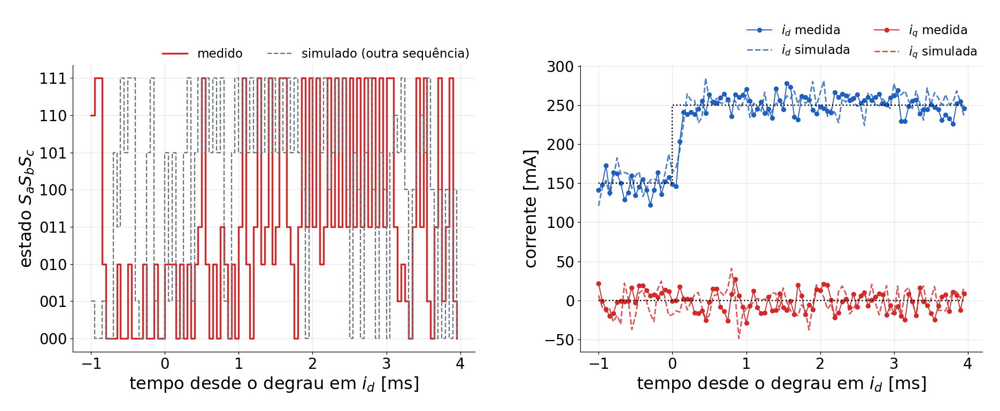{fig-align="center" width="100%"}

- Estados reconstruídos dos dados: **3,40 kHz** de chaveamento médio (simulação: 3,42 kHz); 55 % do tempo no vetor nulo.

## Por que 3,4 kHz e não 20 kHz?

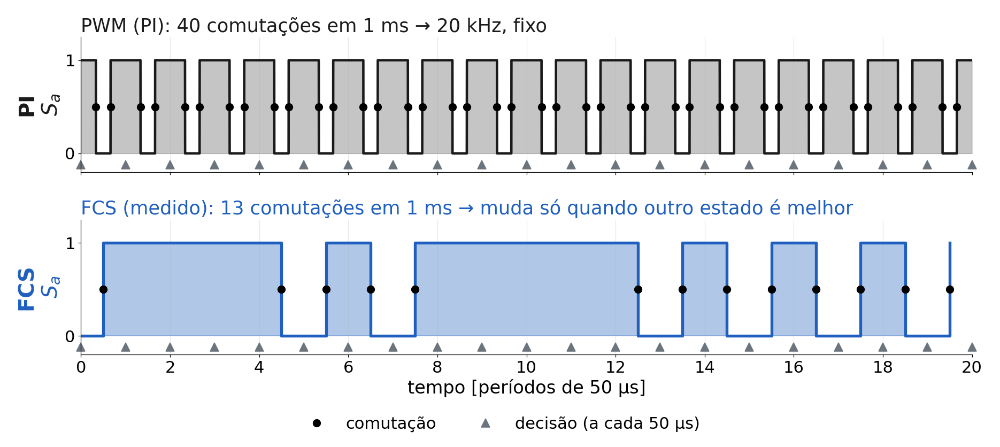{fig-align="center" width="100%"}

- 20 kHz é a taxa de **decisão**; a chave só comuta quando outro estado é melhor. Máximo: mudar em toda decisão = **10 kHz**.
- PWM: liga e desliga em todo período (20 kHz). FCS: repete estados (55 % no vetor nulo) → **3,4 kHz** em média, variável.

## Resposta média: FCS × PI

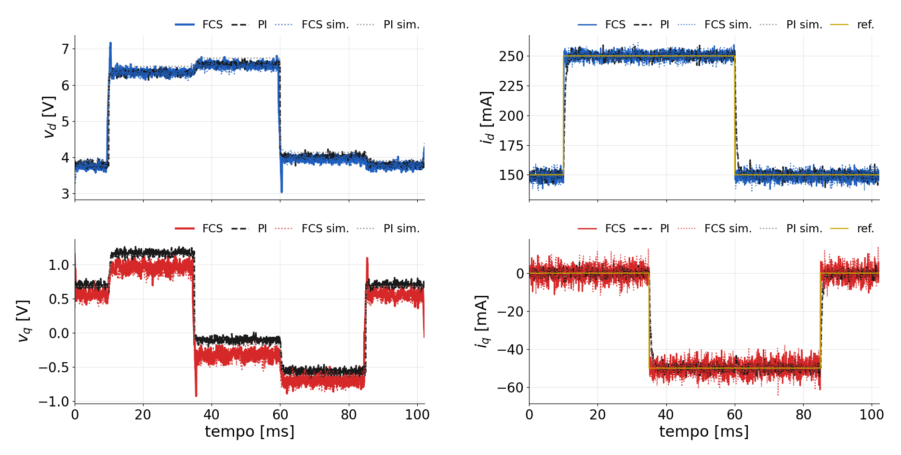{fig-align="center" width="96%"}

- Pontilhado: simulações. $v_q$ do FCS ≈ 0,2 V abaixo do PI, medido **e** simulado: o FCS compensa o atraso; no PI ele gira a tensão ≈ 0,04 rad.

## Degraus: FCS × PI, medido e simulado (desvios, média de 16 períodos)

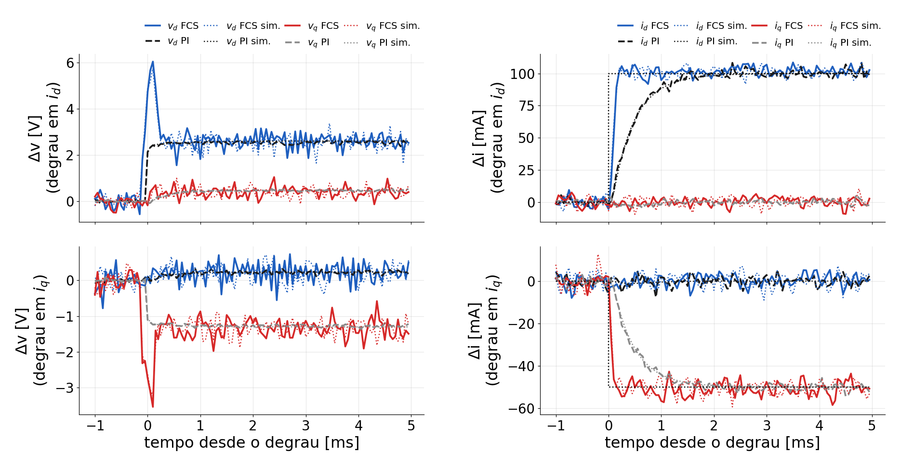{fig-align="center" width="100%"}

## Correntes das fases

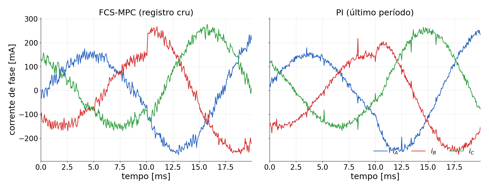{fig-align="center" width="100%"}

## Números

::: {style="font-size:0.95em"}
| | FCS-MPC | PI (300 Hz) |
|---|---|---|
| Subida 10–90 % (d / q) | 0,15 / 0,15 ms | 0,95 / 0,90 ms |
| Sobressinal / acomodação (5 %) | 5 % / 0,30 ms | 2 % / 1,35 ms |
| Erro médio em regime (d / q) | +0,6 / 0,0 mA | 0,0 / 0,0 mA |
| Erro rms em dq, registro cru | 18,7 mA (simulado 21,6) | — |
| Fases: desvio rms da senoide de referência | 13,0 mA | 8,1 mA (ruído do sensor) |
| Interferência entre eixos (d→q / q→d) | 3,5 / 3,9 mA | 3,3 / 1,7 mA |
| Chaveamento | 3,4 kHz, variável | 20 kHz, fixo |

: {tbl-colwidths="[44,28,28]"}
:::

## Crítica

- **Rapidez**: o FCS segue o degrau em ≈ 0,15 ms (≈ 6× o PI), sem projeto de ganhos: o modelo e a busca bastam.
- **Ondulação**: com T~s~ = 50 µs e vetores de 13 V, a corrente oscila ± 30 mA (≈ 10 mA rms além do ruído); o PI, com PWM de 20 kHz, não tem esse problema.
- **Espectro espalhado**: 3,4 kHz em média, sem frequência fixa: ruído audível e filtros mais difíceis.
- **Erro em regime**: pequeno (0,6 mA), mas sem integrador; depende de R e L. Com o R do ARX (26,2 Ω) seria maior.
- **Simulação × ensaio**: frequência de chaveamento e ondulação previstas; a simulação vale para o projeto.

## O que melhorar

- **Amostrar mais rápido** (40 kHz): ondulação ∝ T~s~; o algoritmo cabe na interrupção.
- **Menos V~dc~** (15 V): 12 mA rms na simulação, com folga de tensão.
- **MPC modulado (M²PC) ou com PWM**: escolhe o vetor ótimo e o modula: frequência fixa, ondulação de PWM.
- **Horizonte maior / custo com o erro integrado**: menos ondulação e erro em regime nulo.
- **λ**: nesta carga muda pouco (3,4 → 3,0 kHz com λ = 5·10⁻⁴).

Análise: `analise/analisa_fcs.py` (dados) e `analise/simula_fcs.py` (simulação).

