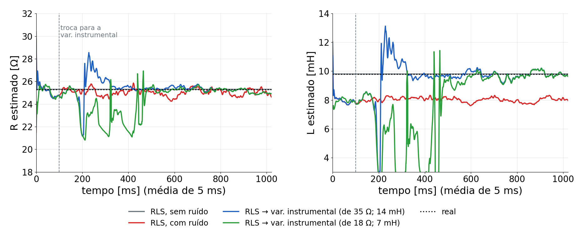
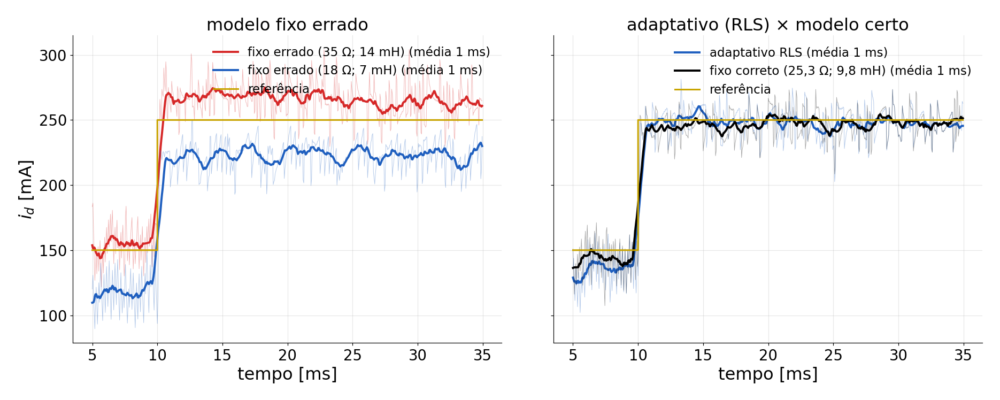
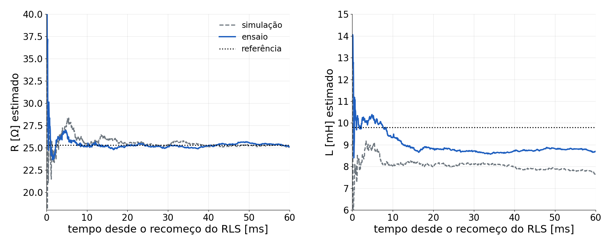
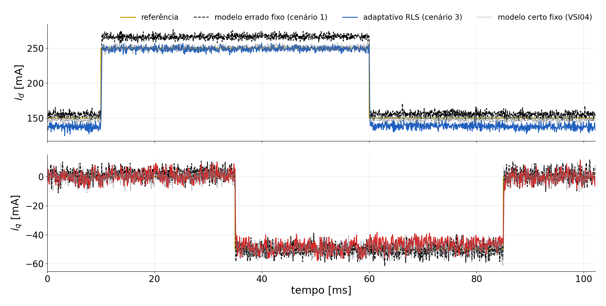
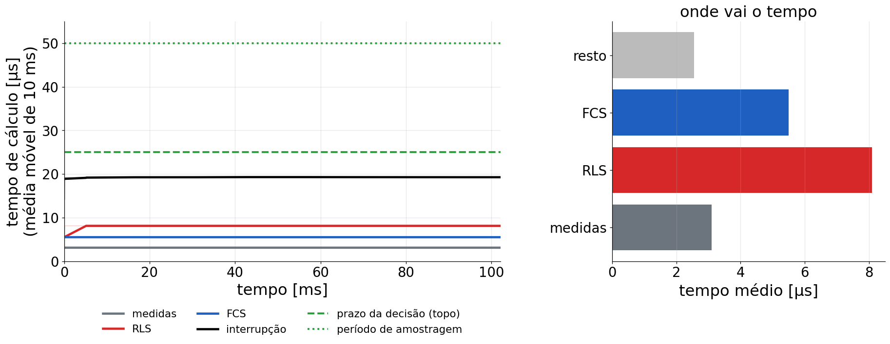
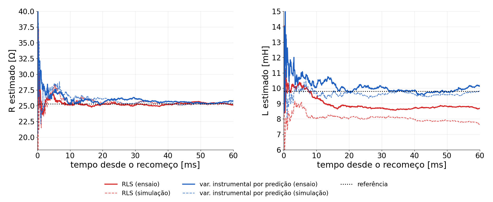

## Por que adaptar o modelo?

- O FCS **não tem integrador**: um modelo errado vira **erro em regime**.
- O modelo muda: R e L variam com a temperatura e a corrente; o ARX deu R = 26,2 Ω, a carga real tem 25,3 Ω.
- Ideia: **identificação em tempo real** (RLS) e o FCS usa sempre o modelo mais recente.

```
 mede i(k) → RLS atualiza θ → FCS prevê com θ e escolhe o estado → aplica → ...
```

- Fecha a sequência: malha aberta → identificação ARX → PI → FCS → **FCS + RLS**.

## O modelo para o RLS

Corrente lida no zero *k*; o vetor escolhido em *k* vale do topo *k*+½ ao *k*+3/2. No intervalo [k, k+1] valem meio período do vetor anterior e meio do novo:

$$
i(k+1) = \theta_1\, i(k) + \theta_2\, v(k-1) + \theta_3\, v(k)
\qquad (\alpha \text{ e } \beta \text{, mesmos } \theta)
$$

$$
\theta_1 = e^{-RT_s/L},\qquad \theta_3 = V_{dc}\,\frac{1 - a_h}{R},\qquad \theta_2 = a_h\,\theta_3,\qquad a_h = e^{-RT_s/2L}
$$

- *v* normalizada por V~dc~ (melhor condicionamento numérico). De θ: $R = V_{dc}(1-\sqrt{\theta_1})/\theta_3$, $L = -R\,T_s/\ln\theta_1$.

## Mínimos quadrados recursivos

A cada amostra, uma atualização com α e outra com β:

$$
\varphi = \big[\,i(k-1),\; v(k-2),\; v(k-1)\,\big]^\top,\qquad
K = \frac{P\varphi}{\lambda + \varphi^\top P \varphi}
$$

$$
\theta \leftarrow \theta + K\,\big(i(k) - \varphi^\top\theta\big),\qquad
P \leftarrow \frac{P - K\varphi^\top P}{\lambda}
$$

- λ = 0,999: memória de ≈ 1000 amostras (50 ms). P~0~ = 100·I.
- Proteção: só aceita θ físico (0,5 < θ~1~ < 0,999; θ~2~, θ~3~ > 0).
- Custo no C2000: matriz 3 × 3, ≈ 100 operações por amostra.

## O FCS com o modelo estimado

Para cada um dos 8 estados *e* (vetor $v_e$):

$$
\hat i(k+1) = \theta_1\, i(k) + \theta_2\, v(k-1) + \theta_3\, v_e,
\qquad
\hat i(k+2) = \theta_1\,\hat i(k+1) + (\theta_2+\theta_3)\, v_e
$$

$$
g_e = \big|\,i^*(k+2) - \hat i(k+2)\,\big|^2 \;(+\,\lambda_c\, n_e)
$$

- Mesmos θ do RLS: a compensação do atraso e a predição saem do próprio modelo estimado.
- Com `usaRLS` = 0, θ vem de R e L fixos (o FCS do VSI04).

## Simulação: convergência (1 s)

{fig-align="center" width="96%"}

- RLS: converge em < 1 ms; sem ruído, exato; com ruído, **L = 8,1 mH** para sempre (viés). RLS → var. instrumental: transitório até ≈ 0,5 s, depois **25,3 Ω; 9,9 mH** nos dois pontos de partida.

## Simulação: erro em regime

{fig-align="center" width="100%"}

## Simulação: números

::: {style="font-size:0.95em"}
| Modelo do FCS | Erro médio em i~d~ | rms (corrente real) | R, L finais |
|---|---|---|---|
| fixo correto (25,3 Ω; 9,8 mH) | +1,9 mA | 19,1 mA | — |
| fixo errado (35 Ω; 14 mH) | **−16,0 mA** | 24,8 mA | — |
| fixo errado (18 Ω; 7 mH) | **+26,9 mA** | 34,2 mA | — |
| adaptativo RLS (de qualquer dos dois) | **+1,9 mA** | 19,6 mA | 25,0 Ω; 8,1 mH |

: {tbl-colwidths="[38,20,20,22]"}
:::

- O RLS converge em < 1 ms e leva o erro em regime ao do modelo certo, partindo de modelos 30 % errados.

## O viés de L: identificação em malha fechada

- O vetor $v(k-1)$ foi escolhido com a corrente medida em *k*−1, que tem o ruído $n(k-1)$; o mesmo ruído está no erro da equação → regressor e erro correlacionados → **L estimado baixo**.
- **Variável instrumental por predição**: instrumentos que não dependem de $n(k-1)$, mas seguem os regressores de perto:

$$
\varphi = [\,i(k-1),\; v(k-2),\; v(k-1)\,] \;\;\rightarrow\;\; z = [\,\hat i(k-1\,|\,k-2),\; v(k-2),\; \hat v(k-1)\,]
$$

- $\hat i(k-1|k-2)$: corrente prevista pelo modelo um passo antes; $\hat v(k-1)$: o vetor que o FCS **escolheria** com ela.
- Versões testadas antes e descartadas: instrumento atrasado (fraco: $v(k-3)$ quase não correlaciona com $v(k-1)$) e FCS simulado em malha fechada (instável).

## Firmware VSI05MPCAdaptativoRLS

::: {style="font-size:0.9em"}
| Item | |
|---|---|
| Base | `VSI04ControleFCS` (hardware, medidas, referências, proteção, chaveamento no topo) |
| Novas variáveis | `usaRLS` (1/0), `metodoRLS` (0 RLS, 1 IV), `esquecimento` (0,999), `reiniciaRLS`, `reiniciaNaGravacao` |
| Para ver | `theta[3]`, `resistenciaEstimada`, `indutanciaEstimada`, `rejeicoes`, `frequenciaChaveamento` |
| Ponto de partida | `resistencia`, `indutancia` (também o modelo fixo com `usaRLS` = 0) |
| Gravação | `Dados3F`: θ~1~, θ~3~, i~d~, i~q~, v~d~, v~q~, i~A~, i~B~ (referências: perfil fixo) |

: {tbl-colwidths="[20,80]"}
:::

- O RLS recomeça no início do registro (`reiniciaNaGravacao` = 1): o registro mostra a convergência.

## Tempo de cálculo: o prazo

- Numa interrupção de 50 µs: ADC, **RLS** (2 atualizações 3 × 3), **FCS** (8 predições) e gravação.
- A decisão precisa estar escrita **antes do topo** (25 µs após o zero); depois, o vetor só vale no período seguinte.
- Medição: **CPU Timer 1** (5 ns) em cada etapa; o contador do PWM dá a latência e a folga até o topo.

::: {style="font-size:0.75em"}
| Watch | O que é |
|---|---|
| `tempoMedioMedidas`, `tempoMedioRLS`, `tempoMedioFCS`, `tempoMedioTotal` | médias móveis (≈ 50 ms) [µs] |
| `tempoMaximoTotal` | pior caso da interrupção (escreva 0 para zerar) |
| `latenciaMedia` | do zero do contador até a entrada da interrupção |
| `folgaMinima`, `perdasPrazo` | menor folga até o topo; decisões que perderam o prazo |

: {tbl-colwidths="[50,50]"}
:::

## Tempo de cálculo: o registro

- Por amostra, na matriz **`Tempos[4][2044]`** [µs]: medidas | RLS | FCS | interrupção inteira.
- Ocupa a RAM que sobrou ao lado de `Dados3F` (juntas: 0xBFA0 de 0xD000 palavras).
- Exporte no *Graph - Time*: `Tempos`, float de 32 bits, tamanho **8176**.
- `analise/analisa_rls.py Dados3F.csv Tempos.csv` gera:
  - os **parâmetros** ao longo do registro: θ~1~, θ~3~ e R, L estimados;
  - os **tempos** por amostra com as médias móveis de 10 ms, o prazo de 25 µs e onde vai o tempo médio.
- Se `perdasPrazo` > 0: tirar contas da interrupção (seno e cosseno por tabela ou TMU) ou mover o RLS para depois da decisão (ele só precisa estar pronto na amostra seguinte).


## Roteiro do ensaio (simplificado)

Watch: **`habilita`**, **`cenario`**, **`grava`** (ver: `correnteD`, `resistenciaEstimada`, `indutanciaEstimada`, `tempoMaximoTotal`, `perdasPrazo`).

::: {style="font-size:0.95em"}
| `cenario` | Configura | Exportar |
|---|---|---|
| 1 | FCS com modelo errado fixo (35 Ω; 14 mH), média de 16 | `Dados3F` → `RLS01.csv` |
| 2 | RLS recomeça do modelo errado: convergência, registro cru | `RLS02.csv` + `Tempos` → `Tempos02.csv` |
| 3 | adaptativo em regime, média de 16 | `RLS03.csv` |
| 4 | variável instrumental (sem viés em L), registro cru | `RLS04.csv` |

: {tbl-colwidths="[12,58,30]"}
:::

Para cada cenário: `cenario = N` → espere 2 s → `grava = 1` → espere voltar a 0 → pause e exporte (`Dados3F` 16352; `Tempos` 8176) → *Run*. Configuração de RAM, compilada com `-O2`.

## O ensaio realizado

::: {style="font-size:1.05em"}
| `cenario` | O que foi feito | Arquivo |
|---|---|---|
| 1 | FCS com modelo **errado e fixo** (35 Ω; 14 mH), média de 16 | `DadosRLS01.csv` |
| 2 | RLS recomeça do modelo errado: **convergência** (registro cru) | `DadosRLS02.csv`, `Tempos02.csv` |
| 3 | **adaptativo** em regime, média de 16 | `DadosRLS03.csv` |
| 4 | **variável instrumental por predição**, recomeça do modelo errado | `DadosRLS04.csv`, `Tempos04.csv` |

: {tbl-colwidths="[12,58,30]"}
:::

- Firmware compilado com `-O2` e trigonometria por hardware (TMU); V~dc~ ≈ 20 V; mesmas referências do PI e do FCS.

## Convergência do RLS: ensaio × simulação

{fig-align="center" width="100%"}

- Parte de 35 Ω; 14 mH. **R chega a 25,3 Ω em ≈ 10 ms**, como na simulação. L assenta em **9,0 mH** (−8 %; a simulação previa −17 %).

## Correntes: modelo errado × adaptativo × modelo certo

{fig-align="center" width="100%"}

## Números

::: {style="font-size:1.05em"}
| | Erro médio i~d~ / i~q~ | rms em regime | R, L usados pelo FCS |
|---|---|---|---|
| Modelo errado fixo (cenário 1) | **−11,0** / −0,7 mA | 13,2 mA | 35 Ω; 14 mH |
| **Adaptativo RLS (cenário 3)** | **+6,1** / −1,4 mA | **9,5 mA** | 25,3 Ω; 9,0 mH (estimados) |
| Modelo certo fixo (VSI04) | +0,6 / 0,0 mA | — | 25,3 Ω; 9,8 mH |

: {tbl-colwidths="[34,24,16,26]"}
:::

- O RLS acerta R e corrige o modelo sozinho; o erro restante vem do **viés de L** (−8 %), que a média da carga não tira.

## Tempo de cálculo medido

{fig-align="center" width="92%"}

- Com a variável instrumental: interrupção de **19,3 µs** (38 % dos 50 µs), quase constante; decisão do FCS pronta em **8,6 µs** (prazo: 25 µs). Estimador (RLS + instrumentos): 8,1 µs, depois da decisão. Só RLS: 15,9 µs.
- Sem otimização (1ª tentativa) a interrupção não cabia: `-O2` e o TMU foram essenciais.

## Cenário 4: variável instrumental por predição na placa

{fig-align="center" width="96%"}

- Parte do mesmo modelo errado (35 Ω; 14 mH). Em ≈ 10 ms: **R = 25,7 Ω, L = 10,0 mH** (RLS: 9,0 mH; identificado: 9,8 mH). Ensaio e simulação concordam.

## Conclusões

- **RLS + FCS funciona na placa**: o modelo errado (35 Ω; 14 mH) é corrigido em ≈ 10 ms e o erro em regime cai de −11 para +6 mA.
- **R** é estimado com precisão (25,3 Ω = regime do PI); com o RLS, **L** tem viés de −8 % em malha fechada.
- **Tempo**: tudo cabe com folga (16 a 19 µs de 50 µs), com otimização do compilador.
- **Variável instrumental por predição** tira o viés na placa: **L = 10,0 mH** (RLS: 9,0 mH), convergindo em ≈ 10 ms a partir de um modelo 40 % errado, sem transitórios perigosos.
- Sequência completa: malha aberta → ARX → PI → FCS → **FCS adaptativo**, cada etapa prevista pela simulação.
- **Próximo passo possível**: aprendizagem por reforço no lugar do FCS e do RLS (treino em simulação com parâmetros variados, só a inferência na placa, FCS + RLS como referência e alternativa de segurança).

Análise: `analise/analisa_ensaio_rls.py`.

