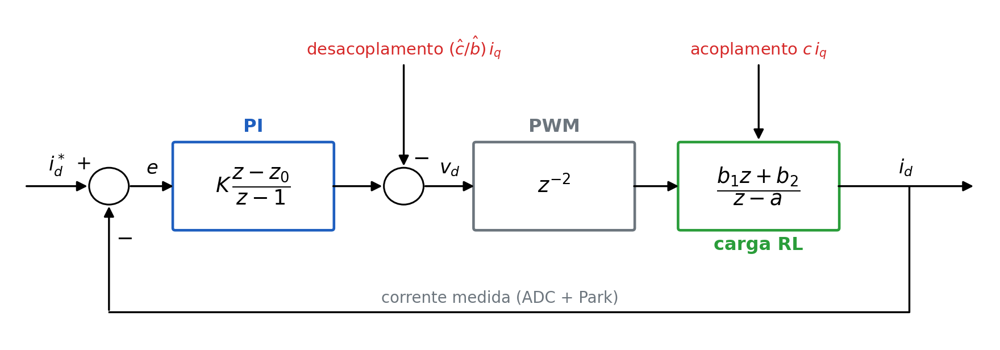
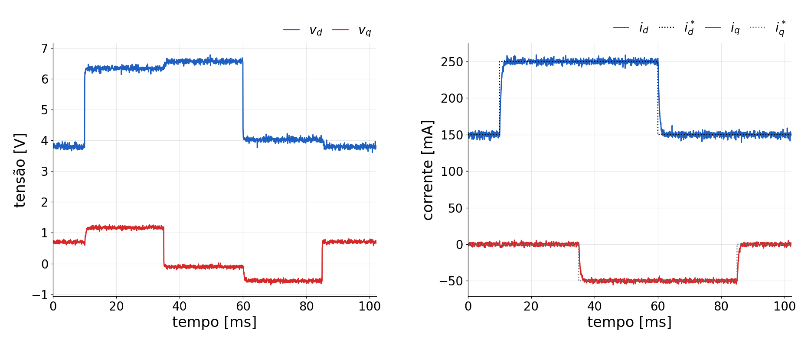
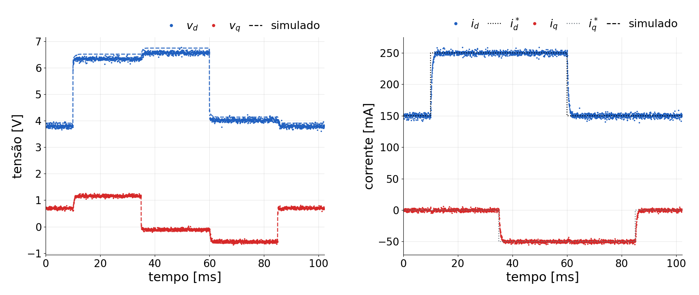
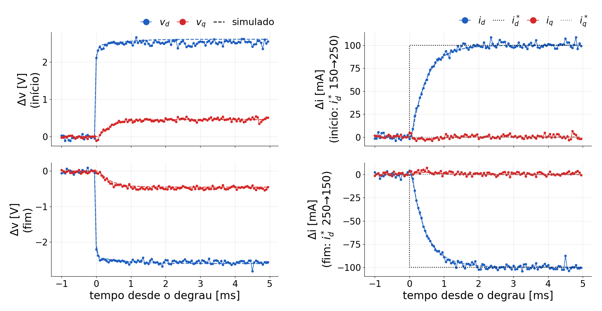
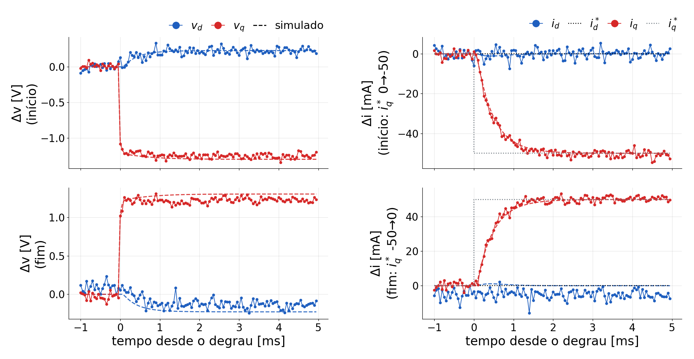
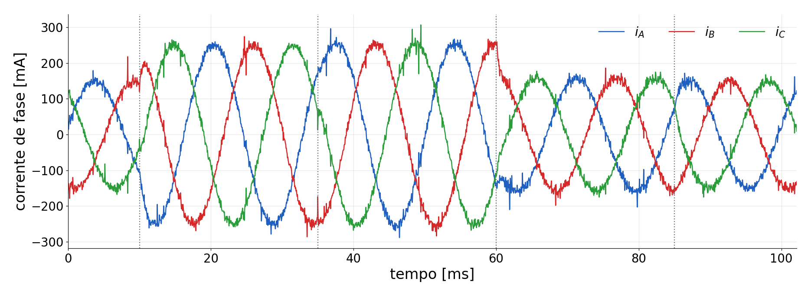

## O ensaio

::: {style="font-size:1.15em"}
| Item | Valor |
|---|---|
| Firmware | `VSI03ControlePI` (base `VSI02IdentificacaoARX`) |
| Carga | RL em estrela, neutro isolado (25 Ω, 10 mH nominais); V~dc~ = 20 V |
| Controlador | PI por eixo, f~c~ = 300 Hz: k~p~ = 18,5 V/A, k~i~ = 49 400 V/(A·s) |
| Modelo usado | R = 26,2 Ω, L = 9,8 mH (identificados); desacoplamento ωL ligado |
| Referências | i~d~\* = 0,15 A + 0,10 A (10–60 ms); i~q~\* = 0 − 0,05 A (35–85 ms) |
| Registro | `Dados3F`: i\*, i, v em dq (média de 16 períodos) e i~A~, i~B~; `DadosControlePI01.csv` |

: {tbl-colwidths="[22,78]"}
:::

## A malha de corrente

{fig-align="center" width="100%"}

- k~p~ = 2πf~c~L e k~i~ = 2πf~c~R: o zero do PI cancela o polo da carga. |v| ≤ 0,45 V~dc~ com anti-windup.

## O registro medido

{fig-align="center" width="100%"}

## Medido × simulado

{fig-align="center" width="100%"}

- Tracejado: simulação (mesmo algoritmo do firmware sobre o modelo MIMO identificado).

## Degrau em i~d~ (desvios; tracejado = simulado)

{fig-align="center" width="100%"}

## Degrau em i~q~ (desvios; tracejado = simulado)

{fig-align="center" width="100%"}

## Correntes das fases

{fig-align="center" width="100%"}

- Amplitude $\sqrt{i_d^2+i_q^2}$: de 150 mA (0,15 A; 0) a 255 mA (0,25 A; −0,05 A), conforme os degraus (linhas pontilhadas).

## Tensões em regime

$v_d = R\,i_d - X\,i_q$, $\;v_q = R\,i_q + X\,i_d$, ajustados nos patamares de regime:

::: {style="font-size:1.0em"}
| | R [\[Ω\]]{style="text-transform:none"} | X [\[Ω\]]{style="text-transform:none"} |
|---|---|---|
| Ensaio do PI (medido) | 25,3 | 4,66 |
| Identificação: ponto de operação (5 V) | 25,3 | 4,65 |
| Modelo ARX (simulação) | 26,1 | 4,53 |

: {tbl-colwidths="[60,20,20]"}
:::

- Carga igual nos dois ensaios; o ARX (só desvios da PRBS) erra o ganho estático em 3 %. O integrador absorve.
- X > ωL = 3,7 Ω: o atraso gira a tensão aplicada ≈ 0,04 rad; R·0,04 ≈ 1 Ω passa ao eixo cruzado.

## Números

::: {style="font-size:0.95em"}
| | Medido | Simulado |
|---|---|---|
| Subida 10–90 % (d e q) | 0,90 ms | 0,95 ms |
| Sobressinal (curva suavizada) | 2–3 % (no ruído) | 0 % |
| Acomodação (5 %) | 1,35 ms | 1,45 ms |
| Erro em regime | 0,0 mA | 0 |
| Ruído em regime (16 períodos) | 1,6–2,3 mA | — |
| Interferência em i~q~ no degrau de i~d~ | 3,3 mA | 2,2 mA |
| Interferência em i~d~ no degrau de i~q~ | 1,7 mA | 1,1 mA |
| v~d~ em regime (0,15 / 0,25 A) | 3,8 / 6,6 V | 3,9 / 6,7 V |

: {tbl-colwidths="[44,28,28]"}
:::

## Conclusões

- O PI projetado sobre o modelo identificado funcionou como previsto: subida de 0,9 ms, sem sobressinal visível, erro nulo em regime.
- A simulação reproduz a medição quase ponto a ponto: o modelo MIMO é bom para projeto.
- Nos degraus, a tensão do outro eixo se move (desacoplamento + PI) e a corrente dele quase não sai do lugar: o acoplamento é rejeitado.
- v~d~ medida ≈ 3 % abaixo da simulada: R efetivo um pouco menor que 26,2 Ω.
- Próximos ensaios: `desacopla = 0` (ver o acoplamento) e `bandaPI = 500` (mais rápido, mais perto do atraso).

Análise: `analise/analisa_pi.py` e `analise/simula_pi.py` (números copiados da saída dos scripts).
