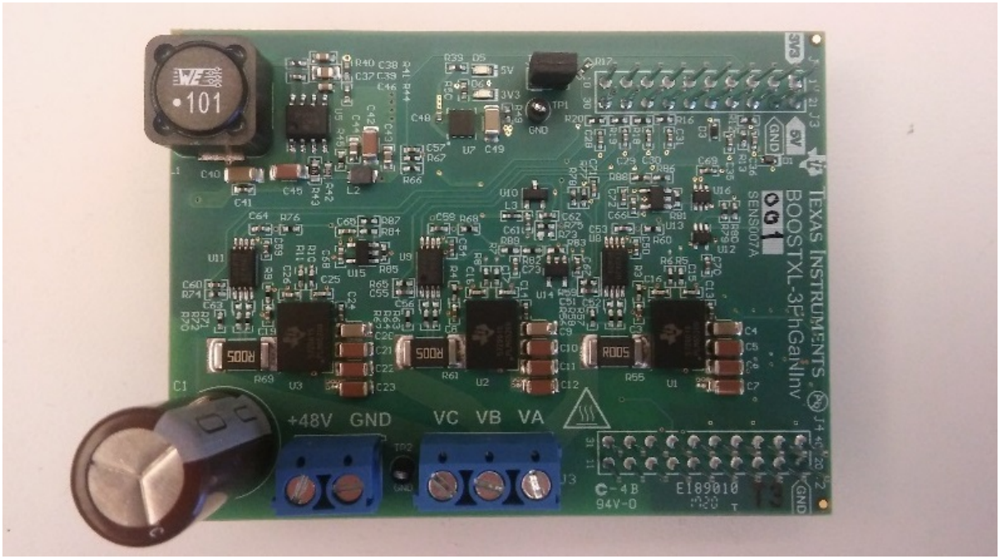
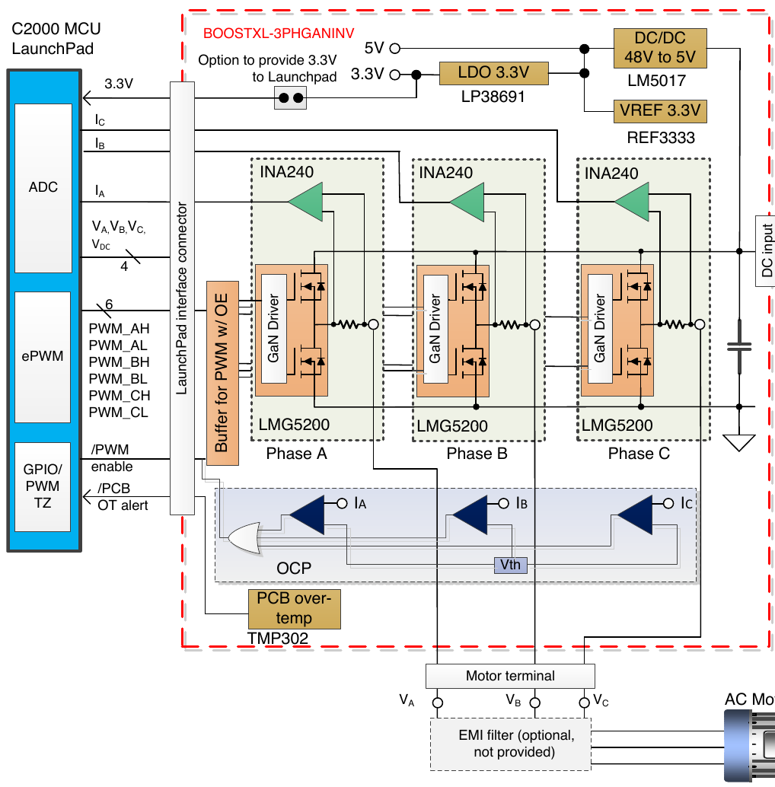
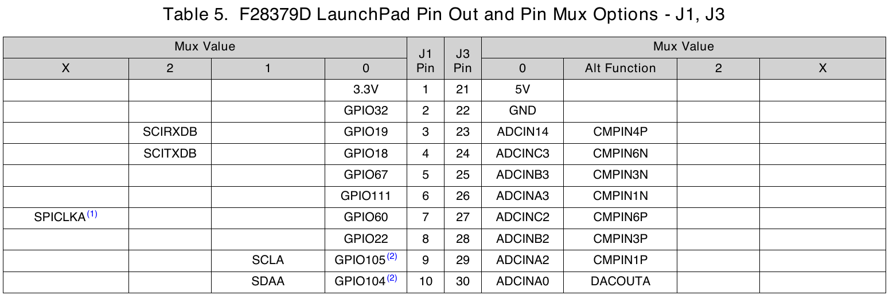
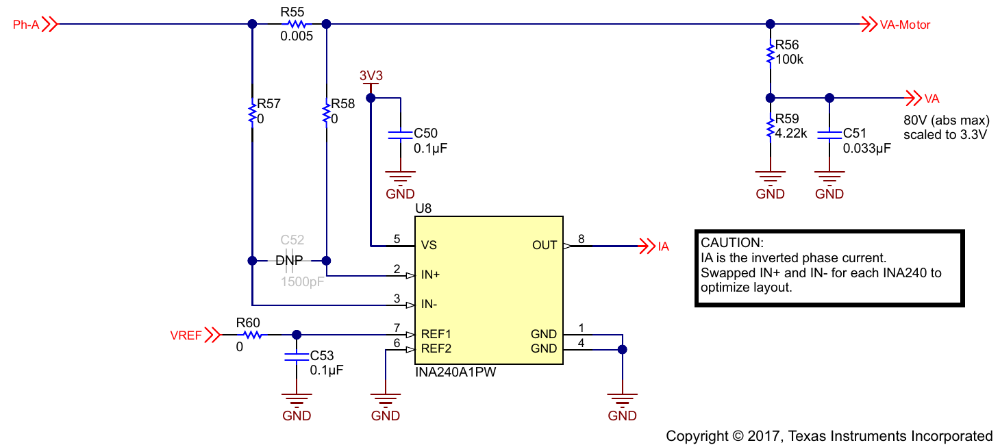

## O sistema

:::: {.columns}
::: {.column width="55%"}
{width="100%"}

[BOOSTXL-3PHGANINV (SLUUBP1A, fig. 4). Bornes: +48V/GND (barramento) e VA, VB, VC (carga).]{style="font-size:0.6em"}
:::
::: {.column width="45%"}
- Três meias-pontes GaN **LMG5200**;
- Um **INA240** com shunt de 5 mΩ por fase;
- Carga em estrela: 25 Ω e 10 mH por fase (ensaios VSI01–VSI05).

| Grandeza | Valor |
|---|---|
| [$\tau = L/R$]{style="text-transform:none"} | ≈ 0,4 ms |
| Pico com 20 V (\|v\| ≤ 0,45 V~dc~) | ≈ 0,36 A |
| Medido nos ensaios | ≈ 0,3 A |
:::
::::

## Diagrama de blocos

:::: {.columns}
::: {.column width="55%"}
{width="92%"}

[SLUUBP1A, fig. 3.]{style="font-size:0.6em"}
:::
::: {.column width="45%"}
- Buffer de PWM com **/PWM enable, ativo em nível baixo**;
- Proteção própria (TLV3201): 12 A;
- O barramento alimenta o LM5017, que gera os 5 V e os 3,3 V da placa: **sem barramento, o
  INA240 e o buffer ficam desligados**;
- Até o primeiro teste precisa do barramento.
:::
::::

## Modelo da carga nos eixos dq

Num referencial que gira a $\omega$ (ângulo $\theta = \omega t$, gerado na placa):

$$
v_d = R\,i_d + L\frac{di_d}{dt} - \omega L\, i_q, \qquad
v_q = R\,i_q + L\frac{di_q}{dt} + \omega L\, i_d
$$

- Sem os termos cruzados $\pm\omega L$, cada eixo é um sistema de 1ª ordem: $\;G(s) = \dfrac{1}{Ls + R}$;
- **Desacoplamento**: o controle soma $-\omega L\,i_q$ a $v_d$ e $+\omega L\,i_d$ a $v_q$, e
  cada eixo volta a ser $G(s)$;
- Com ω = 2π·60 rad/s, $\omega L/R \approx 0{,}08$: o acoplamento é fraco nesta carga, mas o
  modelo vale para qualquer frequência.

## Pinos analógicos da LaunchPad

{width="80%" fig-align="center"}

[SPRUI77C, tabela 5. A coluna J3 recebe os sinais analógicos do BoosterPack.]{style="font-size:0.6em"}

- J3-27, 28, 29: correntes iA, iB, iC (ADCINC2, B2, A2), também as entradas positivas dos
  comparadores 6, 3 e 1;
- J3-24, 25, 26: tensões vA, vB, vC; J3-23: barramento (ADCIN14, ligado às quatro ADCs);
- J3-30: VREF do BoosterPack no ADCINA0, que também é a saída do DACA: **não usar o DACA**.

## Saídas de PWM e sinais digitais

| Sinal | Periférico | GPIO | Pino |
|---|---|---|---|
| Fase A (alto / baixo) | EPWM1A / 1B | 0 / 1 | J4-40 / 39 |
| Fase B | EPWM2A / 2B | 2 / 3 | J4-38 / 37 |
| Fase C | EPWM3A / 3B | 4 / 5 | J4-36 / 35 |
| /PWM enable (ativo baixo) | GPIO | 124 | J2-13 |
| /PCB OT alert (ativo baixo) | GPIO, INPUTXBAR1 | 24 | J4-34 |
| UART pela USB | SCIA | 42 / 43 | — |

- Entradas de PWM do BoosterPack com *pull-down* de 10 kΩ e habilitação com *pull-up* de
  10 kΩ: a placa liga desligada (TIDA-00909, tabela 4);
- O primeiro experimento (VSI01) já usa essa habilitação: começa em 1 e só escreve 0 quando
  o aluno pede.

## Sensor de corrente

{width="88%" fig-align="center"}

[TIDA-00909 (TIDUCE7B), fig. 10: fase A. O BOOSTXL repete o circuito nas três fases.]{style="font-size:0.6em"}

- INA240A1: ganho de 20 V/V sobre 5 mΩ → **0,1 V/A**, ponto médio de 1,65 V (VREF);
- IN+ e IN− trocados para facilitar o *layout*: **a corrente sai invertida**;
- Banda de 400 kHz e acomodação de 9,6 µs (datasheet do INA240).

## Conversão para ampères

:::: {.columns}
::: {.column width="58%"}
Na placa, o sensor dá

$$
v_{ADC} = 1{,}65 - 0{,}1\,i \quad [\text{V}]
$$

A LaunchPad usa uma referência de 3,0 V (REF5030, SPRUI77) e um ADC de 12 bits:

$$
\begin{aligned}
i &= -k\,(N - N_0) \\
k &= \frac{3{,}0}{4096 \cdot 0{,}1} = 7{,}32\ \text{mA}
\end{aligned}
$$

$N_0 \approx 2253$ é medido na inicialização, com o PWM desabilitado.
:::
::: {.column width="42%"}
- Faixa **assimétrica**: de −13,5 A a +16,5 A;
- O SDK usa 27 A / 4096 contagens: erro de ≈ 10 %;
- 1,4 A de pico ocupa só ≈ 190 contagens.
:::
::::

## Tensões de fase e barramento

:::: {.columns}
::: {.column width="58%"}
Divisor de 100 kΩ / 4,22 kΩ com 33 nF (TIDA-00909, fig. 10 e 11):

$$
V = 24{,}7\, v_{ADC}, \qquad V_{\max} = 24{,}7 \cdot 3{,}0 = 74{,}1\ \text{V}
$$

com 18,1 mV por contagem. O SDK usa os mesmos 74,1 V.
:::
::: {.column width="42%"}
- Filtro de **1 kHz**: as tensões medidas chegam atrasadas e sem o PWM;
- Servem para conferir a montagem, **não** para identificar;
- Na identificação, grava-se a tensão **comandada** $v_{dq}$ (aplicada uma amostra
  depois).
:::
::::

## Amostragem sincronizada com o PWM

- O EPWM1 dispara as conversões (SOCA) no **zero do contador**; cada ADC converte a corrente
  e a tensão de uma fase, e a ADCD converte o barramento;
- Com a saída A em nível alto enquanto o contador < CMPA, o zero cai no **meio do pulso**: a
  amostra pega o valor médio da ondulação da corrente;
- O shunt fica em linha com a fase e mede a corrente qualquer que seja a chave conduzindo;
- O fim da conversão (ADCA INT1) chama o laço de controle: não há espera ativa;
- Janela de aquisição de 100 ns (o mínimo é 75 ns em 12 bits; o SDK usa 70 ns).

## Proteção contra sobrecorrente

```
iA → CMPSS6 ┐
iB → CMPSS3 ├─ H ou L ─→ XBAR TRIP4 → DCAEVT1 → OST nos EPWM1, 2, 3
iC → CMPSS1 ┘               ↑
                   GPIO24 (sobretemperatura)
```

- Comparadores contra o DAC interno (referência VDDA = 3,3 V), com filtro digital de ≈ 3 µs;
- **OST** (*one-shot*): as saídas ficam em nível baixo (as duas chaves de cada braço
  desligadas) até o software liberar;
- A parada do emulador (CBC6) também desliga as saídas;
- Acima disso, a proteção da própria placa atua em 12 A.

## Limiar do comparador

O SDK calcula o DAC do CMPSS como $2048 \pm 2048\,I_{lim}/13{,}5$:

- Com a referência de 3,3 V, 2048 = 1,65 V: o ponto médio está **certo**;
- A inclinação 2048/13,5 equivale a 0,122 V/A, mas o sensor dá 0,1 V/A: o limite de 9 A do
  SDK dispara, na verdade, perto de **11 A**;
- Para um limiar próprio, use o offset **medido** de cada fase:

$$
N_{DAC} = \frac{4096}{3{,}3}\left(\frac{3{,}0\,N_0}{4096} \pm 0{,}1\,I_{lim}\right)
$$

- Os firmwares VSI01–VSI05 usam proteção por software (0,8 A); a do comparador ainda não foi usada.

## Tempo morto

- O SDK usa 0,5 µs, os firmwares VSI01–VSI05 usam 100 ns e o TIDA-00909 opera o
  LMG5200 com só 12,5 ns;
- Durante o tempo morto, a tensão do braço depende do sinal da corrente: o erro médio é

$$
\Delta v \approx V_{dc}\, t_m\, f_{PWM} = 12 \cdot 0{,}5\,\mu\text{s} \cdot 20\ \text{kHz} = 0{,}12\ \text{V}
$$

- Com 1 A na carga ($v \approx 4{,}7$ V), isso é ≈ 2,5 %: uma não linearidade que aparece na
  identificação perto de corrente nula;
- Reduzir $t_m$ é um ensaio a fazer depois, com o osciloscópio (o LMG5200 tem atraso de
  propagação de 29,5 ns).

## Pontos a conferir na bancada

| Item | Como conferir |
|---|---|
| Revisão da LaunchPad | na revisão 1.1, ADCINA2 (iC) está em curto com VREFHIB (SPRUI77) |
| Sinal da corrente | em malha aberta: [$v_A > 0 \Rightarrow i_A > 0$]{style="text-transform:none"} em regime |
| Par de PWM da fase A | osciloscópio em J4-40/39 com 50 % |
| Jumper J6 do BoosterPack | retirar quando a LaunchPad é alimentada pela USB |
| Onde atua o TLV3201 | esquemático do BoosterPack (pacote SLUC631) |
| Escala de [$V_{dc}$]{style="text-transform:none"} | comparar `tensaoBarramento` com um multímetro |

## Documentos da TI usados

- **SLUUBP1A**: guia do BOOSTXL-3PhGaNInv (diagrama, foto, jumper J6, OCP);
- **TIDUCE7B**: TIDA-00909, inversor GaN de 48 V (pinagem, INA240, divisores, filtros);
- **TIDUCE8A**: TIDA-00913, medição de corrente em linha com o INA240;
- **SPRUI77C**: LAUNCHXL-F28379D (pinos, REF5030, erratas);
- **SPRS880P**: datasheet do TMS320F2837xD (ADC, CMPSS);
- Datasheets do **INA240** e do **LMG5200**; **SPRACO3**: projeto de dois eixos do SDK.

Os PDFs ficam em `docs/`, ao lado desta apresentação (fora do repositório).
